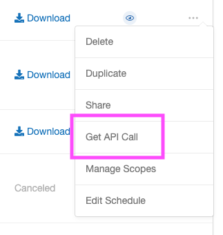
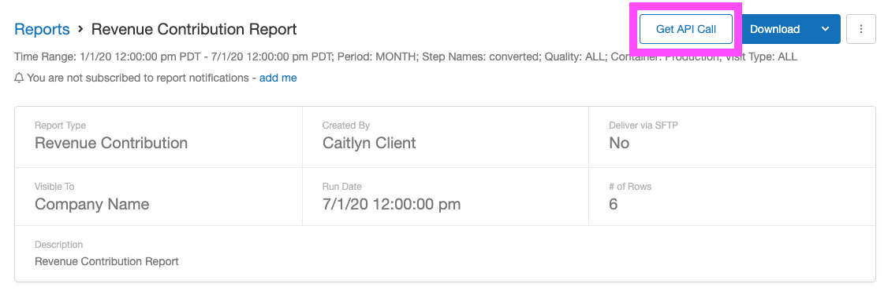
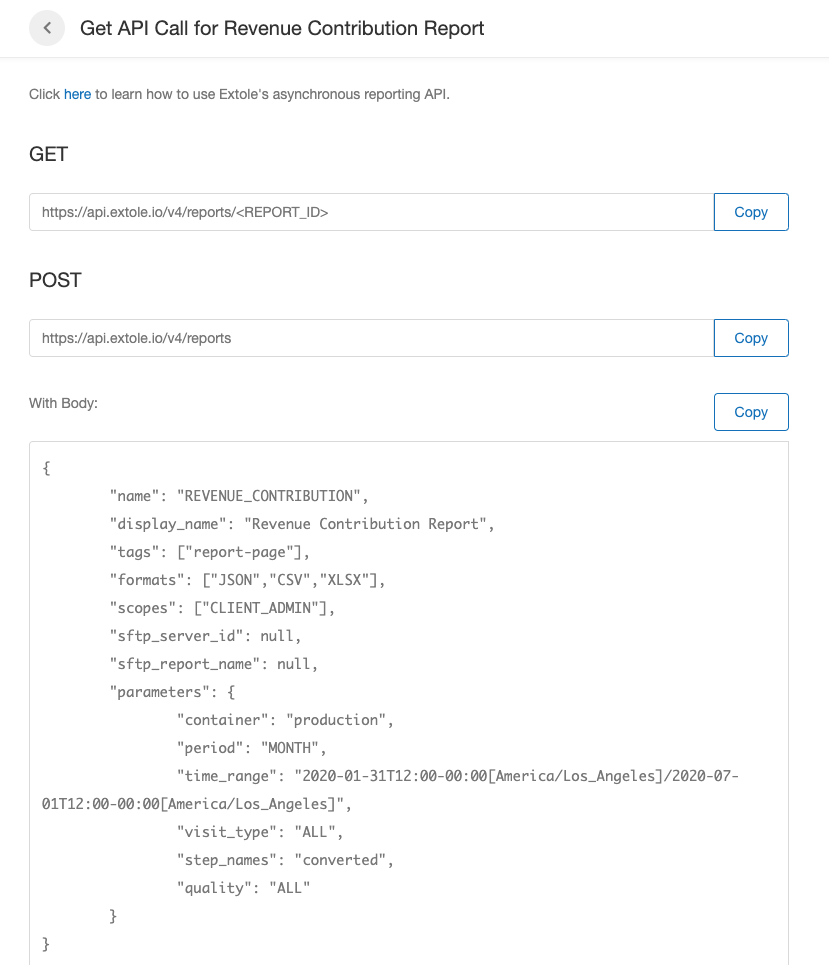
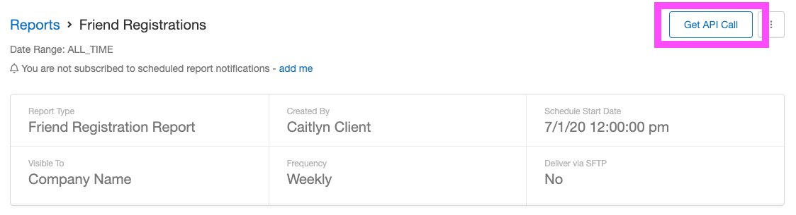
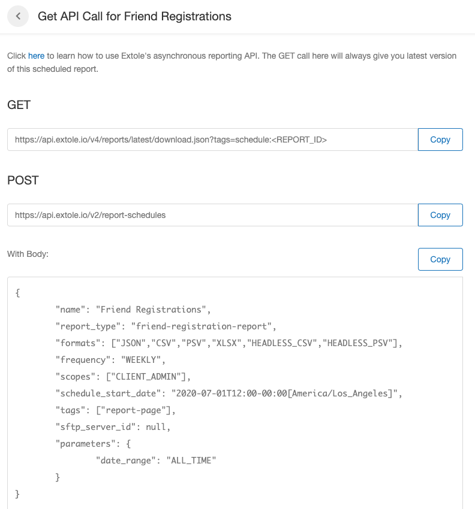

# Overview

Extole provides asynchronous API endpoints to download various reports. To run, check the status of, and download a report, you need to make calls across three API endpoints.

# Setup

## Generate an access token

Get your access token. To generate a long-lived access token, follow the documentation here: [Generating Long-Lived Access Tokens](https://docs.extole.com/docs/generate-long-lived-access-tokens#generate-your-token).

## Execute a report

```
POST https://api.extole.io/v4/reports
```

With these HTTP Headers:

```
Authorization: <ACCESS_TOKEN>  
Content-Type: application/json
```

With this Body:

```json
{
  "name": "<REPORT_NAME>",
  "report_type": "<REPORT_TYPE>",
  "format": "<FORMAT>",
  "parameters": {
    "time_range": "<TIME_RANGE.START>/<TIME_RANGE.END>"
  }
}
```

Options for parameters above:

- **&lt;REPORT_NAME>**: Name of report you want to download. Available reports are listed here: [How to Run Data Reports](/guides/dashboards-and-reporting/how-to-run-a-report)
- **&lt;REPORT_TYPE>**: The report type to run, for example `AOV`. The Get API Call page shows the value for a report you have already run.
- **&lt;FORMAT>**: JSON, CSV
- **&lt;TIME_RANGE.START>**: The start of the report range, as an ISO 8601 date (`2026-11-12`) or date and time (`2026-11-12T09:30:00.000Z`). A date with no time means 00:00 at the start of that day, in your account's timezone.
- **&lt;TIME_RANGE.END>**: The end of the report range, which the report does not include, in the same form as the start. To include a whole last day, use the day after it.

Instead of `<start>/<end>`, `time_range` also takes a named range, such as `PREVIOUS_DAY` or `LAST_MONTH`. The `details` of `time_range` in a report's record list the names its report type accepts. A few older report types take `date_range` instead of `time_range`, and the **Get API Call** page shows which one a report uses. See [Time Ranges](/technical/platform-integrations/rest-apis/asynchronous-reporting-api#time-ranges).

**Note:** Different reports require different parameters. To find out exactly how your API call should look, first run the report in [My Extole](https://my.extole.com/reports). Then, you can click the three dots from the reports listing page and select **Get API Call**:



Alternatively, you can click into the report itself and click **Get API Call**.



For scheduled reports, **Get API Call** on the schedules page gives you the latest version of the scheduled report:

 

A successful response is the report's record, in the same shape as the status response below, with the report's current `status`.

## Check the Status of a Report

There are four options for the status of the report.

- **Pending**: The report is preparing to run.
- **In progress**: The report is initialized and in progress. Depending on the amount of data you pull back, reports typically remain in this status for one to ten minutes.
- **Failed**: There was an error in the API call.
- **Done**: The report is complete and ready to be downloaded.

From the output above, copy and paste the report ID. Remove the quotes.

```
GET https://api.extole.io/v4/reports/<REPORT_ID>
```

A successful output looks like this:

```json
{
  "report_id": "<REPORT_ID>",
  "name": "AOV",
  "report_type": "AOV",
  "display_name": "Average Order Value-2026-11-13",
  "executor_type": "SPARK",
  "format": "CSV",
  "formats": [
    "CSV",
    "XLSX",
    "JSONL",
    "JSON"
  ],
  "status": "DONE",
  "user_id": "<USER_ID>",
  "parameters": {
    "container": {
      "value": "production"
    },
    "visit_type": {
      "value": "ALL"
    },
    "filters": {
      "value": "\"1\"==\"1\""
    },
    "time_range": {
      "value": "2026-11-12T00:00:00.000+02:00[Europe/Bucharest]/2026-11-13T00:00:00.000+02:00[Europe/Bucharest]",
      "details": {
        "name": "time_range",
        "display_name": "time_range",
        "category": "filter",
        "type": {
          "name": "TIME_RANGE",
          "value_type": "STATIC",
          "values": [
            "LAST_WEEK",
            "PREVIOUS_QUARTER",
            "LAST_QUARTER",
            "PREVIOUS_YEAR",
            "LAST_4_HOURS",
            "LAST_2_HOURS",
            "LAST_8_HOURS",
            "FROM_TIME",
            "PREVIOUS_MONTH",
            "YEAR_TO_DATE",
            "PREVIOUS_WEEK_START_MONDAY",
            "PREVIOUS_DAY",
            "LAST_MONTH",
            "LAST_DAY",
            "ALL_TIME",
            "MONTH_TO_DATE",
            "WEEK_TO_DATE",
            "CUSTOM_TIME",
            "LAST_HOUR",
            "LAST_YEAR",
            "LAST_SIX_MONTHS",
            "Forward slash-separated ISO8601 dates",
            "QUARTER_TO_DATE",
            "PREVIOUS_WEEK_START_SUNDAY"
          ]
        },
        "is_required": true,
        "order": 1
      }
    },
    "quality": {
      "value": "ALL"
    }
  },
  "tags": [
    "internal:category:Performance & Metrics:3",
    "internal:category:Performance & Metrics",
    "internal:schedule:<REPORT_RUNNER_ID>",
    "internal:scheduled-2026-11-05T22:00:00Z/2026-11-12T22:00:00Z",
    "User-Generated",
    "internal:report-runner:<REPORT_RUNNER_ID>"
  ],
  "created_date": "2026-11-13T00:03:38.292+02:00",
  "started_date": "2026-11-13T00:16:23.602+02:00",
  "completed_date": "2026-11-13T00:17:31.002+02:00",
  "error_code": null,
  "download_uri": "https://api.extole.io/v4/reports/<REPORT_ID>/download",
  "sftp_report_name": null,
  "visible": true,
  "scopes": [
    "CLIENT_ADMIN",
    "CLIENT_SUPERUSER"
  ],
  "sftp_server_id": null
}
```

## Download the Report

Once the status reads "DONE" you will be able to download your report.

```
GET https://api.extole.io/v4/reports/<REPORT_ID>/download
```
