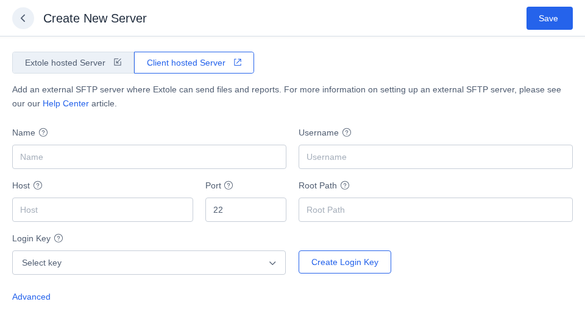
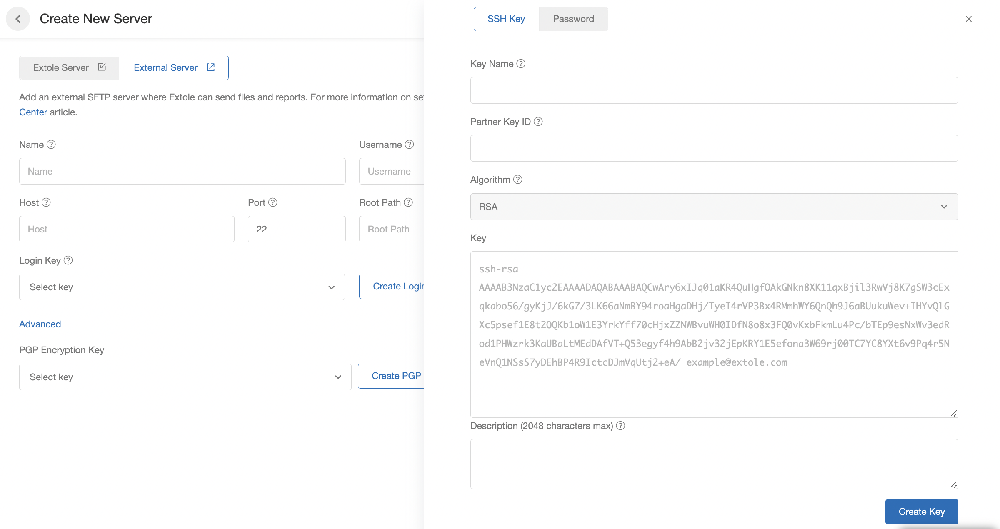
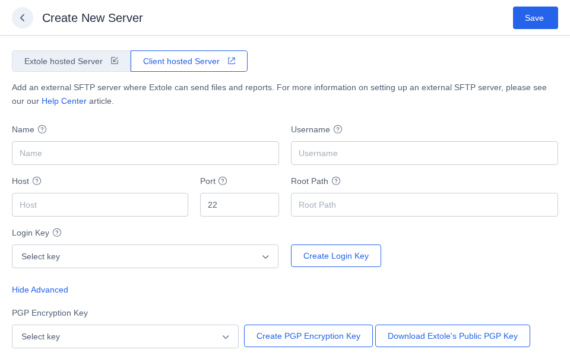
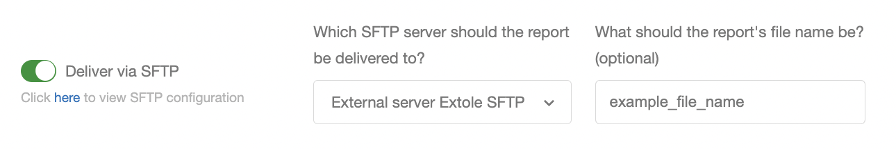

Get data delivered straight to your own SFTP server. Connecting your Extole programs with your own external systems makes it that much easier to get important information about your programs and participating customers into CRMs and ESPs.

# Setting up your SFTP Server

The first step in getting a report delivered to your SFTP server is to set up the server in the Extole Admin Tool. Navigate to [**Tech Center** > **SFTP Servers**](https://my.extole.com/tech-center/sftp) and complete the following steps.

## Add a Server

When you click **+ New Client Server**, **Client hosted Server** is selected at the top of the form, and you will see a number of fields to fill out that describe your SFTP server:

<Frame caption="The **Create New Server** form for a client hosted server, on Extole's Launch Demo test account.">
  
</Frame>

- **Name**: How you'd like to reference the server in the Extole Admin Tool.
- **Host**: The domain of the server where you want Extole to send files and reports (e.g. example.com).
- **Username**: The username used to access the SFTP server (e.g. janedoe).
- **Port**: The port of the server where you want Extole to send files and reports (e.g. for most SFTP servers this is port 22).
- **Root Path**: Where Extole should be delivering files and reports (e.g. /extole/reports).
- **Login Key**: The key used to access the SFTP server. Click on the "Create Login Key" button to create a new SSH key or password and fill out the required fields (see below).

 

- SSH Key

  - Key Name: How we'll refer to the key in the Extole Admin Tool.
  - Partner Key Id: Your unique identifier for the key.
  - Key: The key itself. [View more information on SSH key formatting](https://git-scm.com/book/en/v2/Git-on-the-Server-Generating-Your-SSH-Public-Key).
  - Description: An optional description for the key.

- Password

  - Key Name: How we'll refer to the key in the Extole Admin Tool.
  - Password: The password itself.
  - Description: An optional description for the password.

## Use PGP Encryption with Extole (Optional)

SFTP encrypts every file in transit. To have Extole also encrypt the report files it delivers to your server, give Extole your PGP public key:

1. On the server form, click **Advanced**, then **Create PGP Encryption Key**.
2. Paste your armored public key (the block that starts with `-----BEGIN PGP PUBLIC KEY BLOCK-----`) and fill out the rest of the panel.
3. Click **Save Key**, then **Save**.

Extole then encrypts every report it delivers to this server and adds `.gpg` to each file name. Decrypt the files with your private key. For the full steps, the export command, and how to replace a key, see [PGP Encryption for SFTP Files](/technical/platform-integrations/files/pgp-encryption#receive-encrypted-reports-from-extole).

<Frame caption="The **Advanced** section of a client hosted server, on Extole's Launch Demo test account.">
  
</Frame>

# Delivering Reports to your SFTP Server

With your server set up, you are ready to get reports delivered to your SFTP server.

1. Navigate to the [Reports](https://my.extole.com/reports) page in the Extole Admin Tool.
2. Create a new report by selecting the report type you'd like to run.
3. Configure all of the necessary report parameters.
4. Click on the "Advanced" section at the bottom of the report configuration page. Here, you can choose which server you would like the report delivered to and can also specify the file name:

# Additional Resources

To learn more about [accessing and using *Extole's* SFTP server, please see this article](/guides/dashboards-and-reporting/integrating-reports/using-extole-s-sftp-server).

To learn what happens when Extole can't reach your server, see [Failed Deliveries](/technical/platform-integrations/files/external-sftp-servers#failed-deliveries).
