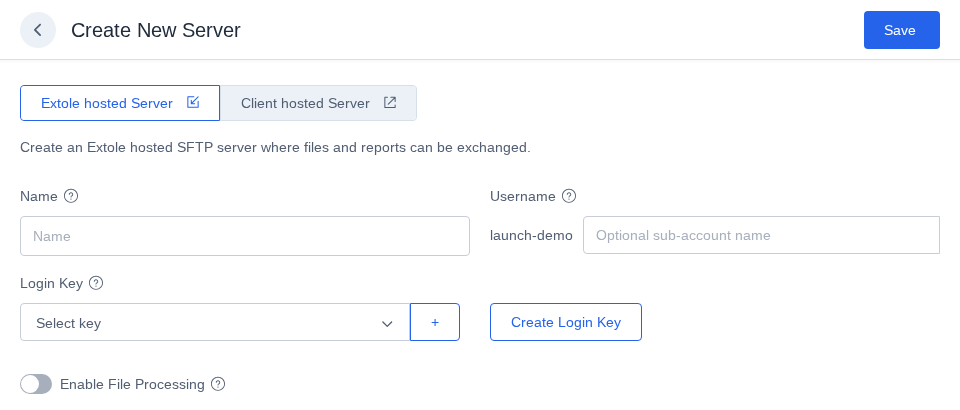
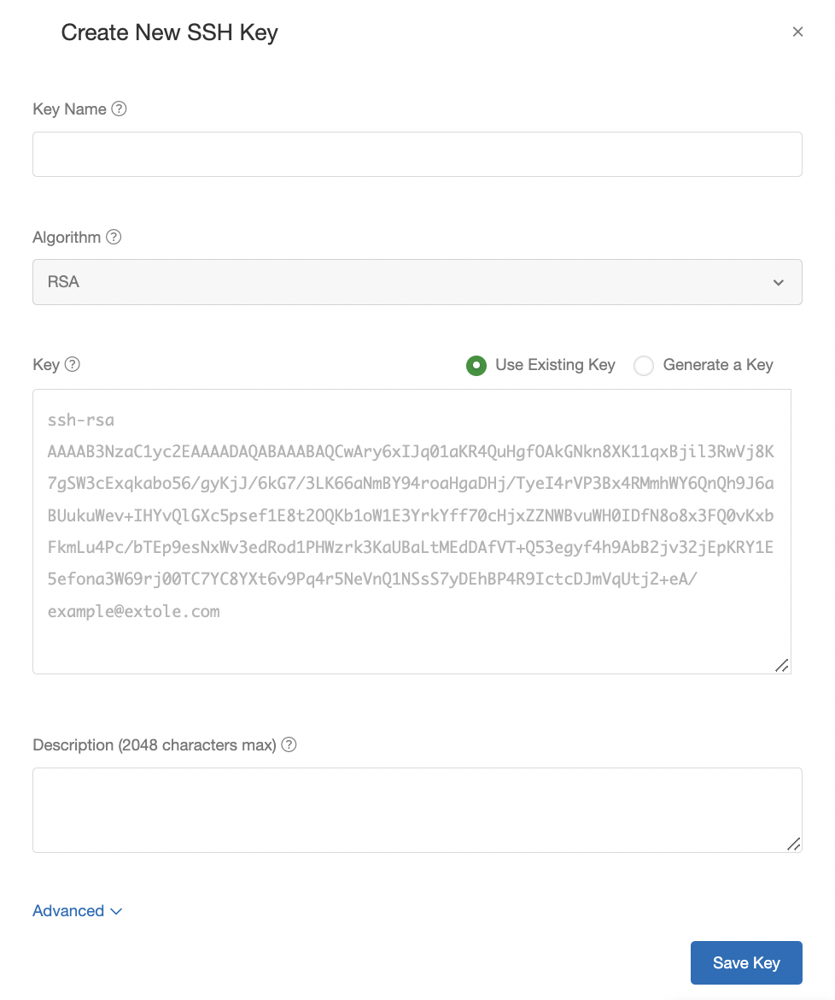
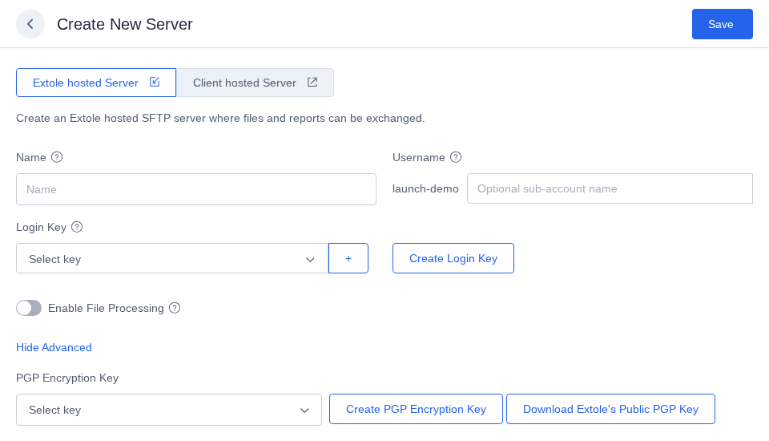
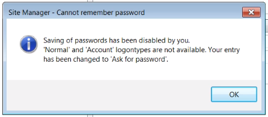
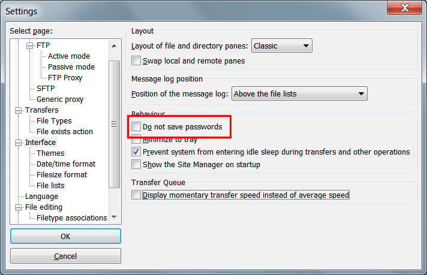

Extole supports using automated batch files to improve the automation of common activities. Batch files (also known as offline files) are a common method for transferring large volumes of information, and most customer relationship management (CRM) systems allow you to export and import these types of files.

**Looking for information about external SFTP servers?** Learn [how to send reports to an external SFTP server in this article.](/guides/dashboards-and-reporting/integrating-reports/sending-reports-to-an-external-sftp)

## Secure File Transport Protocol

All batch files are sent to Extole using Secure File Transport Protocol (SFTP). This is a generally available protocol that provides strong encryption when transferring files to and from Extole. There are many programs you can download that will let you directly connect to Extole, upload and download files, and that make it easy for your IT department to create processes that will automatically upload and download files.

### Why use SFTP?

SFTP provides a method for securely exchanging information with Extole, and preventing third parties from looking at the transfer.

Many clients wish to transfer data via email, SendIt, Ge.tt, or other services. While these transfers may be convenient, they are not appropriate for sensitive information such as Personally Identifiable Information (PII).

Sending information through less-secure services is analogous to sending mail in an unsealed envelope; while you can generally assume your postal workers will safely deliver and not look at your mail, there is no way to be sure. While you can generally assume the IT systems will safely deliver an email without anyone looking at it, there is no way to be sure.

## Accessing Extole's SFTP server

### Add a Server

Navigate to [**Tech Center** > **SFTP Servers**](https://my.extole.com/tech-center/sftp) and click **+ New Extole Server**. **Extole hosted Server** is selected at the top of the form. You will see a number of fields to fill out to describe the server.

<Frame caption="The **Create New Server** form for an Extole hosted server, on Extole's Launch Demo test account.">
  
</Frame>

**Name**: How you'd like to reference the server in the Extole Admin Tool.

**Username**: The username used to access the SFTP server. By default, this will be your client name (e.g., "launch-demo" in the above example). While all usernames must begin with your client name, you can optionally add suffixes to distinguish the purpose of the account using the text box (e.g., extole-events, extole-reports, etc.).

- Some clients may have user names in our previous format "c123456..." which is still supported.

**Login Key**: The key used to access the SFTP server.

Click on the "Create Login Key" button to create a new SSH key and fill out the required fields (see below).

- Key Name: How we'll refer to the key in the Extole Admin Tool.
- Key: The key itself. You can choose to either paste in an existing key or generate a key directly in our tool. The key must be formatted according to the following requirements:

  - Starts with ssh-rsa
  - Ends with email address
  - Does not contain line breaks
  - [View more information on SSH key formatting](https://git-scm.com/book/en/v2/Git-on-the-Server-Generating-Your-SSH-Public-Key)

- Description: An optional description for the key.

### Use PGP Encryption with Extole (Optional)

SFTP encrypts every file in transit. To also encrypt the files themselves, use PGP:

- **Files you upload to Extole**: copy Extole's public key from **Advanced** > **Download Extole's Public PGP Key** on the server form, or from the [Security Center](https://my.extole.com/security-center). Encrypt each file to it and give the file a `.gpg`, `.pgp`, or `.asc` extension. Extole decrypts the file when it processes it.
- **Reports Extole delivers to this server**: click **Advanced** > **Create PGP Encryption Key** on the server form and paste your armored public key. Extole then encrypts every report it delivers to the server.

For the full steps in each direction, including the GnuPG commands, see [PGP Encryption for SFTP Files](/technical/platform-integrations/files/pgp-encryption).

<Frame caption="The **Advanced** section of an Extole hosted server, on Extole's Launch Demo test account.">
  
</Frame>

### Configure and Test Your SFTP Client

Using your own SFTP program, follow it's instructions to configure your private key.

Extole recommends [FileZilla](https://filezilla-project.org/download.php), as it is free and works on multiple operating systems. [Learn how to configure FileZilla with your private key](#h_01G39QXVPRZR33RZ9VAC1BSG8P).

## Uploading to Extole's SFTP server

### File Conventions

Before you upload anything to Extole's SFTP server, make sure your files are compliant with our conventions:

- Name the file based on the event name (ex: reviews-20201015.csv) or add an "event_name" column to your file and Extole will create events in your campaign based on the file name or value.

  - NOTE: Previous SFTP directories are not affected by this feature. The priority goes as follows: "event_name" specified in a row, file name, then "unspecified" if neither are defined.

- The event name used in the file name will be used when posting to the api.extole.io/v5/events endpoint if no event is specified in the file.
- Each file type goes into its own directory on the Extole SFTP system
- All files are encoded as UTF-8.
- Files may contain Unix (\n) or Dos (\r\n).
- All batch files contain a column header row.
- Column order is never important, as Extole determines the order based on the header row.
- Extra columns in the file that Extole does not recognize are ignored.
- Extole stores 30 days worth of file history, and older files are deleted.
- Extole follows standard CSV quoting conventions:
- A comma can be included by quoting the values: First Name, "Last Name, Jr.", Gift Message
- A quote can be included by escaping the quote: First Name, Last Name, "Thanks for the \"help\"

### File Permissions

If you are uploading any CSV file through SFTP, make sure the permissions of the file are configured so "everyone" can either read or write. In this case, we want to make sure Extole can read the file.

1. Check the permissions by right-clicking the file and clicking "Get Info."
2. Scroll all the way down to were it says "Sharing & Permissions."
3. You will see your local machine's name with the permissions of "Read & Write," under which you can select "everyone."
4. Make sure "everyone" has the Privilege set to either "Read Only" or "Read & Write."

### Processed Files

After Extole processes files, it moves them into an "archive" folder on the SFTP server to indicate it has been processed.

# Frequently Asked Questions

### How do I configure FileZilla with my private key?

1. Download and install [FileZilla](https://filezilla-project.org/download.php) for your operating system.
2. In FileZilla Menu, go to File → Site Manager to get to the Site Manager page.
3. Click the New Site button on the lower left, then fill out the fields under the General Tab as follows:  
- Host: sftp.extole.io  
- Protocol: SFTP - SSH File Transfer Protocol  
- Logon Type: Key File  
- User: Found in the SFTP section of settings page of the Extole Admin Tool.  
- Key file: click the Browse button and look for the key file you saved in Step #1.
4. Click the Connect button to establish your connection.

### Why I am receiving an error on connection that passwords cannot be saved?

Extole uses public keys instead of passwords, but this may cause the connection not to occur properly. To resolve this issue please go to Edit -> Settings -> on the left side click “Interface” -> On the right side, uncheck the “Do not save passwords” checkbox under “behavior” section.

 

### Can I setup an automated process that will push or pull files from the SFTP server?

Yes. Your company's IT department likely has tools that can help automate the transfer of files to and from Extole.

### Can the files being sent to and from Extole be encrypted?

Yes. SFTP encrypts every file while it is transferred, and you can also encrypt the files themselves with PGP, in either direction. Encrypt the files you upload with Extole's public key, and add your own public key to a server so that Extole encrypts the reports it delivers there. See [PGP Encryption for SFTP Files](/technical/platform-integrations/files/pgp-encryption).

### Can Extole support another transport protocol like ConnectDirect?

The Extole product offering currently supports SFTP. SFTP is widely support by file transfer packages, including ConnectDirect.

### Can Extole keep copies of my files forever?

The SFTP server is a temporary storage location for the transmission of files. If you need longer-term access to them, you should either work with your IT team to set up automatic downloading and storage.
