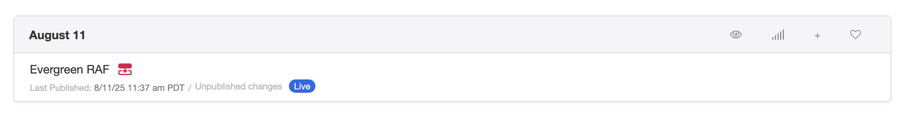

>

> 💡 **Important Note:** This guide only applies to flow campaigns that use Extole's upgraded Flow Builder. Check for the flow icon next to your campaign name.

>

 

# Overview

> Quality Rules on a Business Event evaluate whether an event is high or low quality.

- **High-quality events** may lead to rewards or emails.
- **Low-quality events** are still recorded, but they are marked low quality. The **Business Event Quality** reward rule stops a low-quality event from earning a reward.

> Common use cases:

- Ensuring valid email addresses
- Checking for suspicious IP addresses
- Preventing self-referrals

# Business Event Quality Rules

> All flow campaigns come with default quality rules set up according to our best practices. For example, a standard referral campaign includes the following rules:

| > **Rule** | > **Business Events** | > **Description** |
| --- | --- | --- |
| > Share Email Limit | > Shared | > Limit the number of share emails a person can receive in a specified time. |
| > Mass Share Limit | > Shared | > Limit the number of times a person can share across all programs within a specified time. |
| > Valid Email | > Shared, Share Clicked, Referral Signed Up, Converted | > Check that a valid email address is available. By default, both people in the referral must have an email address. To check an email address sent with the business event instead, set **Email Data Key** to the name of the event data that holds it. |
| > Bot Click Prevention | > Share Clicked, Referral Signed Up | > Prevent bot-driven behavior by limiting the number and speed of clicks from a single user within a specified time. A repeat event within 30 seconds of one that already scored high quality is invalid, as is an event less than 5 seconds after the share it came from. |
| > Is New Customer | > Share Clicked, Referral Signed Up | > Check that the person has not performed an action that makes them a customer in the last 180 days. |
| > Self Referral Prevention | > Share, Share Clicked, Referral Signed Up, Converted | > Prevent self-referral by customer identity (email or key), similar email address, browser ID, and/or IP address. Within this rule, each of these checks can be toggled on or off. |

# Looking for Quality Rules on Rewards?

> These business event quality rules are specific to an event being low or high quality, but wouldn't include all rules like Annual Reward Limits. Learn more about **[Setting up Reward Rules here](/guides/flow-campaigns/how-to-set-up-reward-rules)**.
