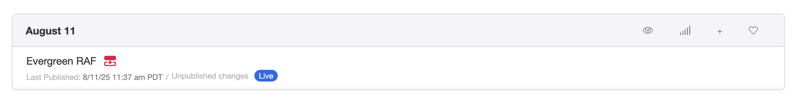

>

> 💡 **Important Note:** This guide only applies to flow campaigns that use Extole's upgraded Flow Builder. Check for the flow icon next to your campaign name.

>

 

## Overview

> Business events represent key actions in your program, such as a user signing up, making a purchase, or referring a friend. These events serve as the building blocks for triggering rewards, sending emails, or tracking participant activity.

>

> This guide walks you through how to add and configure business events in your campaign using the Flow Builder.

## Why Add Events?

> All flow campaigns come with a standard set of business events. Adding business events allows you to customize your campaigns to fit your business needs as they evolve.

>

> The most common use case for adding business events is tracking additional user activities for the purpose of:

- **Rewarding participants** for completing specific actions
- **Measuring** **engagement and program success**
- **Triggering other campaign flows**, like qualification or profile updates

> If an action is important to your program, you need to define it as a business event in the Flow Builder.

## How to Add a Business Event in Flow Builder

>

### Step 1: Open the Flow Builder

> Go to the **Programs Page**, locate the program and campaign you want to edit, and click the **Manage Flow** icon.

>

### Step 2: Select the Role and Flow

1. **Select the right role**. If your campaign has multiple participants whether the new event belongs to the **Advocate** or the **Friend** by selecting the appropriate column in the Flow Builder.
2. **Choose the right flow**. If the role you're adding the event to has multiple flows (e.g., the Advocate has a Marketing and a Share flow), think about when in the person's journey they will be performing this event.

> 💡 **Tip**: If you're unsure, think about **who** is taking the action you want to track and **when** they are doing the action. For example, if you're tracking a referred friend's purchase, that event should be on the **Friend** side, after they have clicked and signed up.

>

### Step 3: Add a New Event

1. Hover above or below an existing event block until you see the **plus (+) icon.**
2. Click the plus icon to add a new event before or after that step.
3. In the search modal, type keywords to find the business event that fits your use case.
4. **Update the event's name** to fit your business case, if necessary, and click **Add** to insert it into the flow.
5. If you need to **change the position** of an event, you can **drag and drop** it to a new place in the flow.

<Warning>
****Important:** Not every available event may be visible by default. If you can’t find what you’re looking for, contact your Extole team for assistance.**
</Warning>

>

### Step 4: Configure the Event

1. Once added, click into the event to review or adjust any associated **rules**. You can assign:

  - **Triggered By** to choose the trigger event that starts the business event, in newly created Flow Builder campaigns. See [How to Set Up Triggered By](/guides/flow-campaigns/how-to-set-up-triggered-by).
  - **Trigger Rules** to define when the event should fire
  - **Quality Rules** to assess if the event is legitimate
  - **Qualification Rules** to limit which events qualify for your program

2. **Update the naming conventions** used to represent the event in your **performance** **dashboards**. The Singular Noun Name will automatically use the name of the business event, so you only need to changes the Plural Noun Name and Rate Name.
3. If you would like to set up custom data on your event, please reach out to your Launch Team or CSM for help.

> For more on rule configuration, see [How to Set Up Business Event Rules](/guides/flow-campaigns/how-to-set-up-business-event-rules).

>

> For more on adding rewards, see one of the following guides:

- [How to Set Up a Reward](/guides/flow-campaigns/how-to-set-up-a-reward)
- [How to Set Up a Tango Gift Card Reward](/guides/flow-campaigns/how-to-set-up-a-tango-gift-card-reward)
- [How to Set Up Reward Rules](/guides/flow-campaigns/how-to-set-up-reward-rules)

>

### Step 5: Publish the Campaign

> Click **Publish** to apply your changes and activate the new event.

>

<Note>
****Note:** Unpublished events will not be active in your campaign. Be sure to publish once you're done editing.**
</Note>

## Can’t Find the Event You Need?

> If an event doesn’t appear in the search results or hasn’t been set up yet, reach out to your **Implementation Team** or **Customer Success Manager**. New business events can be added based on your campaign's needs.
