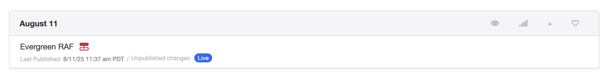
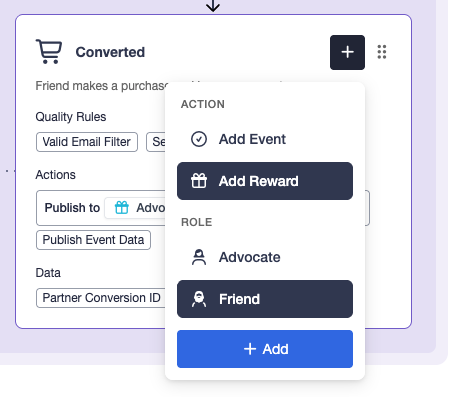
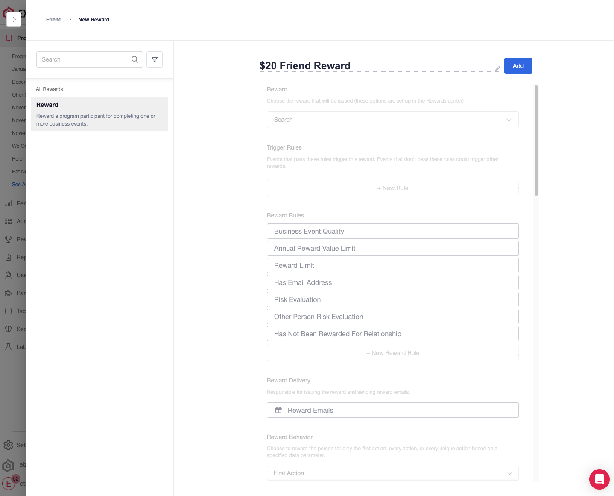
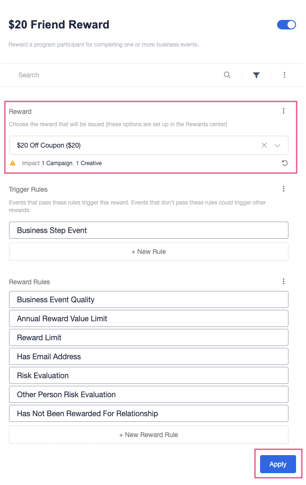
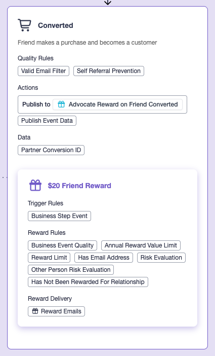
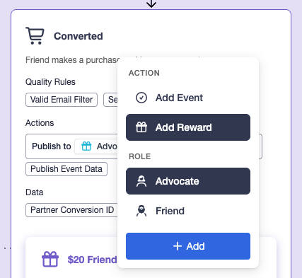

>

> 💡 **Important Note:** This guide only applies to flow campaigns that use Extole's upgraded Flow Builder. Check for the flow icon next to your campaign name.

>

 

>

# Overview

> Every Extole campaign comes with [default rewards](/guides/flow-campaigns/how-to-set-up-a-reward). This guide covers adding additional rewards to your campaign from scratch.

>

## Reward a Person for Their Activity

> Example:

- Reward a friend for starting a subscription or making a qualified purchase

> This use case covers adding a reward for a person who has performed a particular activity like starting a subscription or making a purchase.

>

### Configuration

> Hover over the business event that you want to trigger the reward and hit the + button in the top right.

>

 

>

> By default, the options "Add Reward" and "Friend" will be selected, so go ahead at hit Add. Doing so will prompt you to create your new reward. Be sure to give it a descriptive name.

>

 

>

> To make the reward functional, all you have to do is specify the Reward setting and apply your changes.

- If this reward is a Tango reward, please reference our guide for [How to Set Up A Tango Gift Card Reward](/guides/flow-campaigns/how-to-set-up-a-tango-gift-card-reward).
- We also recommend double checking the default [reward rules](/guides/flow-campaigns/how-to-set-up-reward-rules).

>

 

>

> Once your configuration is complete, you'll see the reward attached to the business event in your flow.

<Info>
In newly created Flow Builder campaigns, a reward's **Triggered By** setting names the business event that earns it. After you add the reward, check that its **Triggered By** names the business event you want. See [How to Set Up Triggered By](/guides/flow-campaigns/how-to-set-up-triggered-by).
</Info>

>

 

>

>

## Reward a Person for Someone Else's Activity

> Examples:

- Reward an advocate when their friend registers
- Reward an ambassador when a friend converts

### Configuration

> Hover over the business event that you want to trigger the reward and hit the + button in the top right.

>

 

>

> The rest of the configuration is the same as for rewarding a person for their activity, described in the section above.

>

>

>

## Add a Second Reward Gated by Event Data

When the new reward should fire only when event data matches (for example, only when product
id equals a specific value):

1. Add the reward from the business event using this page, so it stays attached.
2. Confirm the new reward appears on that event.
3. Then follow [How to Create a Reward That Triggers on Event Data](/guides/flow-campaigns/how-to-create-a-reward-that-triggers-on-event-data)
   to add the data comparison.

A data comparison filters events that already reach the reward. It is not the connection to
the event.

<Info>
  On a Reward for Action or Offer program, add the reward from **Outcome** and choose
  **Participant**. The default **Friend** choice is for referral programs.
</Info>
