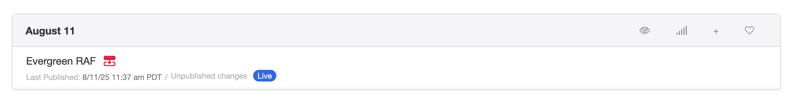

>

> 💡 **Important Note:** This guide only applies to flow campaigns that use Extole's upgraded Flow Builder. Check for the flow icon next to your campaign name.

>

 

>

# Overview

> Setting up Tango gift card rewards is easy, but requires a slightly different process than for other reward types. This article covers how to set up or replace an existing Tango gift card reward in your flow campaign.

## How to Update Tango Rewards

<Warning>
**If you are using **any other type of reward**, please refer to our standard guide.**
</Warning>

>

### Step 1: Navigate to the Tango Reward

1. Go to the **[Programs Page](https://my.extole.com/programs)** and click the **Manage Flow** icon for your desired campaign, or from the **Campaign Editor,** select the **Flow** tab.
2. Locate the reward you would like to update. It may be attached to a business event or have it's own separate box.

### Step 2: Update the Tango Reward

1. Click the existing reward to open its settings.
2. In the **Reward** section, select your Tango reward from the available options.
3. **Rename** the reward to reflect its type and value (e.g., $30 Visa Friend Reward on Signed Up).
4. Click **Apply** to save your changes.

> **Don’t see the reward you need?** You’ll need to create it first. Refer to our guide for creating **[Gift Card Rewards](/guides/rewards-management/setting-up-your-rewards/how-to-reward-with-tango-gift-cards).**

>

> **Looking for help setting up reward rules?** Check out our [reward rule guide](/guides/flow-campaigns/how-to-set-up-reward-rules).

>

### Step 3: Update the Reward Delivery

1. Find the **Reward Delivery** section within the reward. 
2. Remove the default **Reward Emails** and click to **+ New Reward Delivery**.
3. Select the **Tango Email** option and give it a unique name, then click **Add**.
4. Within the Tango Email, update the **Message** setting and hit **Apply** to save your changes.

<Warning>
**Remember that Tango controls the email template and handles sending the email.**
</Warning>

>

### Step 4: Update Campaign Copy (if applicable)

> If you are updating a reward on an existing campaign, you may also need to update the messaging in your campaign to ensure it reflects the new reward and its value.

>

### Step 5: Publish Your Changes

> Once you're done editing your campaign, **be sure to Publish your changes.**

## Related Content

> Once your reward is updated, make sure the rest of your campaign is fully configured. Helpful resources:

- [How to Run a Burst](/guides/programs-and-campaigns/managing-campaigns/how-to-run-a-burst)
- [A/B Testing your Offer](/guides/strategy-and-best-practices/campaign-optimization/a-b-testing-your-offer)
- [Making Updates to your Campaign](/guides/programs-and-campaigns/managing-campaigns/making-updates-to-your-campaigns)
- [Pausing and Ending Campaigns](/guides/programs-and-campaigns/managing-campaigns/pausing-ending-and-scheduling-campaigns)
- [How to Resend Tango Rewards](/guides/rewards-management/reward-fulfillment/how-to-resend-tango-rewards) — same-email resend, corrected-email resend, and Trying to Fulfill
