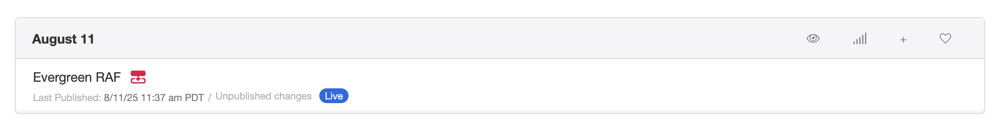
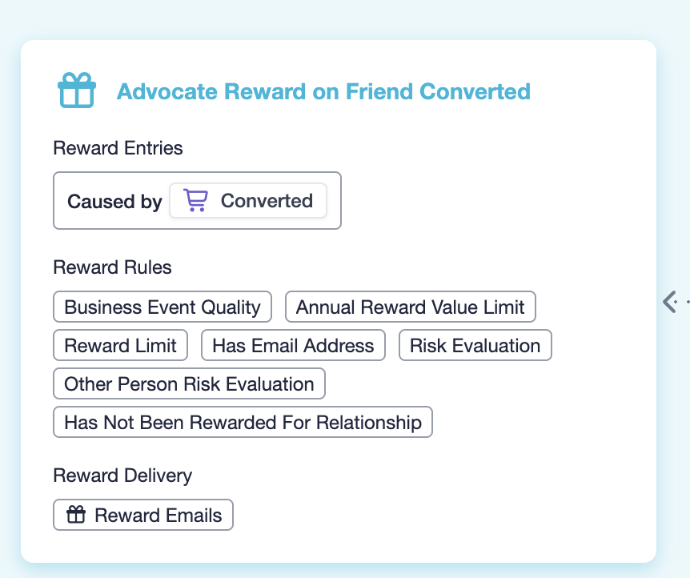

>

> 💡 **Important Note:** This guide only applies to flow campaigns that use Extole's upgraded Flow Builder. Check for the flow icon next to your campaign name.

>

 

>

# Overview

> **Reward rules** define the conditions under which a participant earns a reward in your campaign. These rules ensure that:

- **Only eligible participants** are rewarded
- **Qualifying actions** are clearly defined
- **Rewards are delivered** at the right time and under the right conditions

> Every default Extole campaign includes a set of preconfigured reward rules based on industry best practices. However, you can **adjust, remove, or add rules** to better fit your business goals.

>

> This guide walks you through how to locate, configure, and manage reward rules using the Flow Builder.  
​

# How to Manage Rewards in Flow Builder

### Step 1: Navigate to the Reward in Flow Builder

1. Go to the **Programs** page.
2. Locate the campaign you want to edit.
3. Click the **Manage Flow** icon for that campaign.
4. In the Flow Builder, find the **Reward** node for the flow.
5. Scroll to the **Reward Rules** section for the specific reward you'd like to configure.

### Step 2: View and Edit Existing Reward Rules

1. Click on any existing reward rule to open its configuration panel.
2. Adjust settings as needed for that specific rule.
3. Click **Apply** to save your changes.

> **Example:**  
For the **Annual Reward Value Limit** rule, you can set:

- **Total Value** – Maximum reward value per person per tax year
- **Tax Year Starting Month and Day** – Defines when the yearly limit resets

### Step 3: Add a New Reward Rule

1. In the **Reward Rules** section, click **+ New Reward Rule**
2. Choose from a list of available rules
3. Configure the selected rule
4. Click **Apply** to save

> You can add multiple reward rules. All rules must pass for the reward to be granted.

# Best Practices

- **Start with defaults:** Extole’s preconfigured rules cover common risk and reward scenarios.
- **Be specific:** Tailor rules to your business objectives and reward strategy.
- **Use pending periods:** Add time buffers for validations like fraud checks or return windows.
- **Layer rules carefully:** All rules must pass for the reward to be granted—avoid unnecessary blockers.
- **Test thoroughly:** Before going live, simulate typical participant journeys to confirm the reward logic works as expected.

# Which Rewards a Rule Counts

Some reward rules work by counting the rewards a person has already earned. **Reward Limit** and **Has Not Been Rewarded For Relationship** are the two you will meet most often. Each has two settings that decide what it counts:

- **Scope**: where the rule looks — this campaign, this program, or the whole account.
- **Reward Name**: which rewards it counts. Left empty, the rule counts every reward within its scope. With a name in it, the rule counts only the rewards issued under that name and passes over the rest.

The two rules start from opposite defaults, which is easy to miss:

- **Reward Limit** shows the setting as **Applicable Reward Name**, and it starts empty, so the limit counts every reward in scope.
- **Has Not Been Rewarded For Relationship** shows it as **Reward Name**, behind the **Show Expert** filter on the rule's panel, and it arrives already filled in with the name of the reward the rule sits under. That rule counts only that one reward.

**Has Been Rewarded** and **Has Not Been Rewarded** start the same way as Has Not Been Rewarded For Relationship: their **Reward Name** sits behind **Show Expert** and arrives filled in with the name of the reward the rule sits under. For Has Not Been Rewarded that is usually what you want, because it stops a reward paying twice. For Has Been Rewarded on a bonus tier it is not. A bonus that should pay after five referral rewards, set up with Has Been Rewarded and **Minimum Count** 5, counts earlier bonuses rather than the referral rewards, so it never pays. Set its **Reward Name** to the name of the referral reward it should count.

<Warning>
**A campaign can pay the same reward through more than one route.** The automatic earn, a makegood, and a manually issued reward are separate steps, and each one stamps its own reward name on what it issues. A rule that counts one name holds on that route and lets the other routes through, with nothing to show that it did. When a rule is meant to cover everything a person can earn, clear **Reward Name** so it counts them all.
</Warning>

Before you rely on a limit, list every step in the campaign that issues a reward and read the reward name on each one. That set of names is what the rule has to cover.

# Common Reward Rules (with examples)

### Reward Limits & Eligibility

- **Annual Reward Value Limit:** Prevents a participant from earning more than a set amount per tax year.
- **Reward Limit:** Restricts how many times a participant can earn a reward within a given period.
- **Pending Period:** Delays the reward until a pending period ends and all other conditions have been met. *Example: A friend only receives a reward for opening an account after it has been open for 60 days.* The pending period runs on the campaign where the reward was earned, so that campaign must stay live, paused, or ended until the period ends. A stopped campaign does not finish its pending periods, so those rewards are not evaluated or issued. See [Pausing, Ending, and Scheduling Campaigns](/guides/programs-and-campaigns/managing-campaigns/pausing-ending-and-scheduling-campaigns).

>

> Annual Reward Value Limit and Reward Limit are both on by default when creating new campaigns, however it's unlikely you would use both at the same time. Make sure to remove the one you don't need.

>

### Fraud & Risk Prevention

- **Business Event Quality:** Ensures the event triggering the reward is legitimate and high quality.
- **Has Email Address:** Only allows rewards for participants with a valid email.
- **Risk Evaluation:** Evaluates the email domain and IP of the person to detect risk signals.
- **Other Person Risk Evaluation:** Evaluates the advocate or friend in a two-person program.

### Relationship Rules

- **Has Not Been Rewarded For Relationship:** Ensures rewards are given only once per unique participant relationship  
​ *Example: An advocate can’t earn multiple rewards for referring the same friend.*

### Event-Based Rules

- **Event Value Greater Than / Less Than:** Rewards are only issued if a value (e.g., order amount) meets the criteria.  
​ *Example: Order value must be over \$200.*  
​ The comparison is strict: **Event Value Greater Than** passes only when the value is above the number you set, and **Event Value Less Than** only when it is below it. An order of exactly that amount does not pass. The number is a whole number, so to reward orders of \$175 or more, set **Event Value Greater Than** to 174. An order of \$174.50 then passes too. An event that carries no value is compared as 0.

### Behavior & Action Rules

- **Has Taken Action / Has Not Taken Action:** Reward based on whether a participant has completed (or not completed) specific actions.  
​ *Example: Only reward if the person has completed a sign-up.*  
​ Has Taken Action checks that the person completed the business event. It does not check that a reward was issued for it. To require an earlier reward, use Has Been Rewarded.
- **Has Been Rewarded / Has Not Been Rewarded:** Reward based on whether the participant has already earned a reward in the program. **Minimum Count** sets how many earlier rewards are required, and the default is one. **Reward States** sets which reward states count, and by default EARNED, FULFILLED, SENT, and REDEEMED all count.  
​ *Example: In a tiered program, only issue the second tier's reward after the person has earned the first tier's reward.*
- **Is New Customer:** Only rewards people who haven’t made a purchase in the last 180 days.

### Audience Membership

- **Member of Audience / Is Not Part Of Audience:** Include or exclude participants based on audience membership.  
​ *Example: Only reward VIP customers or loyalty members.*

### Profile Rules

- **Profile Contains Parameter:** Checks the participant’s profile for a specific attribute before issuing a reward.  
​ *Example: Only reward users with a profile tag like `"tier": "gold"`.*

### Related Person Rules

- **Other Person Has Taken Action:** Ensures that the related person (e.g., the advocate in a referral campaign) has completed a required action.  
​ *Example: Only reward the friend if the advocate has also signed up.*
