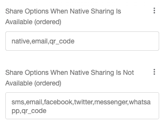
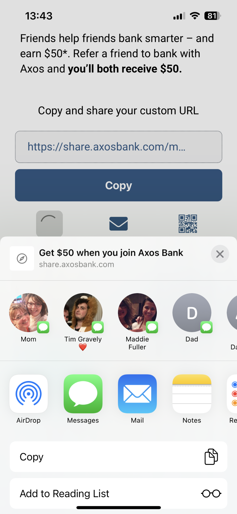

# Overview

Extole supports a variety of share channels including email, SMS, native mobile, and a variety of social media providers. This guide shows you where to choose the share channels available to your advocates, and how to add, remove, and reorder them.

Your share experience shows advocates one of two lists of channels:

- **Share Options When Native Sharing Is Available**: shown on a mobile device whose browser supports native sharing.
- **Share Options When Native Sharing Is Not Available**: shown everywhere else, including every desktop browser. A mobile device whose browser does not support native sharing also sees this list.

# Share Channel Options in a Flow Builder Campaign

This table applies to a Flow Builder campaign. A Legacy campaign uses a text field instead of the picker, described in [Updating Share Channels on a Legacy Campaign](#updating-share-channels-on-a-legacy-campaign).

Every channel below is available to choose in My Extole. The second column gives the name the picker shows for each channel. **Native Mobile** is available only in the list for devices that support native sharing.

| Channel | Label in the picker | On by default when native sharing is available | On by default when native sharing is not available |
|---|---|---|---|
| Native Mobile | Native | Yes | — |
| SMS | SMS | No | Yes |
| Email | Email | Yes | Yes |
| X (Twitter) | X | No | Yes |
| WhatsApp | Whatsapp | No | Yes |
| Pinterest | Pinterest | No | Yes |
| QR Code | QR Code | Yes | Yes |
| Facebook | Facebook | No | No |
| Facebook Messenger | Messenger | No | No |
| LinkedIn | Linkedin | No | No |
| Printable Form | Printable Form | No | No |
| Lead Gen | Lead Gen | No | No |

**Printable Form** adds a button, labeled **Print** by default, that opens a printable referral form carrying the advocate's share code. **Lead Gen** adds a form where the advocate submits a friend's details directly.

# Updating Share Channels on a Flow Builder Campaign

1. Open your campaign in the Campaign Editor.
2. On the **Advocate** tab, select the **Share Experience**.
3. Select the **Behavior** category above the settings list.
4. Find **Share Options When Native Sharing Is Available (ordered)** and **Share Options When Native Sharing Is Not Available (ordered)**. Each shows the channels it currently includes as chips.
5. Change either list:
   - **To add a channel**, click the field to open the list of channels, then check the channel. It's added to the end of the list.
   - **To remove a channel**, click the **x** on its chip, or open the list and uncheck it.
   - **To change the order**, remove the channels you want to move, then add them back in the order you want. Advocates see the channels in the order they appear in the field, except **Native Mobile**, which always shows first.
6. Click **Apply** to save your changes as a draft. Use the preview to check how the share experience looks.
7. Click **Publish Changes**. Your advocates see the new channels only after you publish.

For more on the difference between **Apply** and **Publish Changes**, see [Using Extole's Campaign Editor](/guides/programs-and-campaigns/campaign-creation-and-editing/using-extole-s-campaign-editor#applying-and-publishing-changes).

# Updating Share Channels on a Legacy Campaign

If you have an Extole Legacy Campaign, your share channels will look like the below. Similarly to above, add the share channels you'd like enabled on mobile (Share Options When Native Sharing is Available) and desktop (Share Options When Native Sharing is Not Available). The possible options are formatted as seen below.

If a user visits the site on their mobile device, but it is not native mobile compatible, they will see the second list of options.

As with a Flow Builder campaign, click **Apply** and then **Publish Changes** for your advocates to see the change.

# What is Native Sharing?

Native sharing is the built-in share menu on your phone that pops up when you tap a Share button, letting you quickly send something via text, Slack, email, or any other app you use most.

# How SMS and Native Mobile Are Reported

SMS and Native Mobile are distinct channels in your reports, and they record distinct actions:

- **SMS**: the advocate taps the SMS button, which opens the messaging app on their phone with the share message already filled in. The share is reported on the SMS channel.
- **Native Mobile**: the advocate taps the Share button, which opens the phone's own share menu. The share is reported on the Native Mobile channel whichever app the advocate then picks.

The phone's share menu does not tell Extole which app the advocate chose, so a text message sent from the share menu is reported as Native Mobile rather than SMS.

<Info>
  On a phone that supports native sharing, advocates see only the channels listed under **Share Options When Native Sharing Is Available**. If SMS is not in that list, every text an advocate sends goes through the share menu and is reported as Native Mobile. Add SMS to that list to report texting as its own channel.
</Info>
