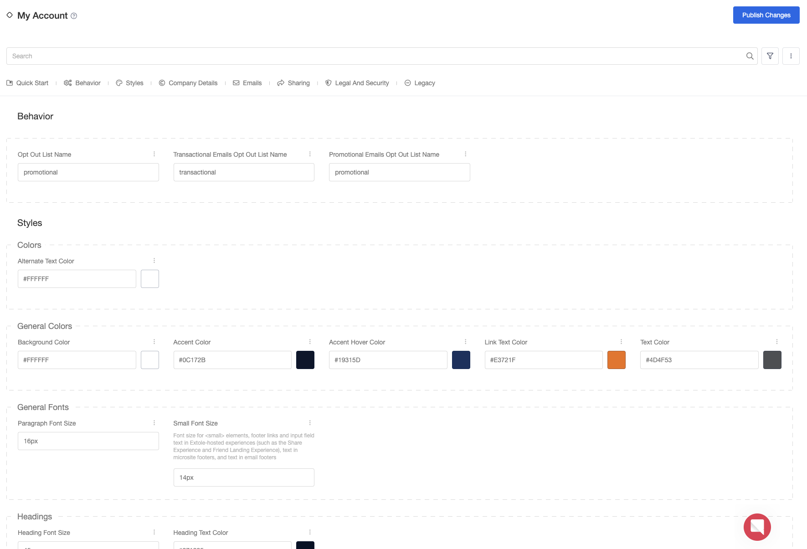
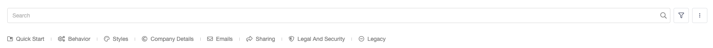
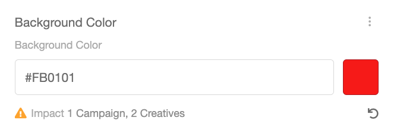
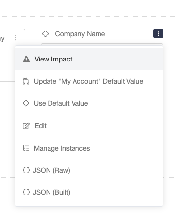
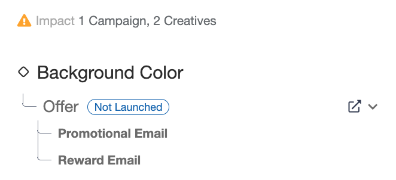

# Overview

The [My Account](https://my.extole.com/account-settings) page in your My Extole account allows you to manage brand-level settings, like company name, logo, website, and primary fonts and colors. These settings are passed down to every setting in your programs and campaigns that is connected to them, giving you a solid foundation of branded styles to work with.

You can access your My Account Settings from the My Account button on your [Programs](https://my.extole.com/programs) page, from your [Settings](https://my.extole.com/settings) page, or through the breadcrumb menu at the top of the Campaign Editor.

 

# Key Features

You may notice that the My Account page strongly resembles the Campaign Editor. This is intentional since the settings you configure on your My Account page will be reflected in the Campaign Editor for all your programs and campaigns.

Let's review the key features of your My Account page.

## Categories

Categories are located just below the search bar. By default, all of the settings are visible to you at once. You can filter the settings by selecting one of the categories.

## Reset Changes

After you change a setting, a Reset icon (counter-clockwise arrow) will appear. You can click this icon to quickly revert your changes.

## View Impact

Settings changed on the My Account page will impact your programs and campaigns. When you update a setting, you will see an Impact statement that tells you how many campaigns and creatives are affected by the change. You can click on the Impact to view the specific campaigns and creatives and navigate to them if desired.

If you would like to view a setting's impact without updating it, you can open the kebab menu to the right of the setting and select View Impact.

## How Changes Reach Your Campaigns

Campaigns read your published My Account settings, so publish a change for it to reach them. A change reaches every campaign setting that is connected to it. A setting someone edited in a campaign is disconnected and keeps its own value until it is reconnected; see [Setting Inheritance](/guides/programs-and-campaigns/campaign-creation-and-editing/using-extole-s-campaign-editor#setting-inheritance). My Account settings apply to one Extole account, so if your brand runs programs in more than one account, set them in each.

For how settings, creatives, and library updates reach a campaign, see [Copies, Inheritance, and Upgrades](/technical/integration-overview/copies-inheritance-and-upgrades).

## Company Email From

**Company Email From** is the address your program emails come from, such as reward and welcome emails. Every program uses the address you set here.

If you set an address on your own domain, Extole uses it once the domain passes its checks in the [Tech Center](https://my.extole.com/tech-center). Until then, program emails come from `email.referral-mail.com`. For the DNS records your domain needs, see [Extole DNS Requirements](/technical/operational-tasks/account-configuration/extole-dns-requirements).
