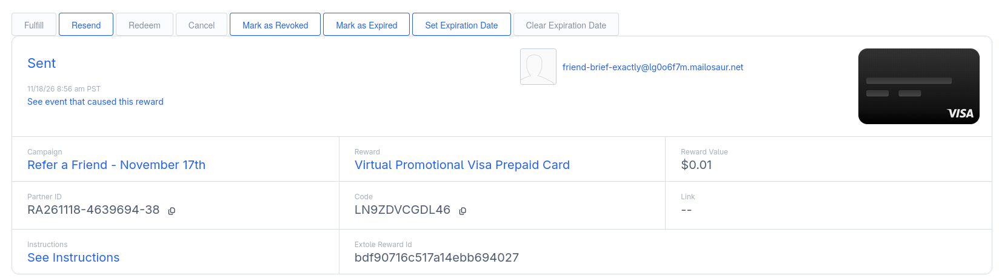
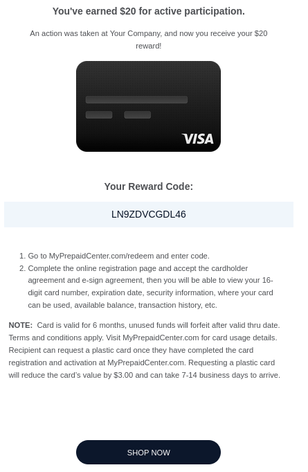
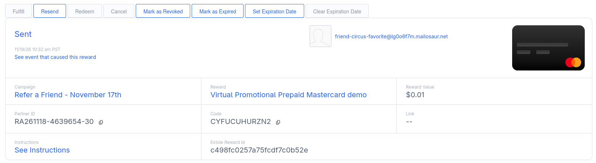
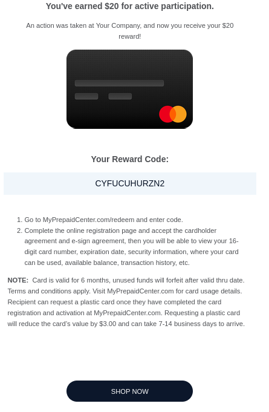
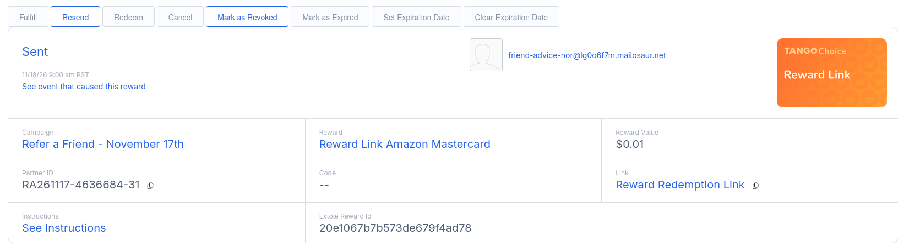
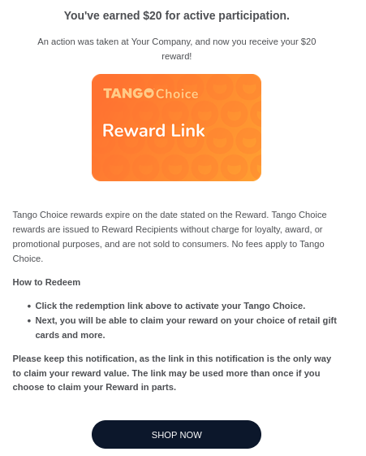
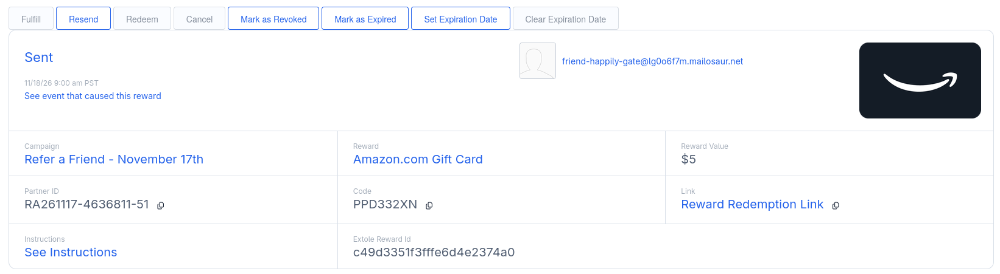
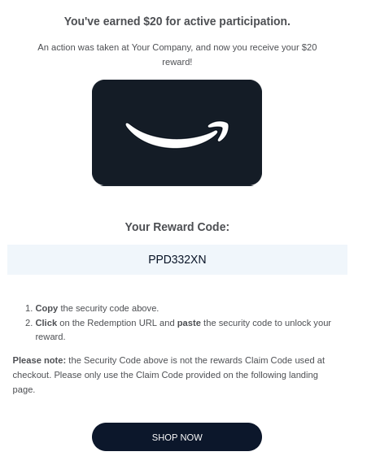
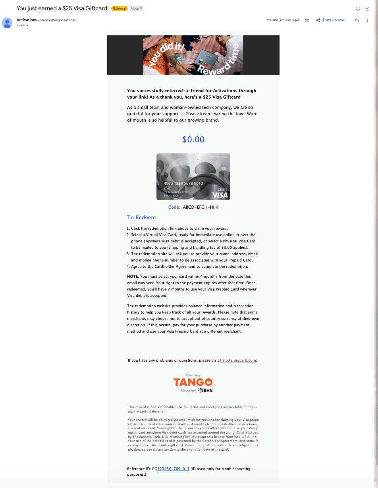

# Overview

When a person earns a Tango gift card reward, they receive an email with a link to redeem it. You choose who sends that email:

- **Reward emails sent by Extole**: Extole sends the email from your campaign. You customize its messaging, and it shows the details each reward has, such as a code, a link, redemption instructions, a brand image and an expiration date.
- **Reward emails sent by Tango**: Tango sends the email from a template that your CSM configures in Tango Rewards Genius.

# Reward Emails Sent by Extole

In a Flow Builder campaign, the **Reward Emails** delivery is the default for a reward. When that delivery sends a Tango gift card, Extole sends the email. You don't need a Gift Card Template Id on this path.

## Set Up Reward Emails Sent by Extole

1. Open the Tango gift card reward in your campaign. See [How to Set Up a Tango Gift Card Reward](/guides/flow-campaigns/how-to-set-up-a-tango-gift-card-reward).
2. In the **Reward Delivery** section, keep **Reward Emails**.
3. Customize the email's messaging, then click **Apply**.
4. Publish your changes.

## Choose What the Email Shows

Set these options in the **Reward Emails** delivery of each reward:

- **Show Coupon Code**: shows the reward code when the reward has one. Use **Reward Code Headline** to change the heading above the code.
- **Add Reward Redemption Button**: adds a **SHOP NOW** button. The button goes to the reward's link when the reward has one. When it doesn't, the button goes to the destination you set for **SHOP NOW**.
- **Show Expiration Date**: shows the expiration date when the reward has one. Use **Expiration Date Headline** to change the label above it.

The redemption instructions and the brand image appear when Tango provides them. You don't need to turn anything on for them.

## Settings for Each Type of Gift Card

The four types below show which options to set. The reward details are from My Extole, and the emails are examples from a test program.

### Virtual Visa and Virtual Mastercard

These cards provide only a reward code.

- **Show Coupon Code**: on.
- **Add Reward Redemption Button**: on. Set the destination for **SHOP NOW** to the page you want recipients to visit, because these cards have no link.

<Frame caption="Reward details for a Virtual Visa reward. The reward has a reward code and no link.">
  
</Frame>

<Frame caption="Example reward email for a Virtual Visa reward. The code appears under Your Reward Code, and the instructions come from Tango.">
  
</Frame>

<Frame caption="Reward details for a Virtual Mastercard reward. The reward has a reward code and no link.">
  
</Frame>

<Frame caption="Example reward email for a Virtual Mastercard reward. The code appears under Your Reward Code, and the instructions come from Tango.">
  
</Frame>

### Reward Link

This reward provides only a link.

- **Show Coupon Code**: off. The reward has no code to show.
- **Add Reward Redemption Button**: on. The button uses the reward's link.

<Frame caption="Reward details for a Reward Link reward. The reward has a link and no reward code.">
  
</Frame>

<Frame caption="Example reward email for a Reward Link reward. The email has no code section, and the SHOP NOW button uses the reward's link.">
  
</Frame>

### Amazon Gift Card

This reward provides a code and a link.

- **Show Coupon Code**: on.
- **Add Reward Redemption Button**: on. The button uses the reward's link.

<Frame caption="Reward details for an Amazon gift card reward. The reward has both a reward code and a link.">
  
</Frame>

<Frame caption="Example reward email for an Amazon gift card reward. The code appears under Your Reward Code, and the SHOP NOW button uses the reward's link.">
  
</Frame>

# Reward Emails Sent by Tango

Tango sends this email from its own template. Your CSM configures the template, and you can customize the messaging.

<Frame caption="Example of a reward email sent by Tango. Tango sends it from the template your CSM configures.">
  
</Frame>

## Customize the Tango Email

- **Header image**: Tango supports branded templates with a custom header image. Use 650 x 150 px, in JPEG or PNG format.
- **Sender name**: The email comes from **noreply@tangocard.com**, but you can change the name it comes from. Use something like \{Company Name\} Referral Rewards.
- **Message**: The copy at the top of the email. It can include simple HTML styling and is limited to 3,000 characters.
- **Redemption text and instructions**: Not editable. Tango adds them based on the gift card.
- **Email closing**: The copy at the end of the email. Add a link to your referral program so advocates and friends can keep referring.

## Set Up Reward Emails Sent by Tango

1. Open the Tango gift card reward in your campaign. See [How to Set Up a Tango Gift Card Reward](/guides/flow-campaigns/how-to-set-up-a-tango-gift-card-reward).
2. In the **Reward Delivery** section, remove **Reward Emails** and click **+ New Reward Delivery**.
3. Select **Tango Email**, give it a unique name, then click **Add**.
4. In **Tango Email**, enter the **Gift Card Template Id** and update the **Message**. Click **Apply**.
5. Publish your changes.

<Warning>
If you add a reward email to the **Tango Email** delivery, Extole sends the reward email instead. In that case, Extole ignores the **Gift Card Template Id** and the **Message**.
</Warning>

Your CSM or Extole Support can help you set up the template.

# Missing Reward Emails

If a recipient can't find the reward email, ask them to check their inbox and their spam or junk folder. For an email sent by Tango, also confirm that no filter blocks **noreply@tangocard.com**.

To resend a reward, see [How to Resend a Reward](/guides/rewards-management/reward-fulfillment/how-to-resend-a-reward). For a Tango gift card, see [How to Resend Tango Rewards](/guides/rewards-management/reward-fulfillment/how-to-resend-tango-rewards).
# Need Help?

For more information on Tango Rewards, see **[How to Reward with Tango Gift Cards](/guides/rewards-management/setting-up-your-rewards/how-to-reward-with-tango-gift-cards)**.
