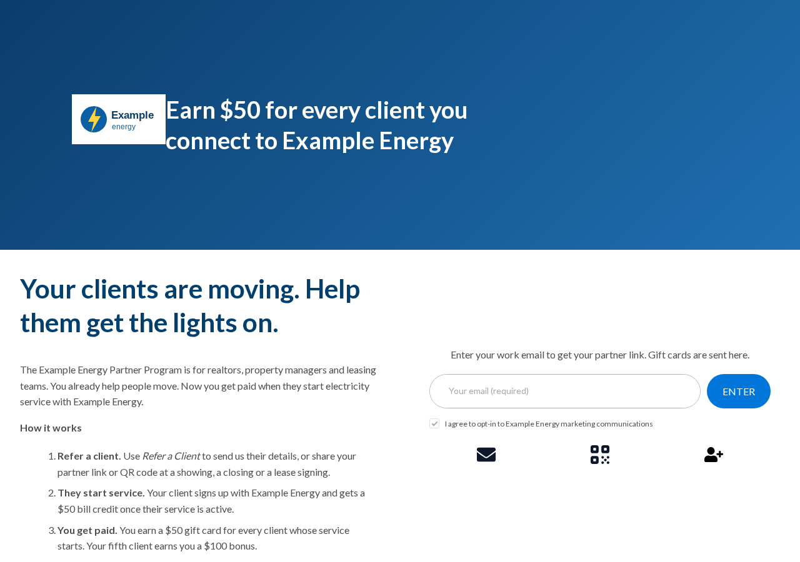
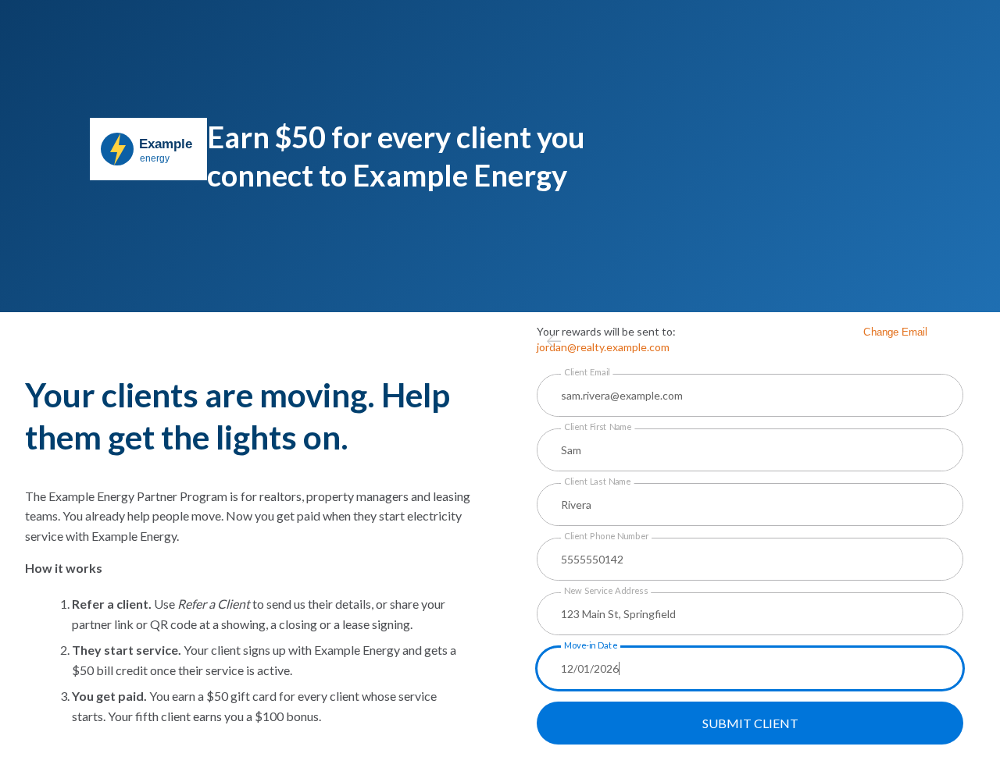

## Overview

A partner referral program pays the people who meet your future customers at the moment they need service: realtors, property managers, leasing teams, and movers. Every move is a new electricity, internet, or phone account, and these partners are standing next to the customer when the decision is made. The program gives them a reason to send that customer to you.

Partners sign up with their work email and get a personal partner link and QR code. They share the link, or they submit a client's details directly through a **Refer a Client** form. When the client starts service, the partner earns a reward, such as a gift card, and the client earns their own, such as a bill credit. A bonus on a partner's fifth client keeps your most active partners referring.

This guide builds the program from the **Refer a Friend with Lead Gen** template. The same build works for any provider whose new accounts start when a customer moves, including energy, internet, cable, and mobile.

<Info>
If your partners are property staff who need property assignments, approvals, and Reward Bank redemption, see [Launch an MDU Referral Program](/guides/programs-and-campaigns/other-acquisition-and-engagement-programs/launch-an-mdu-referral-program). A partner referral program is lighter: any partner signs up with an email, and every client they refer is credited to them.
</Info>

## How It Works

| Role | Who | What they get |
| --- | --- | --- |
| Partner (the advocate) | A realtor, property manager, leasing agent, or mover | A partner link, a QR code, a **Refer a Client** form, and a reward for each client who starts service |
| Client (the friend) | The person moving into a new home | A reward when their service starts |

1. **The partner signs up.** On the partner page, the partner enters their work email and gets a partner link and QR code. Gift card rewards are sent to that email.
2. **The partner refers a client.** The partner shares the link or QR code at a showing, a closing, or a lease signing, or submits the client's details through **Refer a Client**. Either way, the client is linked to the partner who referred them.
3. **The client starts service.** Your enrollment or billing system sends Extole an event when the client's service starts.
4. **Both are rewarded.** The partner earns their reward and the client earns theirs. On the partner's fifth client, the partner also earns a bonus.

The partner page also shows each partner their referrals and earned rewards. A partner who verifies their email sees their activity from every device.

<Frame caption="A partner page. The partner enters a work email to get a partner link, then shares it by email, by QR code, or through **Refer a Client**.">
  
</Frame>

A typical reward structure looks like this. Set amounts that fit your margins and your market.

| Reward | Who earns it | When | Example |
| --- | --- | --- | --- |
| Partner reward | Partner | Each client starts service | \$50 gift card |
| Client reward | Client | Their service starts | \$50 bill credit |
| Milestone bonus | Partner | Their fifth client starts service | \$100 gift card |

## 1. Create the Program

1. Go to the [Programs](https://my.extole.com/programs) page in My Extole.
2. Click **+ New Program**.
3. Choose **Refer a Friend with Lead Gen**.
4. Name the program, for example **Partner Referral Program**, and confirm.

The new program is a draft until you launch it. For more on what the template includes, see [Creating a Program](/guides/platform-overview/creating-a-program).

## 2. Write the Partner Page for Partners

The template's copy speaks to a customer referring a friend. Rewrite it for a professional who refers clients:

- **Headline:** state what the partner earns, such as "Earn \$50 for every client you connect to us."
- **Sign-up prompt:** ask for a work email, and say that rewards are sent to it.
- **How it works:** three short steps: refer a client, they start service, you get paid. Name the milestone bonus in the last step.
- **Share message:** write the message a client receives from the partner, such as a congratulations on the new home and the bill credit they get when they start service.
- **Images:** use moving-day or new-home photos rather than the template's placeholder art.

## 3. Set Up the Refer a Client Form

The lead capture form lets a partner submit a client on the spot, with no link to share. Open the campaign's **Share Experience** and set:

| Setting | What to enter |
| --- | --- |
| **Lead Capture Button Text** | The button partners click, such as **Refer a Client** |
| **Lead Capture Panel Heading** | The form's heading, such as **Refer a Client Who Is Moving** |
| **Lead Capture Panel Submit Button Text** | The submit button, such as **SUBMIT CLIENT** |
| **Lead Capture Form Fields** | The fields on the form |

**Lead Capture Form Fields** is a list of fields. Each field has a name, a label, a type, and whether it is required. Supported types are `text`, `email`, `phone`, `number`, `url`, `textarea`, and `hidden`. The template starts with the client's email, first name, last name, and phone number.

For clients who are moving, add the address where service starts and the move-in date:

| Label | Type | Required |
| --- | --- | --- |
| Client Email | `email` | Yes |
| Client First Name | `text` | Yes |
| Client Last Name | `text` | Yes |
| Client Phone Number | `phone` | Yes |
| New Service Address | `text` | No |
| Move-in Date | `text` | No |

<Frame caption="The **Refer a Client** form with a new service address and a move-in date added.">
  
</Frame>

Keep the email field. The client's email address is what links the client to the partner and to the start-of-service event in the next step.

## 4. Reward When Service Starts

The template rewards both people when the client converts. Point that at the moment the client's service starts.

1. **Name the event.** Rename the **Converted** business event to something your team recognizes, such as **Service Started**.
2. **Choose its trigger.** In the business event's **Triggered By**, select the event your system sends when a client's service starts. The template expects `conversion` from the **Event API**. If your system sends a different name, such as `enrollment`, declare that name on the **Event API** and select it. See [How to Set Up Triggered By](/guides/flow-campaigns/how-to-set-up-triggered-by).
3. **Send the event.** Have your enrollment or billing system send the event server to server when service starts, with the client's email address.
4. **Set the partner reward.** Create a gift card reward, such as a \$50 gift card, and select it in the **Reward** setting of **Advocate Reward on Friend Converted**. See [How to Reward with Tango Gift Cards](/guides/rewards-management/setting-up-your-rewards/how-to-reward-with-tango-gift-cards).
5. **Set the client reward.** Create an account credit reward, such as a \$50 bill credit, and select it in **Friend Reward on Converted**. Your billing system applies the credit. See [How to Reward with Account Credits](/guides/rewards-management/setting-up-your-rewards/how-to-reward-with-account-credits).
6. **Rename the rewards** so reports read clearly, such as **Partner Gift Card** and **New Customer Bill Credit**.

## 5. Add a Milestone Bonus

A bonus on a set number of clients replaces a full tier system and keeps partners referring after their first few clients. Add a second partner reward that pays once, on the partner's fifth client who starts service, using [How to Set Up Bonus Rewards on a Specific Referral Count](/guides/flow-campaigns/how-to-set-up-bonus-rewards-on-a-specific-referral-count-2nd-3rd-5th-etc). Count the **Service Started** event, and give the bonus its own reward and reward email.

## 6. Test and Launch

Before launch, walk one test partner through the whole program:

- Sign up on the partner page and confirm the partner link and QR code appear.
- Submit several test clients through **Refer a Client**, and share the link with one more.
- Send the start-of-service event for each test client.
- Confirm each client's reward, one partner reward per client, and exactly one bonus on the fifth client.
- Confirm the partner page shows the referrals and earned rewards.

Then recruit partners. Brokerages, property management companies, and moving companies can share the partner page with their whole team, and a printed QR code works at a leasing office or a showing.
