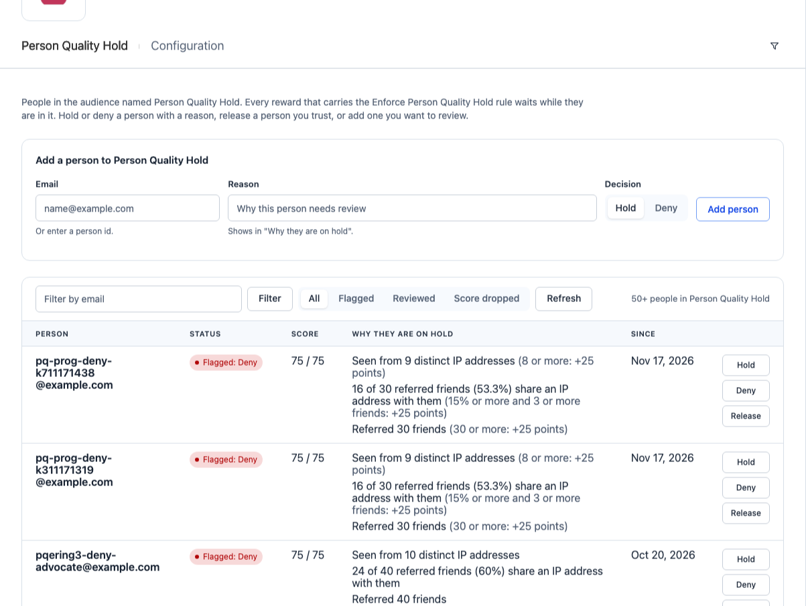
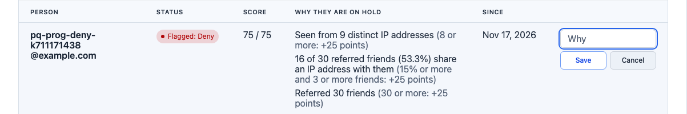
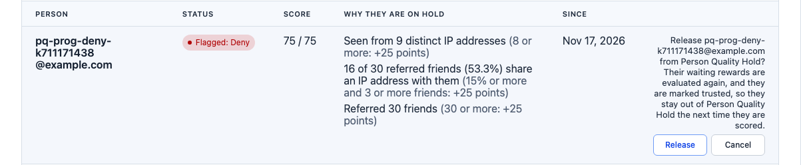
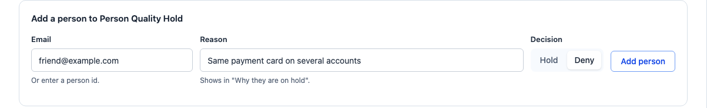
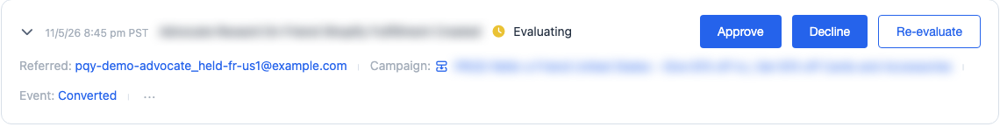
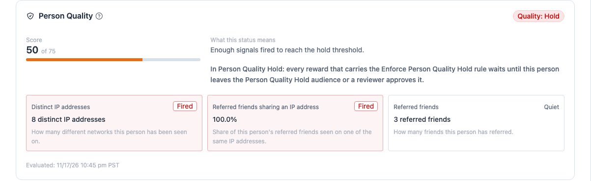

# Overview

Once [Person Quality is set up](/guides/rewards-management/rules-configuration/how-to-set-up-person-quality), it puts people whose activity looks like a reward farm, one person running many accounts to collect rewards, into an audience named **Person Quality Hold**, and their rewards wait. Nothing else happens to them until someone on your team looks. This page is for that reviewer: what each status means, how to read the **Person Quality Hold** tab and a person's profile, and how to record a decision.

A person in Person Quality Hold has not been found guilty of anything. It means "look at this person". Many people the score flags are genuine customers, and your review is what tells the two apart.

# What the Statuses Mean

| Status | What it means | What happens to the person |
| --- | --- | --- |
| **Clear** | No signal added points, or a reviewer released them. | Nothing. |
| **Watch** | One signal added points. | Nothing. The status shows on their profile. |
| **Hold** | Enough signals added points to reach **Hold at**, or a reviewer held them. | They join Person Quality Hold, and every reward that carries Enforce Person Quality Hold waits. |
| **Deny** | Every signal added points, or a reviewer denied them. | The same as Hold, plus whatever your team added to the **Person Quality - Deny** event, such as an alert email. |

**Hold and Deny treat rewards the same way.** Both put the person in Person Quality Hold, and both keep their rewards waiting. Deny is the stronger signal, so read those people first. Neither status blocks the person, declines a reward, or tells the person anything. They keep browsing, sharing, and referring while you review.

# A Day-to-Day Routine

1. Open the **Person Quality Hold** tab and select **Flagged**.
2. Start with the **Flagged: Deny** rows, then the **Flagged: Hold** rows.
3. For each person, read **Why they are on hold**, then open their profile and read the Person Quality panel, the network graph, and their recent activity.
4. Decide, and record it with a reason:
   - Genuine: **Release**.
   - Reward farm: **Deny**, then decline each waiting reward on their profile.
   - Not sure yet: **Hold**, with a reason that says what you are waiting for. Approve or decline individual rewards as needed.
5. Check **Score dropped** rows and decide about them the same way. Their rewards are still waiting.

The review is current when **Flagged** shows nobody who joined before today. People left under **Reviewed** are there on purpose, with a reason. Review at least as often as your customers expect their rewards: daily for a large program, weekly for a small one.

The rest of this page describes each screen and button the routine uses.

# The Person Quality Hold Tab

Open [Partners](https://my.extole.com/integrations), select **Extensions**, and open **Person Quality and Events**. It opens on the **Person Quality Hold** tab.

<Frame caption="The Person Quality Hold tab, with the people the score flagged at Deny listed first.">
  
</Frame>

Each row is one person in the audience:

- **Person**: their name or email. Click it to open their profile. See [Leveraging User Support Pages](/guides/platform-overview/leveraging-user-support-pages). A blocked person shows **Blocked** under the name.
- **Status**: how they came to be in the audience. The values are listed under [The Status Column](#the-status-column) below. This is not the same as their Person Quality status: a person at Deny shows **Flagged: Deny**, not **Deny**.
- **Score**: their points out of **Deny at**, for example 50 / 75.
- **Why they are on hold**: the signals that added points, and any reviewer's decision.
- **Since**: the day they joined the audience. Hover over it for the time.

The count at the top right says how many people are in Person Quality Hold. The list loads 50 people at a time. Click **Load more** at the bottom for the rest. Type in **Filter by email** and click **Filter**, or press Enter, to find one person, and click **Refresh** to reload the list.

## The Status Column

| Status | Meaning |
| --- | --- |
| **Reviewer deny** | A reviewer set the person to Deny. These rows are listed first. |
| **Flagged: Deny** | The score put the person at Deny. |
| **Flagged: Hold** | The score put the person at Hold. |
| **Reviewer hold** | A reviewer set the person to Hold. |
| **Score dropped** | The person is still in the audience, but their score is now below Hold. They stay until a reviewer releases them, because a score that drops is not a review. |

The filters above the list narrow it:

- **All**: everyone in the audience.
- **Flagged**: **Flagged: Deny** and **Flagged: Hold**, the people the score put there and nobody has decided about yet.
- **Reviewed**: **Reviewer deny** and **Reviewer hold**, the people a reviewer decided to keep.
- **Score dropped**: people whose score fell after they joined.

## Reading "Why They Are on Hold"

Each signal that added points has its own line, with the setting it passed and the points it added in gray:

- **Seen from 9 distinct IP addresses** (8 or more: +25 points)
- **16 of 30 referred friends (53.3%) share an IP address with them** (15% or more and 3 or more friends: +25 points)
- **Referred 30 friends** (30 or more: +25 points)

The second line is the strongest single sign of a reward farm: the friends of a real advocate are usually on their own networks. A large group of friends with no shared IP addresses usually means a popular advocate.

A reviewer's decision appears above the signals, with who made it, when, and why, for example **Denied by reviewer@example.com on Nov 17, 2026: Same payment card on twelve accounts**. Once the person has been scored again, the line adds the status the score alone gives, in gray, such as (the score alone gives Clear).

Two other lines can appear:

- **Added outside Person Quality. No score is recorded for this person.** Someone added this person to the audience directly, not through the score or the tab.
- **No signal fires now. The score dropped below Hold after they were added, and they stay until a reviewer releases them.**

# Record a Decision

Every row has the buttons that change its status:

| Row status | Buttons |
| --- | --- |
| Flagged: Deny, Flagged: Hold, Score dropped | **Hold**, **Deny**, **Release** |
| Reviewer hold | **Deny**, **Release** |
| Reviewer deny | **Hold**, **Release** |

## Hold or Deny a Person

Choose **Deny** when the signals and the profile convince you this is not a real customer. Choose **Hold** when you want more time or more evidence. Both keep the person in Person Quality Hold and keep every reward waiting. Deny does not decline the waiting rewards: decline each one on the person's profile, as described in [Decide One Reward at a Time](#decide-one-reward-at-a-time).

1. Click **Hold** or **Deny** on the person's row.
2. Enter the reason in the box that opens in the row. A reason is required, and it shows in **Why they are on hold**.
3. Click **Save**, or press Enter. Click **Cancel**, or press Escape, to leave the row as it was.

Write the evidence, not the verdict. "Same payment card on 12 accounts" or "Waiting for the first order to ship" tells the next reviewer what you saw. "Fraud" or "Looks fine" does not.

<Frame caption="Hold or Deny on a flagged row opens a reason box in the row.">
  
</Frame>

The row changes to **Reviewer hold** or **Reviewer deny** at once, and the person's profile shows the decision. The person stays in Person Quality Hold, so every future reward of theirs waits too. Their score records the decision the next time they are scored: on their next sign-up, share, page view, or conversion, or on their next referral. A developer can score them right away by sending the event `person_quality_review` for them through Extole's Event API.

## Release a Person

Release is for a person you have reviewed and trust.

1. Click **Release** on the person's row.
2. Read the question in the row: "Release *person* from Person Quality Hold? Their waiting rewards are evaluated again, and they are marked trusted, so they stay out of Person Quality Hold the next time they are scored."
3. Click **Release** to confirm, or **Cancel**.

<Frame caption="Release asks to confirm in the row.">
  
</Frame>

When you release a person:

- They leave Person Quality Hold, and the reason recorded for them is removed.
- Every reward waiting on them is evaluated again, usually within a minute, and paid if its other reward rules pass. A reward you already declined stays declined, and a reward you already approved is not paid twice.
- They are marked trusted. Later scoring keeps their status at Clear, so the score does not put them back.

<Warning>
Release pays every reward that was waiting on the person, with no further review of each one. Release only people you have decided are genuine. If you are unsure, leave them in the audience and decide each reward on its own, as described below.
</Warning>

## Add a Person Yourself

To hold someone the score did not flag, for example after a support report:

1. Under **Add a person to Person Quality Hold**, enter their **Email**, or their person ID.
2. Enter a **Reason**.
3. Under **Decision**, choose **Hold** or **Deny**.
4. Click **Add person**.

<Frame caption="The add panel with Deny chosen and a reason entered.">
  
</Frame>

The person appears as **Reviewer hold** or **Reviewer deny**, and their next reward waits. The person must already have a profile in Extole. If nobody matches, the tab says **No person matches** with what you entered. When more than one profile has that email, the tab lists each one with an **Open profile** link and a **Hold this one** or **Deny this one** button, so you can choose the right profile.

## Decide One Reward at a Time

To keep a person in the audience but settle one of their rewards, open their profile from the **Person** column. A waiting reward shows **Evaluating**, with **Approve**, **Decline**, and **Re-evaluate**.

<Frame caption="A reward held by Enforce Person Quality Hold, on the person's profile. The reward and campaign names are blurred in this example.">
  
</Frame>

- **Approve** pays that reward. A note is required: say why. The person stays in the audience, so their next reward waits too.
- **Decline** refuses that reward. A note is required: say why. A declined reward can still be approved later.
- Leave it as it is to keep watching. The reward keeps waiting.

A person you denied stays in the audience with each reward still waiting. Decline the ones you do not want paid.

<Warning>
**Approve** pays the reward even when another of its reward rules would decline it, such as a risk evaluation. Before you approve, expand the reward and read its rule results. If another rule did not pass, say in your note that you are overriding it, or release the person instead and let the other rules decide. See [How to Approve Failed Rewards](/guides/flow-campaigns/how-to-approve-failed-rewards).
</Warning>

# The Person Quality Panel on a Profile

Every person Person Quality has scored, or a reviewer has decided about, shows their status in two places on their profile:

- **A tag** under their name, such as **Quality: Hold** or **Quality: Deny**.
- **The Person Quality panel**, below the profile summary.

<Frame caption="The Person Quality panel of a person at Hold: two signals added points, and the person is in Person Quality Hold.">
  
</Frame>

The panel shows:

- **Score**: their points out of **Deny at**, with a bar. A person a reviewer decided about who has never been scored shows **Not scored yet**.
- **What this status means**: a sentence for the status. When a reviewer decided, it says so, for example "A reviewer set this person's status to Deny. The signals alone give Clear.", followed by who decided, when, and why.
- **Whether they are in Person Quality Hold.** "In Person Quality Hold" means their rewards are waiting. "Not in Person Quality Hold" means their rewards are not waiting, even if their status is Hold or Deny.
- **Each signal**, marked **Fired** or **Quiet**, with the number behind it: distinct IP addresses, the share of referred friends seen on the person's IP addresses, and the number of referred friends.
- **Evaluated**: when the person was last scored.

The profile's network graph shows the friends they referred. A reward farm and a popular advocate can both look like one person with many friends, so read it together with the shared IP address signal. See [Interpreting the Network Graph](/guides/audiences-and-segmentation/my-audiences/interpreting-the-network-graph).

# Frequently Asked Questions

## Most of the people I review are genuine. What should I do?

Release each genuine person: they are marked trusted and are not flagged by the score again. If genuine customers make up most of the people the score holds, the thresholds are too tight for your audience. Contact your CSM to size **Watch at**, **Hold at**, **Deny at**, and the scoring settings against your own population.

## Can I review a released person again?

Yes. A released person is marked trusted, so the score keeps their status at Clear and does not put them back in the audience. To review them again, add them on the tab with **Add a person to Person Quality Hold** and a reason. If a released person appears in the tab with a line such as "*reviewer* cleared them on *date*; they were added back to the audience.", they were added to the audience again by something other than the score.

## Who decided about a person, and when?

The tab and the person's Person Quality panel show the latest Hold or Deny decision, with the reviewer's email, the date, and the reason. After a release, the profile shows who cleared the person and when, but the reason is removed. Each reward keeps its own approve or decline note on the reward card. To keep a full history, such as every decision about one person, record each decision in your own review log as well.

## A reward was not paid after I released the person.

Expand the reward on their profile and read its rule results. The most common causes are another reward rule that did not pass, or a reward you had already declined. If the reward still shows **Evaluating**, click **Re-evaluate**.

## Should I block a denied person?

Person Quality never blocks anyone. Blocking is a separate decision you make on the person's profile, and Deny does not require it. See [How to Block Users and Decline Shares](/guides/rewards-management/reward-fulfillment/how-to-block-users-and-decline-shares).

## Does a person know they are on hold?

No. Nothing is shown or sent to the person at any status. Their rewards wait until you decide.

# Related Articles

- [How to Set Up Person Quality](/guides/rewards-management/rules-configuration/how-to-set-up-person-quality)
- [Leveraging User Support Pages](/guides/platform-overview/leveraging-user-support-pages)
- [How to Approve Failed Rewards](/guides/flow-campaigns/how-to-approve-failed-rewards)
- [Fraud and Anti-gaming Protection](/guides/rewards-management/rules-configuration/fraud-and-anti-gaming-protection)
