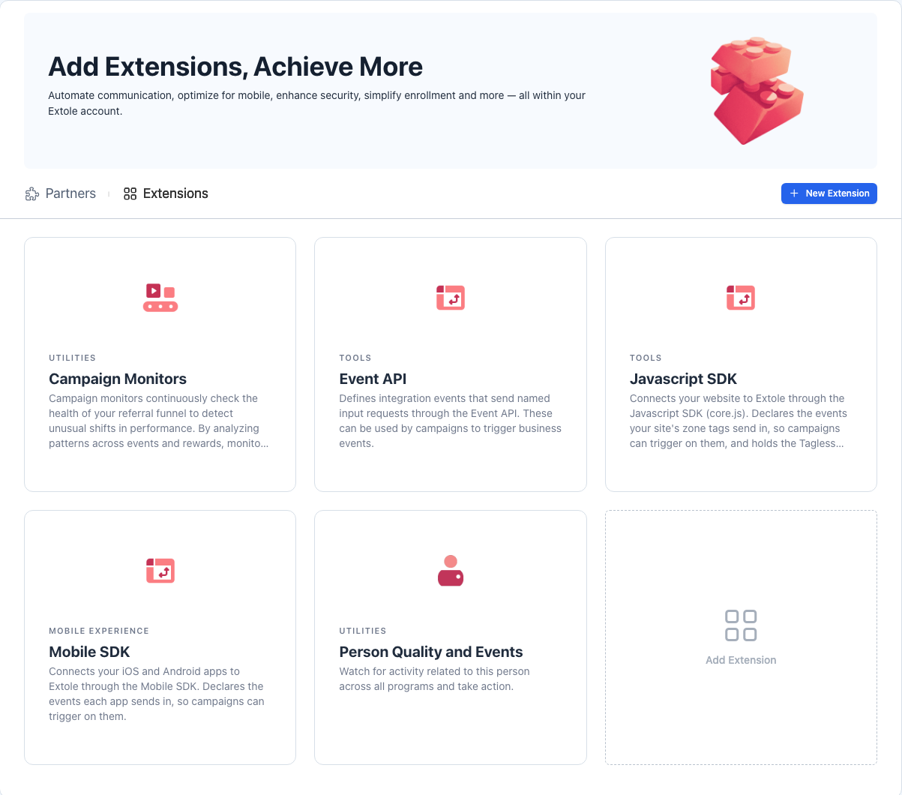
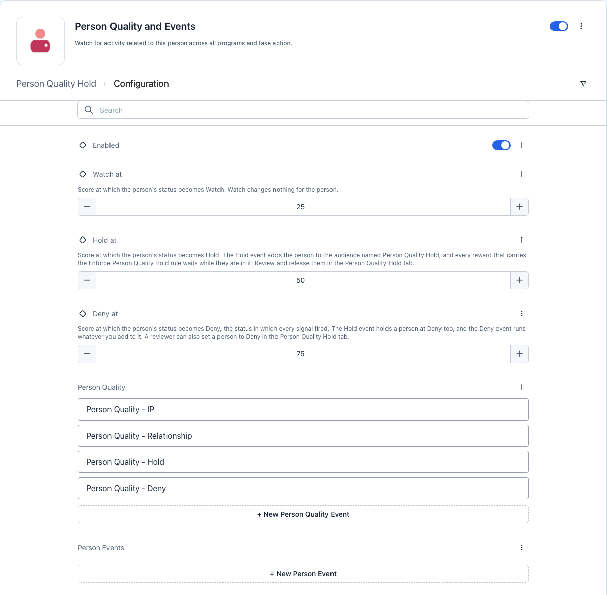
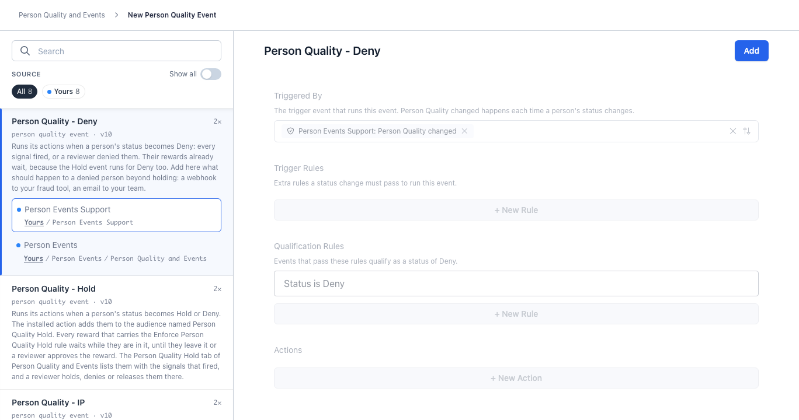
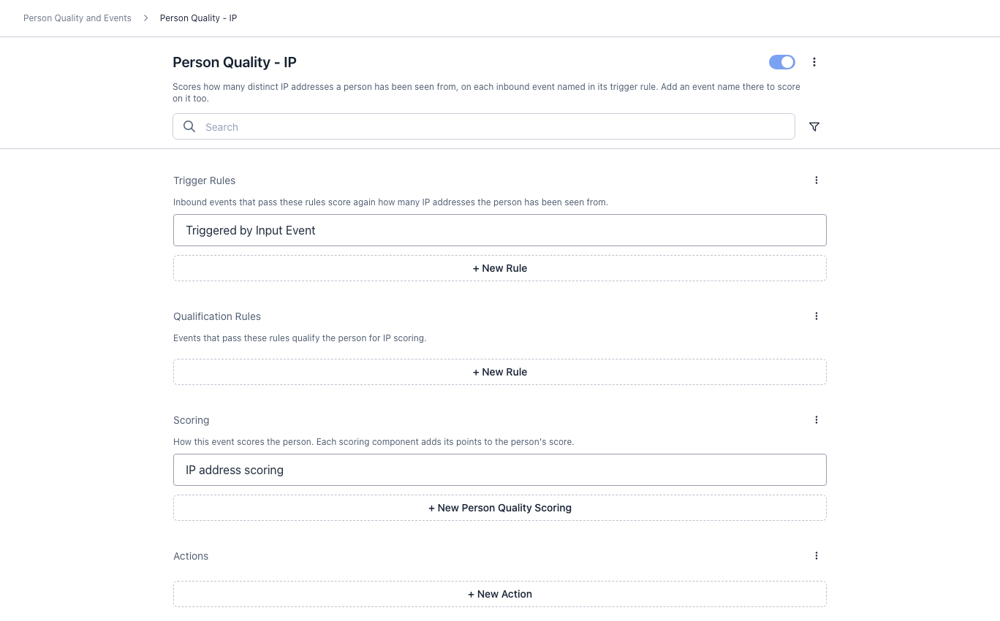
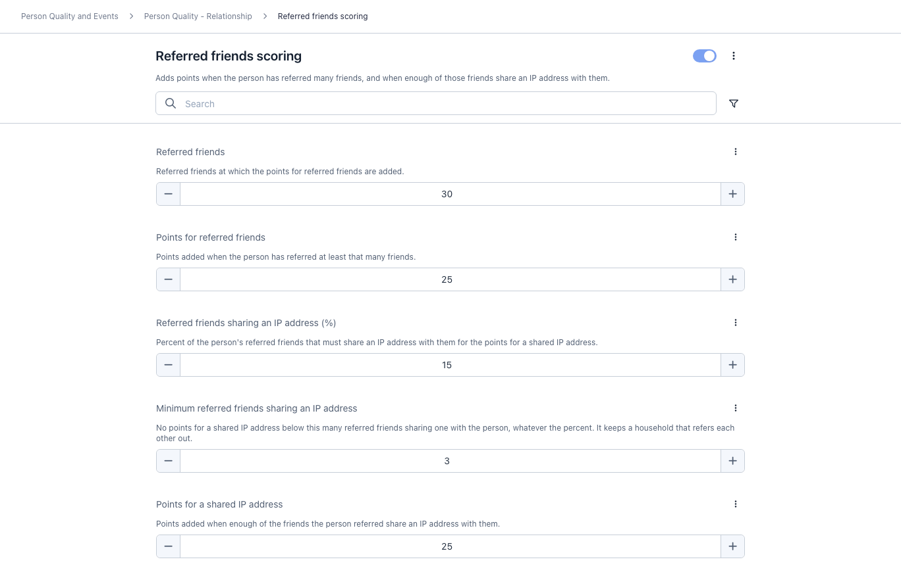
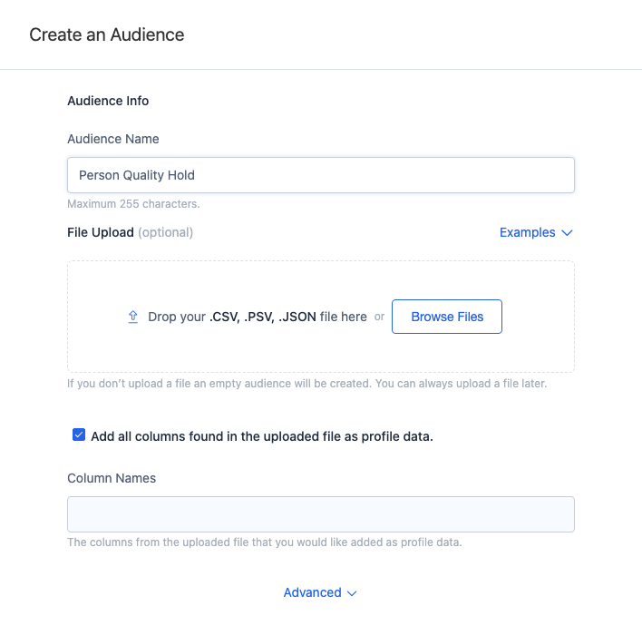
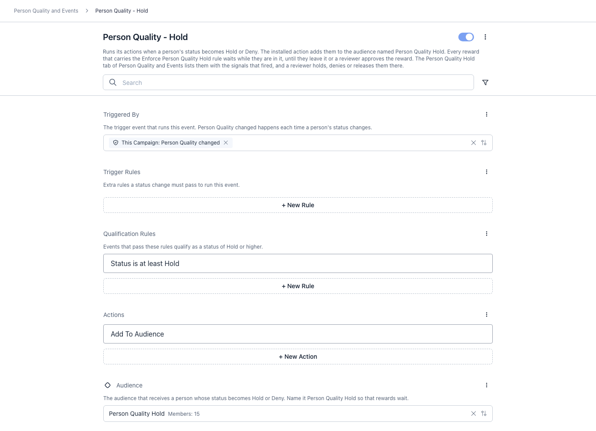
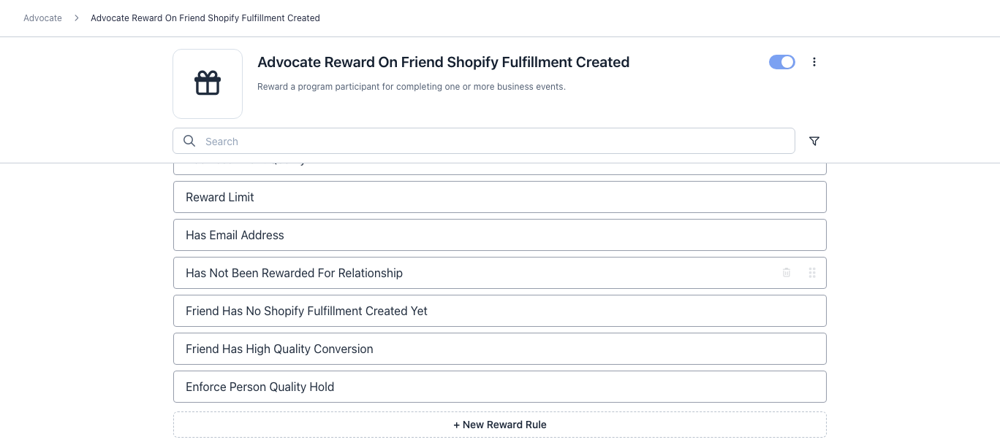
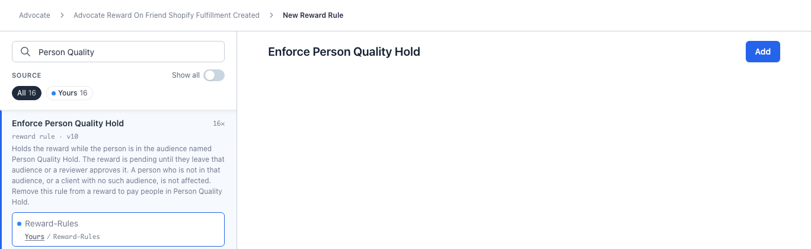

# Overview

Person Quality gives every person in your programs a status of **Clear**, **Watch**, **Hold**, or **Deny**, based on two kinds of activity Extole already records: how many distinct IP addresses the person has been seen from, and the friends they referred. A person whose status reaches Hold or Deny joins an audience named **Person Quality Hold**. While they are in it, every reward that carries the **Enforce Person Quality Hold** reward rule waits as pending, until someone on your team reviews the person and releases them or decides each reward.

Person Quality never blocks anyone, never tells a person they were flagged, and never declines a reward on its own. It finds the people worth a second look and holds their rewards while you look.

This page is for the marketer or program operator who sets Person Quality up. Once it is running, [How to Review People in Person Quality Hold](/guides/rewards-management/rules-configuration/how-to-review-people-in-person-quality-hold) covers the day-to-day review.

## How a Person Gets a Status

Person Quality adds points for each signal a person shows, and compares the total with three thresholds you set:

| Signal | Points by default | When it adds points |
| --- | --- | --- |
| Distinct IP addresses | 25 | The person has been seen from 8 or more distinct IP addresses. |
| Referred friends | 25 | The person has referred 30 or more friends. |
| Referred friends sharing an IP address | 25 | At least 15% of the friends the person referred, and at least three of them, were seen on one of the person's own IP addresses. |

| Status | Default score | What happens to the person |
| --- | --- | --- |
| **Clear** | Below 25 | Nothing. A person who has never been scored counts as Clear. |
| **Watch** | 25 or more (one signal) | Nothing. The status is visible on the person's profile. |
| **Hold** | 50 or more (two signals) | The person joins Person Quality Hold, and their rewards wait. |
| **Deny** | 75 or more (all three signals) | The same as Hold, and anything you add to the Deny event also runs. |

Each signal on its own is common among real customers: people travel, households share a router, and popular advocates refer many friends. Together they describe one person, on many networks, who referred a large group that keeps appearing on those same networks. The minimum of three friends sharing an IP address keeps a couple or a small household from adding points.

# Before You Start

- **Person Quality and Events is on your Extensions list.** Open [Partners](https://my.extole.com/integrations) and select **Extensions**. If you do not see **Person Quality and Events** after clicking **+ New Extension**, contact your Extole team.
- **You have a referral program that earns rewards.** Person Quality scores people in every program on your account.
- **You know who will review the people it holds, and how often.** A person in Person Quality Hold has rewards waiting, so the review is part of the setup. Decide this before you turn the hold on. [How to Review People in Person Quality Hold](/guides/rewards-management/rules-configuration/how-to-review-people-in-person-quality-hold) describes the routine.

# Step 1: Install Person Quality and Events

1. Open [Partners](https://my.extole.com/integrations) and select **Extensions**.
2. Click **+ New Extension**, select **Person Quality and Events**, and click **Install**.
3. Open **Person Quality and Events** from the Extensions tab.

<Frame caption="Person Quality and Events on the Extensions tab, once installed.">
  
</Frame>

The extension opens on its **Person Quality Hold** tab, which lists the people being held. The second tab, **Configuration**, holds its settings.

# Step 2: Set the Thresholds

Select the **Configuration** tab. The top of the configuration has four settings:

| Setting | Default | What it means |
| --- | --- | --- |
| **Enabled** | On | Turns Person Quality and Events on or off. |
| **Watch at** | 25 | The score at which a person's status becomes Watch. Watch changes nothing for the person. |
| **Hold at** | 50 | The score at which a person's status becomes Hold. The person joins Person Quality Hold, and their rewards wait. |
| **Deny at** | 75 | The score at which a person's status becomes Deny, which by default means every signal added points. |

The thresholds must rise from Watch at to Hold at to Deny at, and none of them can be blank or zero. A person's score is shown out of the **Deny at** value, for example 50 of 75.

<Frame caption="The Configuration tab: Enabled and the three thresholds at the top, then the Person Quality and Person Events sections.">
  
</Frame>

<Tip>
Start with the defaults. A threshold that suits one program's audience can flag too many people in another, so review the first people Person Quality holds before you change anything. If many of them turn out to be genuine customers, ask your Extole team to size the thresholds against your own population.
</Tip>

The **Person Events** section further down is for other person events, such as Reward Limit Reached. It is not part of Person Quality.

# Step 3: Add the Four Person Quality Events

Person Quality runs as four events in the **Person Quality** section. Add each one:

1. Under **Person Quality**, click **+ New Person Quality Event**.
2. Select the event in the list on the left, then click **Add**.
3. Repeat for the other three, in this order: **Person Quality - IP**, **Person Quality - Relationship**, **Person Quality - Hold**, **Person Quality - Deny**.

<Frame caption="+ New Person Quality Event offers the four Person Quality events.">
  
</Frame>

| Event | What it does |
| --- | --- |
| **Person Quality - IP** | Scores how many distinct IP addresses the person has been seen from. It runs on the inbound events named in its trigger rule. |
| **Person Quality - Relationship** | Scores the friends a person referred: how many, and how many share an IP address with them. It runs once for each new referral and scores the advocate. |
| **Person Quality - Hold** | Runs when a person's status becomes Hold or Deny, and adds them to an audience. |
| **Person Quality - Deny** | Runs when a person's status becomes Deny. It has no action until you add one. |

The Hold and Deny events arrive already set up. Their **Triggered By** reads **This Campaign: Person Quality changed**, the trigger event Person Quality and Events produces each time a person's status changes. Hold qualifies with the rule **Status is at least Hold** and Deny with **Status is Deny**. For more about trigger events, see [How to Set Up Triggered By](/guides/flow-campaigns/how-to-set-up-triggered-by).

## The Scoring Settings

The points and the signal settings live on two scoring components, one inside each scoring event. Open **Person Quality - IP** and select **IP address scoring** in its **Scoring** section, or open **Person Quality - Relationship** and select **Referred friends scoring**.

<Frame caption="Person Quality - IP: its trigger rule, and IP address scoring in its Scoring section.">
  
</Frame>

**IP address scoring**

| Setting | Default | What it means |
| --- | --- | --- |
| **Distinct IP addresses** | 8 | The number of distinct IP addresses at which the points are added. Extole keeps a person's 10 most recent locations, so a value above 10 never adds points. |
| **Points** | 25 | The points added when the person has been seen from at least that many distinct IP addresses. |

**Referred friends scoring**

| Setting | Default | What it means |
| --- | --- | --- |
| **Referred friends** | 30 | The number of referred friends at which the points for referred friends are added. |
| **Points for referred friends** | 25 | The points added when the person has referred at least that many friends. |
| **Referred friends sharing an IP address (%)** | 15 | The percent of the person's referred friends that must share an IP address with them. |
| **Minimum referred friends sharing an IP address** | 3 | No points for a shared IP address below this many friends, whatever the percent. It keeps a household that refers each other from adding points. |
| **Points for a shared IP address** | 25 | The points added when enough of the person's referred friends share an IP address with them. |

**Referred friends scoring** also has an advanced setting, **Referred friends examined** (default 200): how many of the person's referred friends are checked for a shared IP address each time one of their referrals is scored. The referred friends count always covers every friend.

<Frame caption="Referred friends scoring, with its defaults.">
  
</Frame>

A changed IP setting applies the next time that person's IP addresses are scored. A changed referred friends setting applies on the advocate's next referral. Each signal keeps the points it earned until it is scored again.

## The Events That Score a Person

**Person Quality - IP** scores a person again on each event named in its trigger rule. Open **Triggered by Input Event** under its **Trigger Rules** to see the list in **Trigger Event Names**. By default it holds `signed_up`, `share_destination`, `page_view`, `converted`, and `person_quality_review`.

- Add the names of the events your own program sends for a person, such as a purchase event, so those people are scored too.
- Keep `person_quality_review`. Sending it for one person, for example from [Create Event](/guides/rewards-management/reward-fulfillment/how-to-manually-create-a-referral-or-other-event), scores that person again right away.
- If your site sends a high volume of `page_view` events, you can remove `page_view` and score on sign-ups, shares, and conversions only.

**Person Quality - Relationship** scores the advocate each time a new friend is referred. It has no list to edit.

# Step 4: Create the Person Quality Hold Audience

The Hold event needs an audience to add people to, and the reward rule finds that audience by its name.

1. Open [Audiences](https://my.extole.com/audiences-overview/my-audiences) and click **Create Audience**.
2. For **Audience Name**, enter `Person Quality Hold`. Do not upload a file.
3. Click **Create Empty Audience**.

<Frame caption="Create an Audience, with the name the reward rule looks for.">
  
</Frame>

Then point the Hold event at it:

1. Open **Partners** > **Extensions** > **Person Quality and Events** > **Configuration**, and open **Person Quality - Hold**.
2. For **Audience**, select **Person Quality Hold**.
3. Click **Apply**, then click **Apply Changes** at the top of the extension to publish it.

<Frame caption="Person Quality - Hold, triggered by Person Quality changed, adding the person to Person Quality Hold.">
  
</Frame>

<Warning>
The name is what turns the hold on. The Enforce Person Quality Hold rule holds a reward only when the person is in an audience named exactly **Person Quality Hold** (capital letters and spaces around the name do not matter). Do not use that name for any other audience, and do not give the hold audience any other name.
</Warning>

Leave **Person Quality - Deny** without an audience. The Hold event runs for Deny too, so a person whose status becomes Deny is already in Person Quality Hold and their rewards already wait. The Deny event is the place for anything extra a denied person should get, such as an email to your team or a webhook to your fraud tool: open it and click **+ New Action**.

A person stays in Person Quality Hold until someone on your team releases them, even if their score later drops. A score that drops is not a review.

# Step 5: Hold Rewards for People in Person Quality Hold

**Enforce Person Quality Hold** is a reward rule with no settings. While the person being rewarded is in Person Quality Hold, the reward is pending: on their profile it shows **Evaluating**. It is paid when they leave the audience, or when someone approves it on the person's profile. It can also be declined there. A person who is not in the audience, or an account with no audience of that name, is not affected.

New programs include the rule on every reward. A program created before Person Quality and Events was available to your account does not, so check each reward:

1. Go to **Programs**, find the campaign, and open its Flow Builder.
2. Select each reward, for example the advocate reward, and look under **Reward Rules**.
3. If **Enforce Person Quality Hold** is not listed, click **+ New Reward Rule**, search for `Person Quality`, select **Enforce Person Quality Hold**, and click **Add**.
4. Publish the campaign.

<Frame caption="The advocate reward's Reward Rules, with Enforce Person Quality Hold listed.">
  
</Frame>

<Frame caption="+ New Reward Rule, searched for Person Quality.">
  
</Frame>

Do this for every reward that should wait, including friend rewards. The rule checks the person who receives that reward: a friend reward is held only when the friend is in Person Quality Hold, not when their advocate is. For more about reward rules, see [How to Set Up Reward Rules](/guides/flow-campaigns/how-to-set-up-reward-rules).

<Tip>
A reward is checked when it is earned. When the event that earns a reward is also the event that puts the person into Hold, the reward can be checked a few seconds before the person joins Person Quality Hold, and it is paid. A **Pending Period** reward rule of ten minutes or more on the same reward closes that gap: when the period ends, the hold is checked again, and a person who joined the audience during the period is held.
</Tip>

# Step 6: Check That It Works

Use a test person of your own, never a customer:

1. Open the **Person Quality Hold** tab of Person Quality and Events.
2. Under **Add a person to Person Quality Hold**, enter the test person's email, a **Reason** such as "Setup test", leave **Decision** on **Hold**, and click **Add person**. The person appears in the list as **Reviewer hold**.
3. Have the test person earn a reward in a program whose reward carries Enforce Person Quality Hold.
4. Open the test person's profile from **User Support** > **Person Search**. The reward shows **Evaluating** instead of being paid, with **Approve**, **Decline**, and **Re-evaluate** beside it.
5. On the **Person Quality Hold** tab, click **Release** on the test person's row, then click **Release** again to confirm. Within about a minute the pending reward is evaluated again and paid, as long as its other reward rules pass.

If the reward was paid in step 4, check that the reward lists Enforce Person Quality Hold under **Reward Rules** and that the audience is named exactly Person Quality Hold.

# Optional: Act on a Status in Your Own Rules

The rule **Person Quality status** can be added to a step's trigger, qualification, or quality rules in any program. It has two settings, **Comparison** and **Status**, and the statuses rise from Clear through Watch and Hold to Deny. For example, a quality rule of **Person Quality status** with Comparison **is below** and Status **Hold** passes only for people whose status is Clear or Watch. A person who has never been scored counts as Clear.

# Turning It Off

- **To stop scoring people,** turn off **Enabled** on the Configuration tab and click **Apply Changes**. People already in Person Quality Hold stay in it, and their rewards keep waiting until you release them.
- **To pay people in Person Quality Hold for one reward,** remove **Enforce Person Quality Hold** from that reward's **Reward Rules** and publish the campaign. A reward that was already waiting when you removed the rule keeps waiting. Find each one on the person's profile and click **Re-evaluate**, or **Approve**.
- **To release one person,** use **Release** on the Person Quality Hold tab. See [How to Review People in Person Quality Hold](/guides/rewards-management/rules-configuration/how-to-review-people-in-person-quality-hold).

# Related Pages

- [How to Review People in Person Quality Hold](/guides/rewards-management/rules-configuration/how-to-review-people-in-person-quality-hold)
- [Fraud and Anti-gaming Protection](/guides/rewards-management/rules-configuration/fraud-and-anti-gaming-protection)
- [How to Set Up Reward Rules](/guides/flow-campaigns/how-to-set-up-reward-rules)
- [How to Set Up Triggered By](/guides/flow-campaigns/how-to-set-up-triggered-by)
