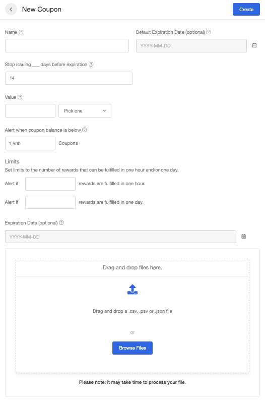
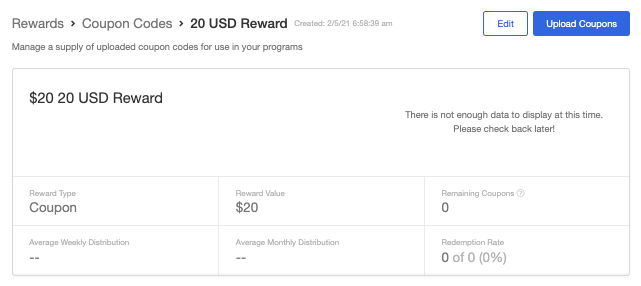
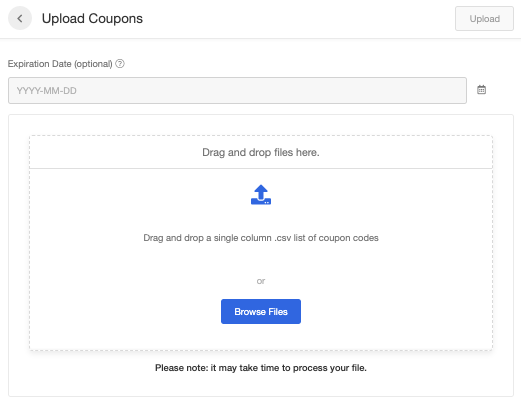

# Overview

Coupon rewards are a great way to reward your customers while encouraging them to continue shopping, sharing, and loving your products or services. Extole supports the ability to load lists of one-time use coupon codes into the system that can be delivered to your advocates and their friends.

The main coupon page within the [Rewards](https://www.my.extole.com/account-rewards) of your Extole account shows a list of all of the coupon sets that are currently loaded into the system, as well as how many coupons remain. Make sure to always keep your coupon sets properly loaded with a sufficient number of coupon codes.

# Create a Coupon Set

To create a coupon set for your program:

1. Navigate to **Rewards** > **+ New Reward** or to an existing **Coupon Code**.
2. Hit **Coupon** to add your first coupon set or add an additional coupon set to your list.
3. Enter a descriptive name for your coupons and set **Value** and **Currency**. For a coupon that redeems for a free item, see [Set the Value for a Gift with Purchase](#set-the-value-for-a-gift-with-purchase).
4. Set the "Alert when coupon balance is low" threshold that controls when we trigger an email notification warning you that your coupon codes are low.
5. Set Limits that will trigger email notifications when too many rewards are fulfilled in an hour or a day.
6. Upload a single-column CSV file that contains a list of coupons. Coupon codes can be up to 255 characters long. If the upload fails because a code contains characters outside letters, numbers, dashes and underscores, see [Coupon Upload Rejects Codes](/technical/troubleshooting/coupon-upload-rejects-codes).
7. Hit the **Create** button when you are finished.

## Set the Value for a Gift with Purchase

**Value** and **Currency** describe the reward. Extole copies them onto every reward issued from the coupon set as its face value. The face value appears in the [Rewards Report](/guides/dashboards-and-reporting/report-types/recommended-reports/rewards-reporting), in [reward webhooks](/technical/platform-integrations/webhooks/reward-webhooks), and in reward displays that participants see. Extole does not apply the coupon at checkout. Your commerce system decides what each code redeems for.

**Currency** offers currency codes, **Percent Off**, **Points**, and **Month**. It has no option for a free item. For a coupon that redeems for a gift with purchase:

1. Set **Currency** to your store's currency.
2. Set **Value** to the amount you want reports and participants to see for the gift, such as its retail price. **Value** must be greater than zero.

Extole does not calculate tax on rewards. Whether **Value** includes tax is your choice. Match how your business values rewards elsewhere, and use the same choice for every coupon set.

# Add Coupons to Campaigns

Once you have uploaded your coupon set, you can configure your campaigns to reward your advocates and/or friends with coupon codes. Go into the campaign you want to assign the coupons to and click the Rules tab. Here you can assign the codes to a specific event.

# Reload Coupons

Over time, the coupon codes in your coupon sets will deplete, and you may eventually need to add more coupon codes. To reload an existing coupon set with new codes:

1. Open the coupon set you want to edit and click the **Upload Coupons** button on the top right.
2. Upload a sing-column CSV file that contains a list of additional coupons. Coupon codes can be up to 255 characters long.
3. Hit **Upload** when you are finished.

# Notifications

Make sure you are subscribed to Reward notifications in order to get alerts when you are running low on coupons. Go to your [Notifications](https://my.extole.com/notifications) make sure you are subscribed to Business Operations notifications at the level of Noteworthy.

# Frequently Asked Questions

## How quickly does an advocate receive a coupon after a friend’s conversion?

Rewards are provided within minutes of conversion approval. If your conversion events are auto-approved, this could be instantly. If you wait for a 30-day return period to pass before approving events, it may take up to 30 days after the event.

## How are coupons typically issued to friends?

Friend coupons are typically issued on the Friend Landing Experience. They are typically displayed on the Friend Landing Experience and earned either after clicking on an advocate’s share link or after providing an email address on the Friend Landing Experience.

## My company uses gift codes with PINs. Can I use this as the coupon code?

Extole displays whatever line information is in the coupon file. It's possible for lines in the coupon file to look like the following:

- 8229 4016 8209 1717 608 PIN: 4178
- 6202 8816 8018 5883 699 PIN: 2985

Extole will deliver strings like these in the reward email or friend landing page.

## How long can my coupon codes be?

Coupon codes can be up to 255 characters long.
