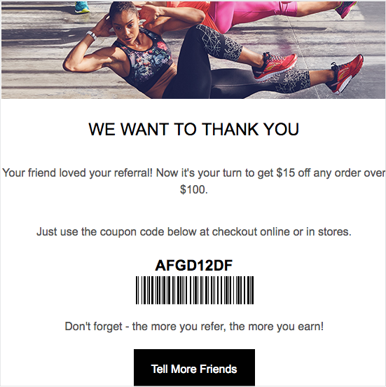
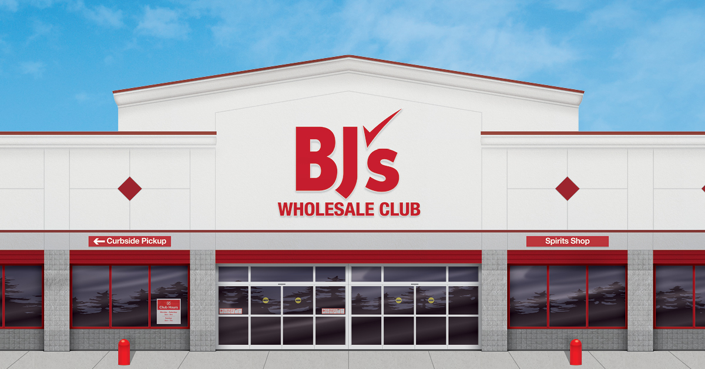

Your customers don't think in channels. They hear about you from a friend, browse on their phone, and buy wherever is easiest, online one day and in your store the next. Extole's Site-to-Store programs make your referral program work the same way. A friend can accept a referral online and redeem it in store, and an advocate can earn a reward for a purchase made in either place and spend it in either place.

The result is a seamless experience for online and offline customers. It also gives people a reason to walk through your doors. Shoppers who visit a store tend to spend more per order than they do online, and every visit is a chance to sell them something they didn't come in for.

## How It Works

1. **The advocate shares.** A customer shares their referral link from your website, an email, or your app.
2. **The friend claims the offer online.** The friend follows the link to your site and gets an offer, such as a coupon code or a loyalty sign-up reward.
3. **The friend buys online or in store.** Extole records online purchases from your site. In-store purchases reach Extole from your point-of-sale system.
4. **The advocate is rewarded.** The advocate gets a reward they can use on your site or at the register.

How much of step 3 Extole can see in your stores depends on two things you already have: your coupon codes and how your stores identify a shopper.

## Before You Start: What You Need

### Your Coupon Codes

| Coupon option | What it means |
| --- | --- |
| **One single-use code for online and in store** | Each friend gets one unique code that your website and your registers both accept. |
| **Separate single-use codes online and in store** | Your website and your registers use different code systems. Extole can give each friend a code for each. |
| **Multi-use code in store** | Your registers accept one shared code, such as a printed barcode, rather than a unique code per shopper. |

Every program below works with any of these. Single-use codes are what let Extole tie an in-store purchase back to the friend who used one.

### Your In-Store Purchase Tracking

This decides whether Extole can reward the advocate for a purchase made in your store.

- **Loyalty program with member IDs.** The friend joins your loyalty program online and gives their member ID at the register. Your point-of-sale system sends the purchase with that ID, and Extole matches it to the friend. This is the most reliable option.
- **Email address or single-use coupon code captured at the register.** The cashier records the friend's email address, or the friend redeems the unique code Extole gave them. Either one points to exactly one friend, so Extole can match the purchase.
- **Phone number.** The friend gives their phone number when they claim the offer online and again at the register. Your point-of-sale system sends it with the purchase, and Extole matches it to the friend. This works when your stores already look shoppers up by phone number.
- **First name and last name.** Many shoppers share a name, so a name on its own can't tell Extole which friend made the purchase. Send names along with one of the identifiers above, where they make the record easier to read. Don't rely on them for matching.
- **No method to uniquely track an in-store purchase.** Your stores don't capture who made the purchase. Extole can still send friends and advocates offers they can use in store. It can't see those purchases or reward an advocate for them.

## Choose Your Program

| If your stores can track... | Choose | What Extole rewards |
| --- | --- | --- |
| Nothing unique about the shopper | **Retail Online** or **Retail Loyalty** | Online purchases. Rewards can be spent in store. |
| A loyalty member ID, email address, single-use code, or phone number | **Retail Loyalty and Purchase** | Online and in-store purchases |

### Retail Online

**Best for:** Brands whose stores can't identify a shopper, and who want referrals to drive online sales.

**What you need:** Any coupon option. No in-store tracking.

**How it works:**

1. The advocate shares their referral link.
2. The friend follows the link and gets a unique coupon code for an online purchase.
3. The friend buys online. Extole's tags on your site record the purchase.
4. The advocate gets a reward they can use online or in store.

The friend's experience stays online, and the advocate's reward brings them into your store.

### Retail Loyalty

**Best for:** Brands whose main goal is growing their loyalty program, and whose stores can't identify a shopper.

**What you need:** Any coupon option. No in-store tracking.

**How it works:**

1. The advocate shares their referral link and invites the friend to join your loyalty program.
2. The friend signs up online and gets a coupon for their first purchase, online or in store.
3. The advocate gets a coupon for their next purchase, online or in store.
4. When the friend buys online, Extole's tags record it so you can measure the program. In-store purchases aren't tracked.

### Retail Loyalty and Purchase

**Best for:** Brands that want to reward every referred purchase, wherever it happens.

**What you need:** A single-use coupon option, and one of these at the register: a loyalty member ID, an email address, a single-use coupon code, or a phone number.

**How it works:**

1. The advocate shares their referral link and invites the friend to join your loyalty program.
2. The friend signs up online and gets a coupon for their first purchase, online or in store.
3. The friend buys:
   - **Online.** Extole's tags on your site record the purchase.
   - **In store.** Your point-of-sale system sends the purchase to Extole with the friend's identifier.
4. Extole rewards the advocate for either purchase, with a reward they can use online or in store.

If your website and registers use different single-use codes, that works too.

## What It Takes to Set Up

- **Online purchases:** Extole's tags on your site. See [Track Conversions](/technical/solutions/extole-solution-guides/retail#track-conversions).
- **In-store purchases** (Retail Loyalty and Purchase only): your point-of-sale system or a nightly export sends each purchase to Extole by API or file upload. A web developer typically needs about a week to build and test this. See [Manage Site to Store](/technical/solutions/extole-solution-guides/retail#manage-site-to-store).
- **Matching shoppers:** Extole matches an in-store purchase to the friend by the identifier you send. See [How Extole Matches an Event to a Profile](/technical/integration-overview/how-extole-matches-an-event-to-a-profile).

Extole removes duplicates by order ID, so a purchase sent by both your site and your point-of-sale system is counted once.

## Customer Example: BJ's Wholesale Club

BJ's Wholesale Club runs its referral program across bjs.com and its clubs. Members invite friends to join BJ's, and a referred friend gets a one-year Club Card membership for \$10. When the friend enrolls, the member gets a \$10 reward added to their membership account, so they save on their next shopping trip.

