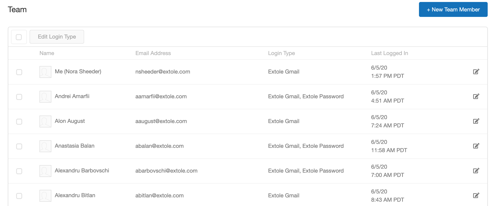
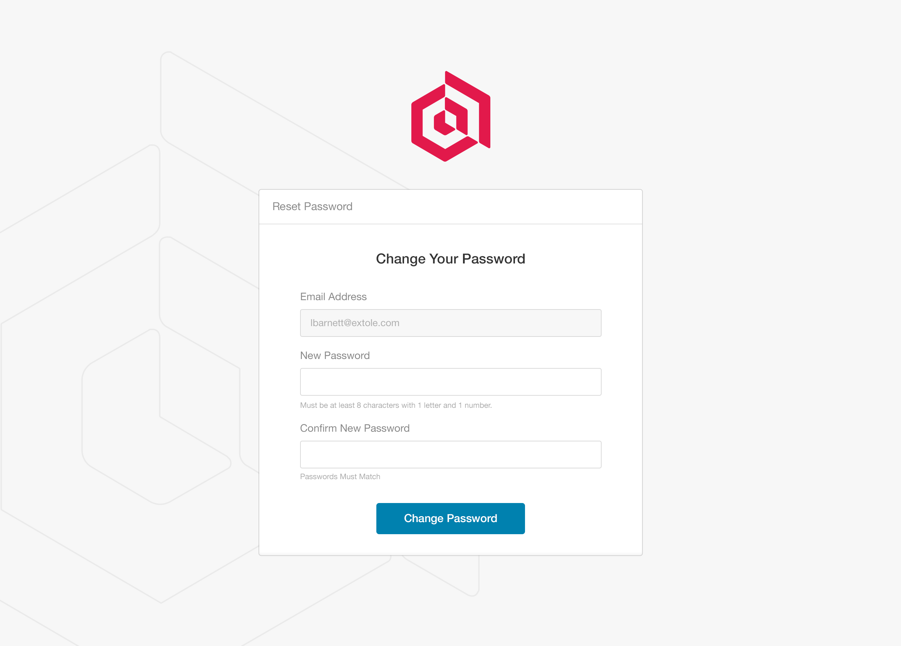

# Overview

This article provides you with all of the information necessary to invite coworkers to your My Extole account. In addition, you can also learn how to add users, delete users, edit users, reset passwords, and so on.

# Managing Users

In order to manage the people who have access to your My Extole account, navigate to your [Settings page](https://my.extole.com/settings). Your settings include a Team section. Here you will see your own account and any other accounts associated with your Extole program.

 

## Edit User

Clicking the edit button on the far right of any given user will allow you to edit that user.

## Add User

The **+ New Team Member** button at the top right adds a new member and sends them an invite email asking them to set up their account.

My Extole has no option to resend the invite email. If a new member can't find their invitation, or its link has expired, send them a password reset email instead, as described in [Reset Password](#reset-password). The link in that email takes them to a page where they set their password, and then they can sign in.

## Delete User

If you would like to delete a user, click on the edit icon to the far right of their name. At the top of the page, you will see a Delete User button.

## Reset Password

The reset password functionality will trigger an email to the user who is requesting their password to be reset. That user clicks on the link to reset the password which will bring them to a page where they can set a new one.

 

To send a user a password reset email:

1. In the **Team** section of [Settings](https://my.extole.com/settings), click the edit icon to the far right of the user's name.
2. In the **Password** section, click **Send Reset Password Email**. The button changes to **Email Sent**.

The link in the email is valid for 20 hours. If it expires, send a new one.

Use the same steps for a team member who was invited but hasn't set up their account yet. The password reset email lets them set their password in place of the invitation.

The password reset email applies to users who sign in with an email address and password. A user who signs in only with single sign-on (SSO) has no Extole password, so no email is sent to them. They sign in through your SSO provider.

## Unlock Account

The unlock button will allow you to unlock someones account. Accounts can get locked if a user forgets their password and enters the incorrect one too many times. You can unlock their account by clicking the unlock button next to the password reset button.
