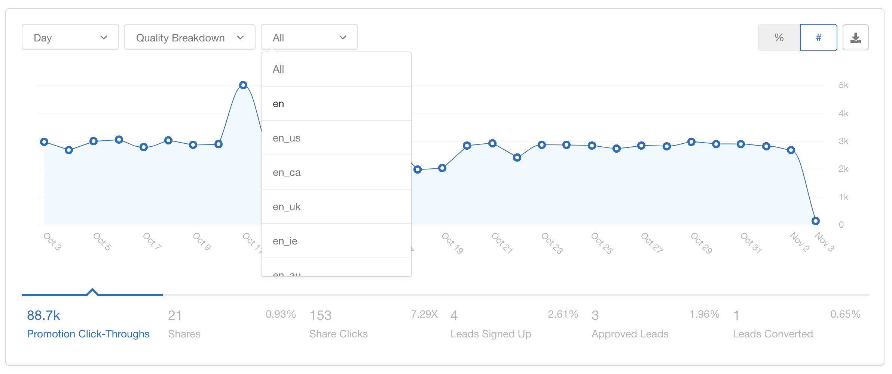

# Key Features

## Internationalize Any Program

Any Extole program can be run internationally. Whether you're interested in expanding your Refer A Friend, Influencer, Sweepstakes, or [Offer](/product/product-overview/programs/offer/index) program (also called Reward for Action) to new markets, we can make it happen with all your countries or locales managed within one program.

## Create Multi-language Experiences

Our language localization services bridge the gap between your brand and diverse audiences worldwide. Allow your customers to advocate on your behalf seamlessly across languages, fostering meaningful connections.

[Adding Languages to International Programs >](/guides/programs-and-campaigns/international-programs/adding-languages-to-international-programs)

## International Reward Options

Reward advocates and friends with something they can use where they live. Each region in your program can have its own reward, and reward rules issue the right one based on the participant's country or locale. You can mix reward types across regions, so one program can give a discount code in one market and a gift card in another.

- **International gift cards**: Choose from US or international gift cards through [Tango](/guides/rewards-management/setting-up-your-rewards/how-to-reward-with-tango-gift-cards), denominated in the recipient's local currency. Through [Tremendous](/technical/partners/rewards-and-payments/tremendous), you can offer an international Visa gift card, PayPal in over 100 countries, and rewards sent in a specific currency such as EUR or GBP.
- **Discount codes by country or locale**: Load a separate [coupon set](/guides/rewards-management/setting-up-your-rewards/how-to-reward-with-coupons) for each region, each with its own value, so a friend in the UK receives a code that works on your UK site and a friend in Germany receives one that works on your German site.
- **Account credits in local currency**: Issue [account credits](/guides/rewards-management/setting-up-your-rewards/how-to-reward-with-account-credits) in USD or in another supported currency.

To see every reward type Extole supports, go to [Rewards Overview](/product/product-overview/rewards/rewards-overview). For how to structure regions, languages, and rewards in one program or several, see [Configuring an International Program](/guides/programs-and-campaigns/international-programs/configuring-an-international-program).

## Analyze Dashboard Insights by Country/Locale

Our program dashboards comprehensively summarize your program's performance in different markets. You can track engagement, conversions, and customer behavior with precision, allowing you to fine-tune strategies and optimize results as you expand to new territories.

[Reports Based on Locale and Country >](/guides/dashboards-and-reporting/report-types/audience-reports/reports-based-on-locale-and-country)
