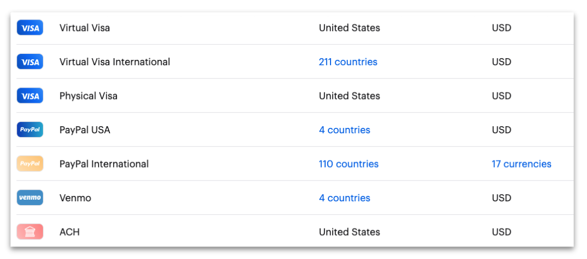
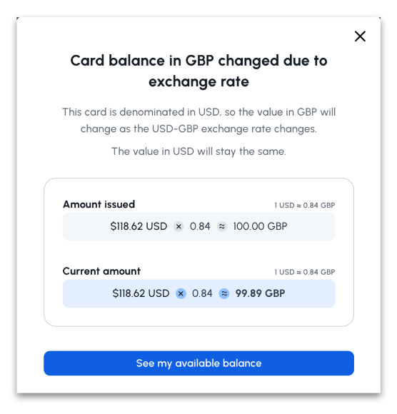
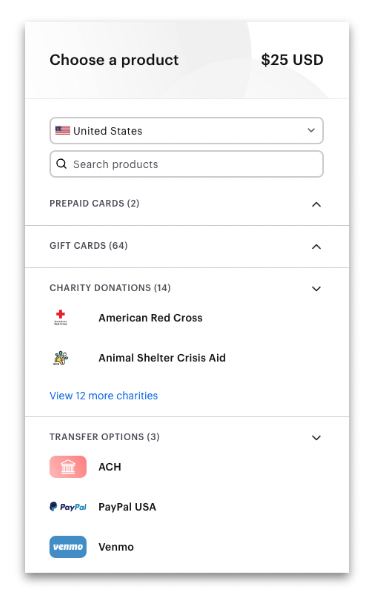
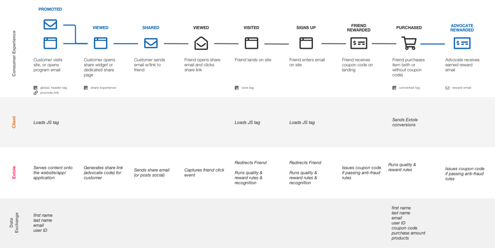
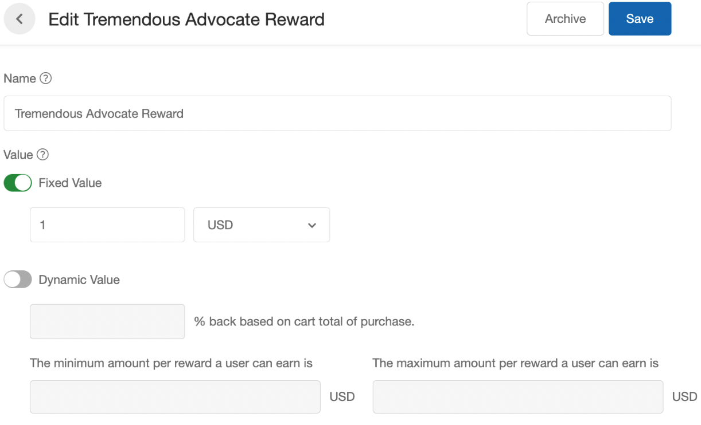
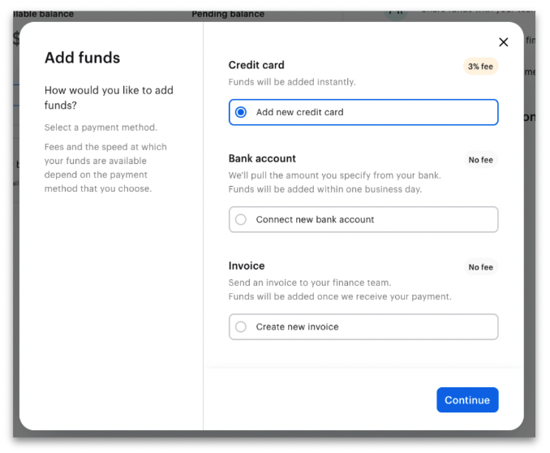

## Overview

[Tremendous](https://www.tremendous.com/about/) is a rewards platform designed around choice. By integrating Extole with Tremendous, you can give your program participants a choice of money, prepaid cards, international gift cards, and charity donations. Tremendous automatically takes care of any currency conversions, money movement, and cross-border regulations that might apply to your business case, while Extole handles rewarding the right people for their engagement with your brand. Each time a customer earns a reward through your program, Extole will communicate directly with Tremendous via webhook to trigger the reward dispensing process.

## Prerequisites

| Requirement    | Description                                                                                                                                         |
| :------------- | :-------------------------------------------------------------------------------------------------------------------------------------------------- |
| Extole Account | An Extole account is required in order to take advantage of this integration. All other aspects of the integration are handled by your Extole team. |

## Use Cases

<Frame caption="Tremendous rewards">
  
</Frame>

**International Rewards**\
Reward global participation in your Extole programs with the Tremendous international Visa gift card. The value is awarded in USD but transferred to local currency upon redemption. Tremendous handles all conversions based on real-time exchange rates and displays balances in the local currency within their portal.

**Cash Rewards**\
Offer rewards through PayPal, Venmo, and ACH transfer. While PayPal offers a fast and familiar way to get money in over 100 countries in several currencies, Venmo provides a more popular option for Millennial and Gen Z advocates and friends. Meanwhile, ACH (Automated Clearing House) transfers to any US bank or credit union. All cash options charge a small processing fee.

**Multichoice Rewards**\
Provide your program participants with the option to choose any Tremendous reward type available in their region. Search their [full catalog](https://www.tremendous.com/catalog/).

## User Flow

Extole’s integration with Tremendous is designed to give your customers a smooth and fulfilling reward experience. To get a better sense of how your customers will get rewarded through a standard Refer A Friend program, let’s take a look at a standard user flow.

<Frame caption="Example user flow for a standard Refer A Friend program">
  
</Frame>

The referral experience begins when a customer opens an email promoting your referral program or sees a promotion on your website or mobile app encouraging them to refer your product, service, or expert to a friend. When they tap on a CTA, advocates will be taken to a share experience hosted by Extole, where a share link is generated and they can choose the channel through which they'd like to share.

Friends then receive an email or SMS message with the advocate's share link, or they may see the share message on social media. When the referred friend clicks on a share link, they will be directed to your website or app and encouraged to complete the desired action (e.g., convert, register, etc.). 

Once referred friends have converted or otherwise achieved their outcome, Extole will run quality and reward rules to ensure both the friend and the advocate who referred them are eligible for the reward. We will then send a webhook to Tremendous and receive the necessary information for sending the reward to customers via Extole's Earned Reward email. You can fully customize the Earned Reward email within the Campaign Editor of your My Extole account.

Remember that Extole programs are completely customizable and your team at Extole is dedicated to helping you find the best solution for your goals.

## Integration

### Initiate the Connection with Extole Team

Your Extole team installs and configures the Tremendous integration for you. To start, talk to your Extole team about which Tremendous rewarding solution is right for your program, and whether you'll use an Extole-managed Tremendous account or your own.

### Integration Settings

The integration lives on the [Partners](https://my.extole.com/integrations) page in My Extole. Each Tremendous integration carries these settings:

| Setting | What it controls |
| :------ | :--------------- |
| **API URL** | The Tremendous environment that Extole places orders with and reads balances from. When this is empty, Extole uses Tremendous's testflight (sandbox) environment. |
| **API Authentication Certificate** | The Tremendous access token Extole uses to authenticate. |
| **Funding Source Id** | The Tremendous funding source that pays for each order. |
| **Delivery Method** | How Tremendous delivers the reward: `LINK`, `EMAIL`, or `PHONE`. The default is `LINK`, which returns a redemption link that Extole sends in the Earned Reward email. |
| **Product Ids** | The Tremendous products a recipient can choose from when they redeem. Used when **Use Template ID** is off. |
| **Use Template ID** | When on, Extole orders with a Tremendous campaign instead of a product list. |
| **Campaign Template ID** | The Tremendous campaign to order with when **Use Template ID** is on. A reward can set its own value — see [Rewards and Tremendous Campaigns](#rewards-and-tremendous-campaigns). |
| **Low Balance Threshold** | The balance, in whole currency units, below which Extole sends a low balance alert. For example, `500` alerts when the balance drops below 500. |
| **Reward Suppliers** | The Tremendous rewards that this integration fulfills. |

### Configure the Reward in Extole

In Extole, your marketing team creates Tremendous rewards and sets their values in the [Rewards](https://my.extole.com/account-rewards) center, then connects each reward to a campaign. When Extole detects that a rewardable action has been completed and is high-quality (not fraudulent), the reward is earned and Extole places the order with Tremendous.

<Frame caption="Example Tremendous reward configured in Extole">
  
</Frame>

### Rewards and Tremendous Campaigns

Each Tremendous reward has its own **Campaign Template ID**. When the integration's **Use Template ID** is on, Extole orders a reward with the reward's own **Campaign Template ID**, and with the integration's value when the reward leaves it empty. This lets the advocate reward and the friend reward use distinct Tremendous campaigns — for example, a different set of products or a different email design — from one integration.

### Provide Funds in Tremendous

You and your Extole team have joint access to the Tremendous portal. There you can upload funds directly to keep a healthy balance for your program rewards, and check your current balance.

## How Extole Fulfills a Tremendous Reward

When a Tremendous reward is earned, Extole places one Tremendous order for it:

- **Recipient**: the person's first name and email address. When the profile has no first name, the order uses "Valued Customer".
- **Value**: the reward's face value, in the reward's currency. The currency is USD unless the reward sets another.
- **Payment**: the integration's **Funding Source Id**.
- **Order ID**: the Extole reward ID. Tremendous accepts one order per ID, so each reward is ordered once.

What happens next depends on Tremendous's answer:

- **The order is complete.** Extole marks the reward fulfilled and stores the redemption link, which the Earned Reward email sends to the recipient.
- **The order is accepted but still processing.** Extole sends the order again on its retry schedule, Tremendous answers with the same order, and Extole fulfills the reward once that answer carries the redemption link.
- **Tremendous rejects the order as invalid**, for example because a product or campaign ID is wrong. Extole marks the reward failed without retrying. Ask your Extole team to correct the setting.
- **The funding source doesn't have enough money**, or Tremendous returns another error. Extole retries the order automatically: first within minutes, then at intervals that grow to days and weeks. When you add funds, the next retry completes the order. If every retry fails, Extole marks the reward failed.

### Using More Than One Tremendous Integration

An account can have more than one Tremendous integration, for example to pay for rewards from distinct funding sources or distinct Tremendous accounts. Each integration places orders only for the rewards listed in its own **Reward Suppliers**, so one earned reward produces one order, from the integration it belongs to.

## Balance Alerts

Extole sends two My Extole notifications about your Tremendous balance. Both are in the Business Operations category, so subscribe to that category on the [Settings](https://my.extole.com/settings) page to receive them — see [Subscribing to My Extole Notifications](/guides/notifications-and-troubleshooting/platform-and-admin/subscribing-to-my-extole-notifications).

| Notification | When Extole sends it | Level |
| :----------- | :------------------- | :---- |
| `tremendous_low_balance_alert` | After a Tremendous reward is fulfilled, Extole checks the funding source balance. It sends this alert when the balance is below the integration's **Low Balance Threshold**. When the threshold is empty, Extole sends no low balance alert. | Warning — delivered at the **Some** and **All** levels |
| `tremendous_no_funds_available` | Tremendous refused an order because the funding source doesn't have enough money. The alert names the reward and the reward supplier. | Error — delivered at the **Noteworthy**, **Some**, and **All** levels |

When you receive `tremendous_no_funds_available`, add funds in the Tremendous portal. The orders waiting on funds complete on their next automatic retry.

## Using this Integration

Once the integration is set up, you can see rewards flow from Extole to Tremendous in real time in your My Extole account. In the Tremendous portal you can manage your funds and run reports to monitor funding balances and rewards issued over time.

## FAQs

### Can Tremendous reward in currencies beyond USD?

All transactions made through Tremendous are in USD, and all rewards are technically issued in USD. In a few cases, rewards are available in non-USD currencies. For example, PayPal allows recipients to redeem their rewards in their regional currency in certain countries. That said, PayPal can still be redeemed in any region where it's offered in the Tremendous catalog; the funds are just received in the recipient's account in the USD-converted amount.

Tremendous uses automatic conversion by default if a recipient receives a USD reward in a foreign country. Meaning, when a recipient redeems their reward, the amount they'll receive will be the equivalent amount of the USD reward in their regional currency. For example, if you sent someone in Canada a \$20 USD reward, they would receive \$26.99 CAD based on the current conversion rate. Should the recipient complete the steps to redeem a merchant gift card, the amount will not change after they receive the gift card code, and they'll have a \$26.99 CAD card.

### How does Tremendous handle exchange rates?

The continued variance based on the exchange rate after redemption is only possible with the Virtual Visa International prepaid option. As the recipient holds onto the card, the USD amount will remain the same, but the converted amount in their regional currency may fluctuate based on the conversion rates over time (both USD and the regional currency are listed on their card page).

### What if I want to reward in a non-USD amount?

If you're looking to send specific amounts in another currency (for example, €100 EUR instead of $100 USD), you can do this by using Currency Codes within Tremendous. The currency of the reward is set by you as the sender when placing an order. If no currency code is specified during the order, the reward will be sent in the default USD amount and converted to the equivalent in the recipient's currency when they receive it. But if a currency code is used, this will allow you to send the specific non-USD amount and the price of the reward will be the USD equivalent of that conversion.

<Info>
**Learn More**

[Check out the Tremendous Help Center for more information](https://help.tremendous.com/en/articles/foreign-currencies).
</Info>
