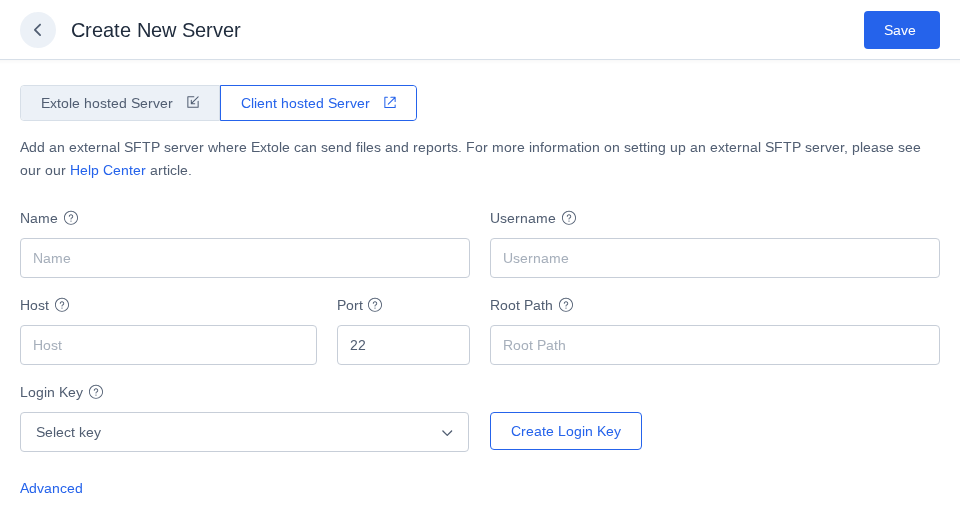
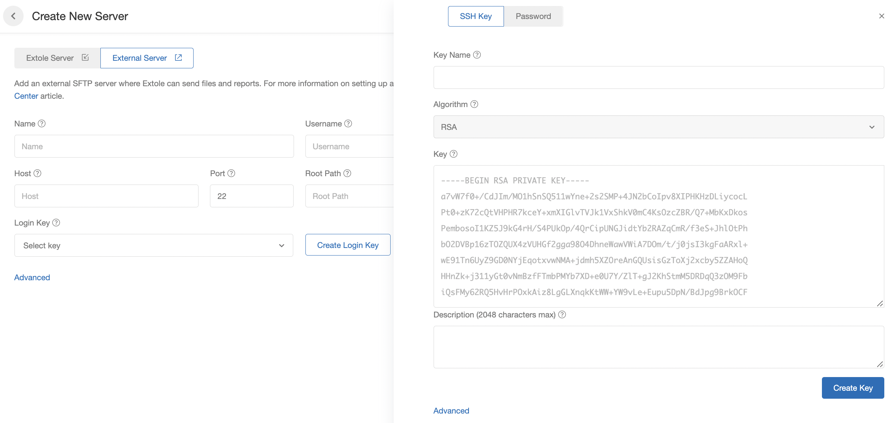
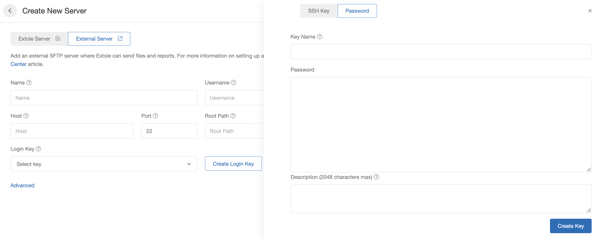
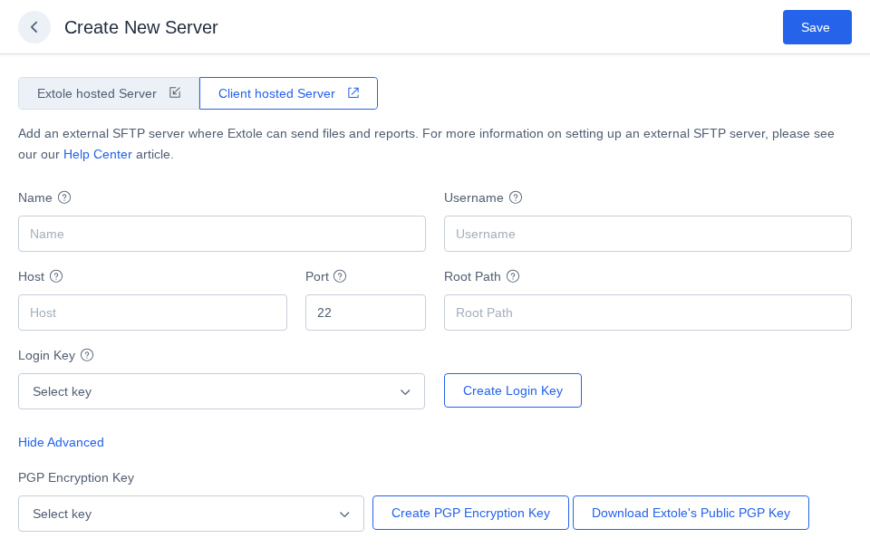
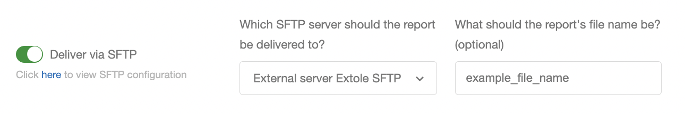

## Overview

[//]: # "How do I send Extole data to my SFTP server?"

Get data delivered straight to your own SFTP server. Connecting your Extole programs with your own external systems makes it that much easier to get important information about your programs and participating customers into your customer relationship management tools and email service providers.

[//]: ___

## Setting up your SFTP Server

[//]: # "How do I set up my SFTP server in Extole?"

The first step in getting a report of Extole data delivered to your SFTP server is to set up the server in your My Extole account. Navigate to your Tech Center and complete the following steps.

### Add a Server

In My Extole, navigate to [**Tech Center** > **SFTP Servers**](https://my.extole.com/tech-center/sftp) and click **+ New Client Server**. **Client hosted Server** is selected at the top of the form, and you will see a number of fields to fill out that describe your SFTP server:

* Name: How you'd like to reference the server in My Extole.
* Host: The domain of the server where you want Extole to send files and reports (e.g. example.com).
* Username: The username used to access the SFTP server (e.g. janedoe).
* Port: The port of the server where you want Extole to send files and reports (e.g. for most SFTP servers, this is port 22).
* Root Path: Where Extole should be delivering files and reports (e.g. /extole/reports).
* Login Key: The key used to access the SFTP server. Click on the "Create Login Key" button to create a new encrypted RSA private key or password and fill out the required fields (see below).

<Frame caption="The **Create New Server** form for a client hosted server.">
  
</Frame>

**SSH Key**

* Key Name: How we'll refer to the key in My Extole.
* Partner Key Id: Your unique identifier for the key.
* Login Key: The key itself. This must be an encrypted RSA private key.
* Description: An optional description for the key.

**Password**

* Key Name: How we'll refer to the key in My Extole.
* Password: The password itself.
* Description: An optional description for the password.

[//]: ___

### Use PGP Encryption with Extole (Optional)

[//]: # "How do I set up PGP encryption to send Extole data to my SFTP server?"

SFTP encrypts every file in transit. To have Extole also encrypt the report files it delivers to your server, give Extole your PGP public key:

1. On the server form, click **Advanced**, then **Create PGP Encryption Key**.
2. Paste your armored public key (the block that starts with `-----BEGIN PGP PUBLIC KEY BLOCK-----`) and fill out the rest of the panel.
3. Click **Save Key**, then **Save**.

Extole then encrypts every report it delivers to this server and adds `.gpg` to each file name. Decrypt the files with your private key. For the full steps, the export command, and how to replace a key, see [PGP Encryption for SFTP Files](/technical/platform-integrations/files/pgp-encryption#receive-encrypted-reports-from-extole).

<Frame caption="The **Advanced** section of a client hosted server.">
  
</Frame>

[//]: ___

## Delivering Reports to your SFTP Server

[//]: # "How do I send Extole reports to my SFTP server?"

With your server set up, you are ready to get reports delivered to your SFTP server.

1. Navigate to the Reports page in My Extole.
2. Create a new report by selecting the report type you'd like to run.
3. Configure all of the necessary report parameters.
4. Click on the "Advanced" section at the bottom of the report configuration page. Here, you can choose which server you would like the report delivered to and can also specify the file name.

[//]: ___

### Files in a Report Delivery

[//]: # "Does Extole send a .done file or a row count with a report?"

Extole delivers one file for each format the report produces, and no other file. It doesn't write a `.done` file, a manifest, or a separate row count file.

Each file is named in one of two ways, followed by the format's extension:

* **File name set**: the file name set for the report or its schedule.
* **No file name set**: the report name, a hyphen, and the time Extole created the report in UTC. For example, `Rewards Report-2026-11-17T225700.csv`.

The extension is `csv`, `psv`, `json`, `jsonl`, `xlsx`, `headless.csv`, or `headless.psv`. When the server has a PGP key, Extole encrypts the file and adds `.gpg` to its name.

A schedule delivers a file even when a run has no rows. To skip those files, set `deliver_empty_reports_to_sftp` to `false` on the schedule.

### Check a Delivered File

The report itself carries its status and row count. Read them with the Extole API:

* [Get a report](/api-reference/reports/get-a-report) returns the report's `status`. `DONE` means the report completed. `SFTP_DELIVERY_FAILED` means the report completed and Extole couldn't deliver its file.
* [Get report info](/api-reference/reports/get-report-info) returns `total_rows`, the number of rows in the report.

To confirm that your system received the whole report, compare `total_rows` with the number of data rows in the file.

## Uploading Under a Temporary Name

[//]: # "How do I stop my automation from picking up a file before Extole finishes uploading it?"

By default, Extole writes each report straight to its final file name, so a process that watches your server can see the file while it is still being written. To prevent this, set a temporary file suffix on the server. Extole then uploads each file as the final name plus the suffix, and renames it to the final name only after the upload completes. The final name appears only when the file is whole.

For example, with the suffix `.filepart`, the file `report.csv` is uploaded as `report.csv.filepart` and then renamed to `report.csv`. With PGP encryption, `report.csv.gpg.filepart` becomes `report.csv.gpg`.

Set the suffix with the `temporary_file_suffix` field when you create or update the server through the API (`POST /v6/sftp-destinations` or `PUT /v6/sftp-destinations/{sftpDestinationId}`). The suffix is one or more letters, digits, dots, underscores, hyphens, or tildes. To go back to uploading straight to the final name, update the server with `temporary_file_suffix` set to `null`.

Before you set a suffix, check these on your side:

* The SFTP user can rename and remove files in the root path. Validating the server tests the rename, and validation fails when the server refuses it.
* Your automation ignores files that end with the suffix.

If an upload or the rename fails, Extole removes the file with the temporary name and the delivery fails, as described below.

Extole's own SFTP server accepts the same setting. See [Receiving Reports Under a Temporary Name](/technical/platform-integrations/files/extoles-sftp-server#receiving-reports-under-a-temporary-name).

## Failed Deliveries

[//]: # "What happens when Extole can't deliver a report to my SFTP server?"

When a report finishes, Extole connects to your SFTP server and uploads the report's files. If Extole can't connect or log in, it waits one second and tries once more. Once the upload has started, Extole doesn't try again: a failure during the upload ends the delivery.

When the delivery fails, Extole stops trying and the report's status changes to **SFTP delivery failed**. Extole never sends that file to your server again. For a scheduled report, the next run delivers only its own new file, not the one that failed.

The report itself completed, so its data is still in My Extole. To get the missed file onto your server, do one of these:

* Open the report on the [Reports](https://my.extole.com/reports) page in My Extole, download its file, and upload it to your server yourself.
* When your server is reachable again, click **Duplicate** in the report's menu and run the copy. The copy keeps the same SFTP server, so it delivers a new file when it finishes. The menu doesn't offer **Retry** for a report whose delivery failed.

### Notifications for Failed Deliveries

Extole sends an error notification each time a delivery fails. The notification names the report ID and the server:

* **The upload failed**: "Failed to deliver report to sftp."
* **A file with the same name is already on the server**: "Report file already exists on sftp server."
* **Extole couldn't encrypt the file with the server's PGP key**: "Could not encrypt report file to deliver to sftp."

These notifications belong to both the **Reports** and **Business Operations** categories. You receive them when you subscribe to either category at the **Noteworthy** level or higher. They arrive in your My Extole Notifications by default, and by email when you turn on the email channel for that category. To set this up, see [Subscribing to My Extole Notifications](/guides/notifications-and-troubleshooting/platform-and-admin/subscribing-to-my-extole-notifications).
