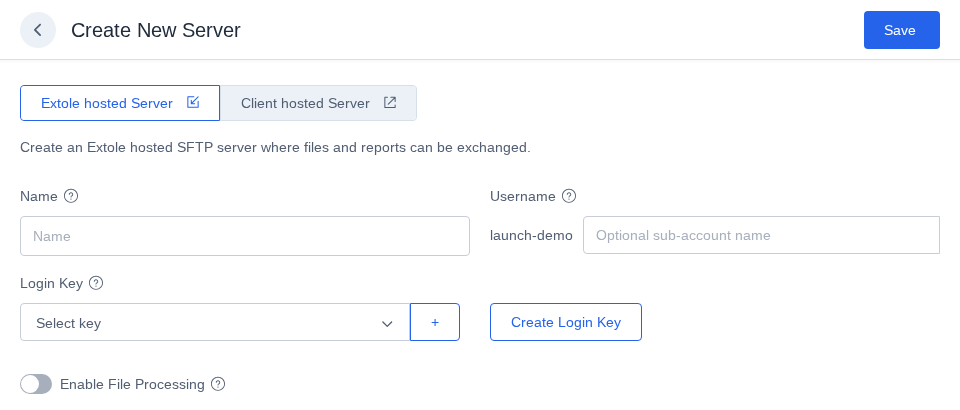
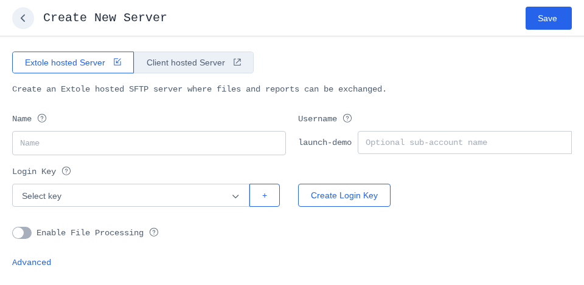
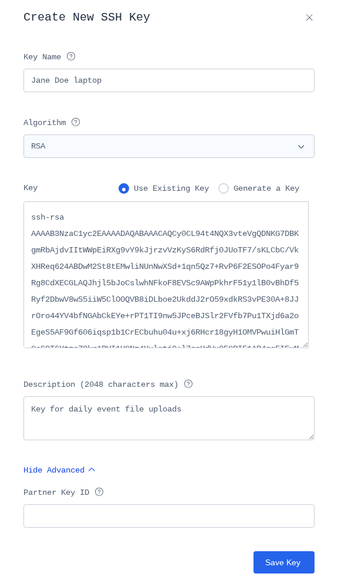
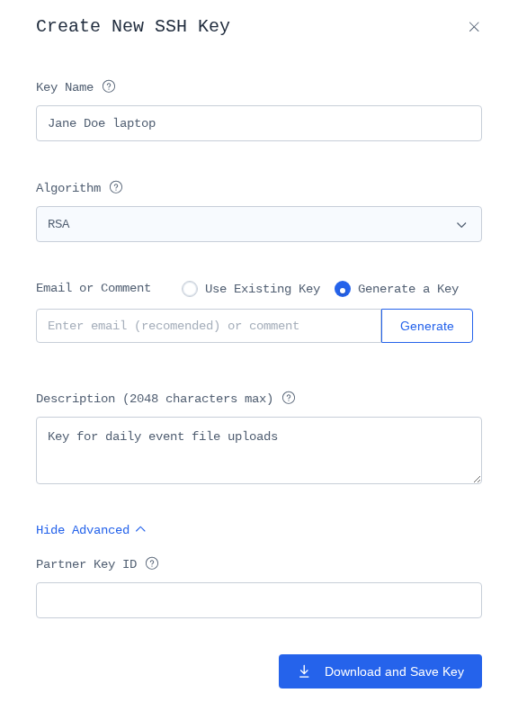
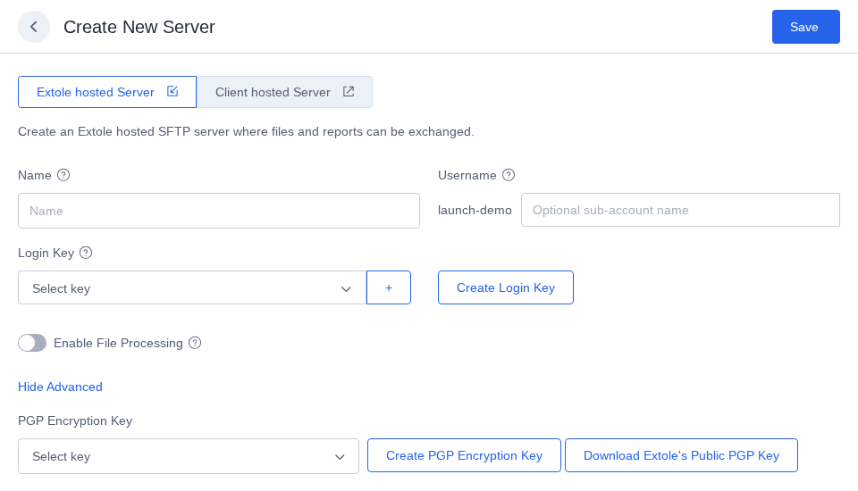

## Overview

[//]: # "How do I upload files using SFTP to Extole?"

If your business registers online but completes conversion events outside of your company's website, then it may make sense for you to use file-based conversions to send Extole purchase events. Within the Tech Center of your My Extole account, you can easily upload  files of events. These events become conversion events in Extole and go through all the standard event approval methods and incentive configurations.

[//]: ___

## Accessing Extole's SFTP server

[//]: # "How do I set up an SFTP server in Extole?"

### Add a Server

In My Extole, navigate to [**Tech Center** > **SFTP Servers**](https://my.extole.com/tech-center/sftp) and click **+ New Extole Server**. **Extole hosted Server** is selected at the top of the form. You will see a number of fields to fill out to describe the server.

<Frame caption="The **Create New Server** form for an Extole hosted server.">
  
</Frame>

**Name**: How you'd like to reference the server in your My Extole account.

**Username**: The username used to access the SFTP server. By default, this will be your client name (e.g., `launch-demo` in the above example). Every username starts with your client name. To show what an account is for, you can add a suffix in the text box, such as `launch-demo-events` or `launch-demo-reports`.

<Warning>
**Username Format**


Some clients may have user names in our previous format "c123456..." which is still supported.  
</Warning>

### Add a Login Key

A login key is an **SSH key pair**. It's how you sign in to Extole's SFTP server, which doesn't use passwords. The pair has two halves:

* **Public key**: the half you give Extole. You paste it into My Extole, and the SFTP server uses it to recognize you. It's safe to share.
* **Private key**: the half you keep. Your SFTP client uses it to prove who you are each time it connects. Never send it to Extole or anyone else, and store it where only you, or the system that uploads your files, can read it.

Extole accepts **RSA** keys in OpenSSH public key format only. Other key types, such as Ed25519, are rejected when you save the server.

You can create the key pair yourself with `ssh-keygen`, or let My Extole generate one in your browser. Use `ssh-keygen` when the private key will live on a server that uploads files automatically, or when your IT team manages your keys.

#### Create a Key Pair with ssh-keygen

`ssh-keygen` is built in to macOS, Linux, and Windows 10 and 11.

1. Open **Terminal** on macOS or Linux, or **PowerShell** on Windows.
2. Run the following command, replacing the email address with your own:

   ```bash
   ssh-keygen -t rsa -b 4096 -C "jane.doe@example.com" -f extole_sftp
   ```

   `-t rsa -b 4096` creates a 4096-bit RSA key, `-C` adds a comment to the public key so you can tell keys apart, and `-f` names the files.
3. When prompted for a passphrase, enter one to protect the private key, or press Enter twice to leave it empty. Your SFTP client asks for the passphrase each time it connects, so a job that uploads files automatically usually uses a key without one.
4. The command creates two files in the current folder, which is your home folder in a new terminal window:
   * `extole_sftp`: your **private key**. Keep it.
   * `extole_sftp.pub`: your **public key**. You add this one to My Extole.
5. Display the public key so you can copy it. On macOS or Linux, run `cat extole_sftp.pub`. In PowerShell, run `Get-Content extole_sftp.pub`.

The public key is one long line that looks like this:

```text
ssh-rsa AAAAB3NzaC1yc2EAAAADAQABAAACAQCy...truncated...Q0== jane.doe@example.com
```

Before you paste it, check that it:

* Starts with `ssh-rsa`.
* Is on a single line, with no line breaks. Copy it straight from the terminal, because some editors and email clients wrap long lines.
* Ends with the comment you set with `-C`. An email address is conventional, but the comment is optional.

If you already have an RSA key pair you want to use, paste the contents of its `.pub` file instead.

#### Add the Key to Your Server

1. In My Extole, navigate to [**Tech Center** > **SFTP Servers**](https://my.extole.com/tech-center/sftp) and click **+ New Extole Server**. To add a key to a server you already have, click the edit icon on that server instead.
2. Next to **Login Key**, click **Create Login Key**. The **Create New SSH Key** panel opens.

   <Frame caption="The **Create New Server** page, with **Create Login Key** next to the **Login Key** list.">
     
   </Frame>
3. Fill out the panel:
   * **Key Name**: How the key appears in My Extole. Name it after the person or system that holds the private key, such as `Jane Doe laptop` or `Nightly upload job`.
   * **Algorithm**: Always **RSA**. You can't change it.
   * **Key**: Leave **Use Existing Key** selected and paste your whole public key line. Never paste the private key here.
   * **Description**: Optional. Up to 2,048 characters.
   * **Partner Key ID**: Optional, under **Advanced**. Your own identifier for the key. You can leave it blank.

   <Frame caption="The **Create New SSH Key** panel with a public key pasted into **Key**.">
     
   </Frame>
4. Click **Save Key**. The panel closes, and your new key is selected in the **Login Key** list.
5. To let more than one person or system sign in to the same server, click **+** next to the **Login Key** list to add the selected key, then create or select the next key.
6. Fill out the rest of the server and click **Save**. Extole checks the key format when you save the server. If the key isn't an RSA public key on one line, you'll see an error saying the key must start with `ssh-rsa` and be base64 encoded.

#### Let My Extole Generate the Key Instead

In step 3 above, select **Generate a Key** instead of **Use Existing Key**:

1. In **Email or Comment**, enter your email address or another label for the key, and click **Generate**. Your browser creates a 2048-bit RSA key pair and shows both halves.
2. Fill out **Key Name** and the other fields as above.
3. Click **Download and Save Key**. My Extole saves the public key, and your browser downloads the private key as a file whose name ends in `-extole-ssh-key`.
4. Move that file somewhere safe. It's the private key your SFTP client uses to connect.

The private key is created in your browser and isn't saved to Extole. If you lose the file, create a new login key and remove the old one from the server.

<Frame caption="**Generate a Key** selected. Click **Generate**, then **Download and Save Key**.">
  
</Frame>

Next, point your SFTP client at the private key. See [Configure and Test Your SFTP Client](#configure-and-test-your-sftp-client).

[//]: ___

### Use PGP Encryption with Extole (Optional)

[//]: # "How do I use PGP encryption with Extole?"

SFTP encrypts every file in transit. To also encrypt the files themselves, use PGP:

* **Files you upload to Extole**: copy Extole's public key from **Advanced** > **Download Extole's Public PGP Key** on the server form, encrypt each file to it, and give the file a `.gpg`, `.pgp`, or `.asc` extension. Extole decrypts the file when it processes it.
* **Reports Extole delivers to this server**: click **Advanced** > **Create PGP Encryption Key** on the server form and paste your armored public key. Extole then encrypts every report it delivers to the server.

For the full steps in each direction, see [PGP Encryption for SFTP Files](/technical/platform-integrations/files/pgp-encryption).

<Frame caption="The **Advanced** section of an Extole hosted server.">
  
</Frame>

[//]: ___

### Configure and Test Your SFTP Client

[//]: # "How do I test my SFTP client?"

Using your own SFTP program, follow its instructions to configure your private key.

[//]: ___

## Uploading to Extole's SFTP server

[//]: # "How do I upload files using Extole's SFTP server?"

### File Conventions

The following conventions are used by almost all files at Extole to ensure file transfer consistency:

* Name the file based on the event name (ex: reviews-20201015.csv) or add an "event_name" column to your file and Extole will create events in your campaign based on the file name or value.
  * NOTE: Previous SFTP directories are not affected by this feature. The priority goes as follows: "event_name" specified in a row, file name, then "unspecified" if neither are defined.
  * The event name used in the file name will be used when posting to the **api.extole.io/v5/events** endpoint if no event is specified in the file.
* Each file type goes into its own directory on the Extole SFTP system.
* All files are encoded as UTF-8.
* Files may contain Unix (\n) or Dos (\r\n).
* All batch files contain a column header row.
* Column order is never important, as Extole determines the order based on the header row.
* Extra columns in the file that Extole does not recognize are ignored.
* Extole stores 90 days worth of file history, and older files are deleted.
* Extole follows standard CSV quoting conventions:
  * A comma can be included by quoting the values: First Name, "Last Name, Jr.", Gift Message
  * A quote can be included by escaping the quote: First Name, Last Name, "Thanks for the "help"

### File Permissions

If you are uploading any CSV file through SFTP, make sure the permissions of the file are configured so "everyone" can either read or write. In this case, we want to make sure Extole can read the file.

1. Check the permissions by right-clicking the file and clicking "Get Info."
2. Scroll all the way down to where it says "Sharing & Permissions."
3. You will see your local machine's name with the permissions of "Read & Write," under which you can select "everyone."
4. Make sure "everyone" has the Privilege set to either "Read Only" or "Read & Write."

### Processed Files

Extole picks up each file you upload to the `events`, `conversions`, `optouts`, `approvals`, or `audiences` folder. It renames the file in the same folder to show its status: `<file name>.<ID>.<status>`.

* **ID**: the batch job ID. For a file in `audiences`, it is the audience operation ID. When Extole creates neither for the file, the name carries `none` in its place.
* **Status**: `processing`, `completed`, `failed`, `canceled`, `ignored`, or `duplicate`. A file shows `processing` while its batch job runs, then `completed`, `failed`, or `canceled`. A file shows `ignored` when file processing is turned off for the server.

For example, `events/events_20261023.psv.pgp` becomes `events/events_20261023.psv.pgp.t1a2b3c4d5e6f7g8h9i0.completed`. Extole doesn't pick up a file again while its name ends in one of these statuses.

Extole doesn't pick up or rename files in `dropbox` or `optouts/exports`. When a job on your account is set up to pick up a file, the job handles it, and Extole doesn't rename it.

### Reprocess a File

Extole rejects a file as a `duplicate` when an earlier file on your account has the same name. The name Extole compares is the path you uploaded to, without an encryption extension. So `events/events_20261023.psv.pgp` and `events/events_20261023.psv` have the same name, and the same file name in another folder does not. An earlier file keeps its name after Extole stops storing it.

The rejected file stays on the SFTP server with its contents. To process a `duplicate` or `failed` file again, rename it on the SFTP server:

1. Remove the ID and the status that Extole appended.
2. Add a part that makes the name unique, such as `_retry`, before the file's extensions.
3. Keep the file's original extensions at the end of the name. For an encrypted file, the name must still end in `.pgp`, `.gpg`, or `.asc`.

For example, rename `events/events_20261023.psv.pgp.t1a2b3c4d5e6f7g8h9i0.duplicate` to `events/events_20261023_retry.psv.pgp`. Extole picks up the renamed file as a new upload and processes every row in it. If an earlier upload already processed some of those rows, remove them from the file before you rename it.

[//]: ___

## Receiving Reports Under a Temporary Name

[//]: # "Can my automation download a report from Extole's SFTP server before Extole finishes writing it?"

When a report is delivered to your Extole SFTP server, Extole writes it to the `dropbox` folder under its final file name. Extole writes each file in one step, so a process that polls that folder finds the file only once it is complete. This is true with or without a suffix.

You can still set a temporary file suffix on the server, for example so your automation can use the same rules here as on a server you host yourself. Extole then writes each file as the final name plus the suffix, copies it to the final name, and removes the temporary copy. With no suffix set, delivery works as it always has.

The setting is the same `temporary_file_suffix` field used for a server you host yourself. To set or clear it, see [Uploading Under a Temporary Name](/technical/platform-integrations/files/external-sftp-servers#uploading-under-a-temporary-name). Extole manages the rename on its own server, so you don't need to grant any extra permissions. Set your automation to ignore files that end with the suffix.

[//]: ___

## Frequently Asked Questions

### How do I connect to Extole SFTP servers using WS_FTP?

To connect to Extole SFTP servers using WS_FTP, you need to upload both a private AND public key. The public key needs to be in a .pub format. In this case, Extole needs to [provide both keys in the correct format](https://community.progress.com/s/article/How-to-Import-SSH-Key-Pair-from-Vendor).

### Can I set up an automated process that will push or pull files from the SFTP server?

[//]: # "Can I set up an automated process that will push or pull files from the SFTP server?"

Yes. Your company's IT department likely has tools that can help automate the transfer of files to and from Extole.

[//]: ___

### Can the files being sent to and from Extole be encrypted?

[//]: # "Can the files being sent to and from Extole be encrypted"

Yes. SFTP encrypts every file while it is transferred, and you can also encrypt the files themselves with PGP, in either direction. Encrypt the files you upload with Extole's public key, and add your own public key to a server so that Extole encrypts the reports it delivers there. See [PGP Encryption for SFTP Files](/technical/platform-integrations/files/pgp-encryption).

[//]: ___

### Can Extole support another transport protocol like ConnectDirect?

[//]: # "Can Extole support another transport protocol like ConnectDirect?"

The Extole product offering currently supports SFTP. SFTP is widely supported by file transfer packages, including ConnectDirect.

[//]: ___

### Can Extole keep copies of my files forever?

[//]: # "Can Extole keep copies of my files forever?"

The SFTP server is a temporary storage location for the transmission of files. If you need longer-term access to them, you should work with your IT team to set up automatic downloading and storage.

[//]: ___
