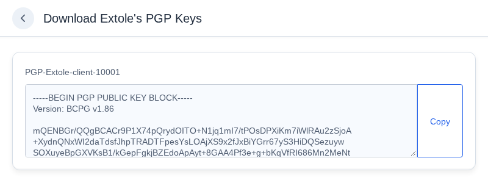
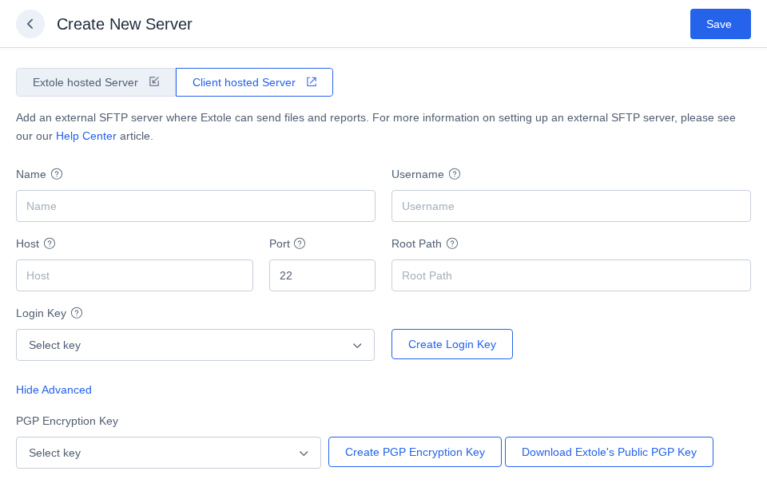
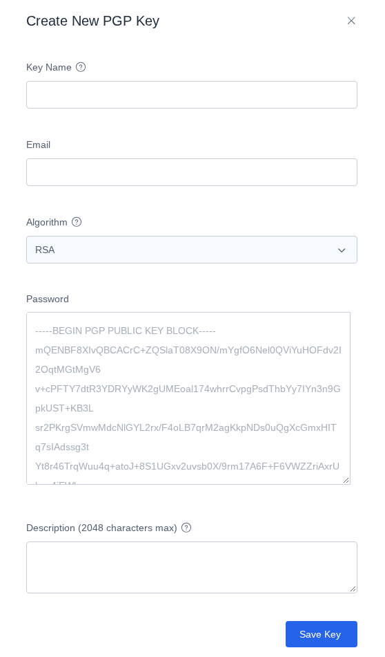

## Overview

[//]: # "Can the files I send to and receive from Extole be encrypted?"

SFTP encrypts every file while it travels between your systems and Extole. PGP adds a second layer: the file itself is encrypted, so it stays unreadable on the server until someone with the matching private key decrypts it.

You can use PGP in either direction, or in both:

| Direction | Encrypted with | Decrypted by |
|---|---|---|
| Files you upload to Extole's SFTP server | Extole's public key | Extole, when it processes the file |
| Reports Extole delivers to an SFTP server | Your public key | You, with your private key |

PGP is optional. A file without it still travels encrypted over SFTP.

You can do every My Extole step on this page yourself, in the **Tech Center** of your own account. Extole Support can also add your public key to a server for you. Send them the public key only, never the private key.

[//]: ___

## Send Encrypted Files to Extole

[//]: # "How do I send PGP-encrypted files to Extole?"

### Get Extole's Public Key

Extole creates one PGP key pair for your account. Extole keeps the private key and gives you the public key, and every server in your account uses the same pair.

You can copy the public key from either of these places:

* [**Tech Center** > **SFTP Servers**](https://my.extole.com/tech-center/sftp): click **+ New Extole Server**, or the edit icon on an existing server, then click **Advanced** and **Download Extole's Public PGP Key**.
* [**Security Center**](https://my.extole.com/security-center): under **Keys**, click **Download Extole's Public PGP Key**.

Both open **Download Extole's PGP Keys**, which shows the key as text under the name `PGP-Extole-client-<your client ID>`. Click **Copy**, paste the key into a text file, and save it, for example as `extole-public-key.asc`. Keep every line, including `-----BEGIN PGP PUBLIC KEY BLOCK-----` and `-----END PGP PUBLIC KEY BLOCK-----`.

<Frame caption="**Download Extole's PGP Keys** in My Extole. Your account shows its own key.">
  
</Frame>

### Encrypt Each File

Encrypt the file to Extole's public key before you upload it. With [GnuPG](https://gnupg.org/), for example:

```bash
gpg --encrypt --recipient-file extole-public-key.asc --output events-20261119.csv.gpg events-20261119.csv
```

Extole decrypts a file when it meets these conditions:

* **The file name ends in `.gpg`, `.pgp`, or `.asc`.** Extole decrypts only files with one of these extensions and reads every other file as plain text.
* **It's encrypted to Extole's public key.** Extole doesn't accept a file encrypted with a passphrase alone, such as the output of `gpg --symmetric`.
* **It carries an integrity check.** GnuPG adds one by default.
* **It isn't marked for your eyes only.** Leave out `gpg --for-your-eyes-only`.

Binary output and armored output (`gpg --armor`) both work. Signing the file is optional, because Extole doesn't check signatures.

### Upload the File

Upload the encrypted file to your Extole SFTP server the same way as any other file. When Extole processes it, Extole decrypts it and drops the encryption extension, so `events-20261119.csv.gpg` is processed as `events-20261119.csv`. Name the file the way you would name the unencrypted file, then add the extension. For naming and format conventions, see [Extole SFTP Server](/technical/platform-integrations/files/extoles-sftp-server#file-conventions).

When Extole can't decrypt a file, it doesn't process the file and sends an error notification in the **Business Operations** category that names the file and the server.

[//]: ___

## Receive Encrypted Reports from Extole

[//]: # "How do I get Extole to PGP-encrypt the reports it sends me?"

### Export Your Public Key

Give Extole the public half of your own PGP key pair, as an armored (text) block. With GnuPG, run the following command, replacing the email address with the one on your key:

```bash
gpg --armor --export jane.doe@example.com > my-public-key.asc
```

The file starts with `-----BEGIN PGP PUBLIC KEY BLOCK-----` and ends with `-----END PGP PUBLIC KEY BLOCK-----`. Copy all of it, including those two lines. Your key must include an encryption key, which is how Extole finds the key it encrypts with.

Never paste or send your private key. It's the half you keep to decrypt the files Extole sends you.

### Add Your Key to the Server

1. In My Extole, navigate to [**Tech Center** > **SFTP Servers**](https://my.extole.com/tech-center/sftp). Click the edit icon on the server Extole delivers your reports to, or click **+ New Client Server** to add your server.
2. Below the **Login Key**, click **Advanced**.
3. Click **Create PGP Encryption Key**. The **Create New PGP Key** panel opens.
4. Fill out the panel:
   * **Key Name**: How the key appears in My Extole, such as `Acme reports key`.
   * **Email**: The email address on your key. Each PGP key in your account needs its own email address.
   * **Algorithm**: Always **RSA**. You can't change it.
   * **Password**: Paste your whole public key block here. The box is labeled **Password**, but it holds your public key.
   * **Description**: Optional. Up to 2,048 characters.
5. Click **Save Key**. The panel closes, and your key is selected in the **PGP Encryption Key** list.
6. Click **Save** to save the server.

<Frame caption="The **Advanced** section of a client hosted server.">
  
</Frame>

<Frame caption="The **Create New PGP Key** panel. Paste your public key into the box labeled **Password**.">
  
</Frame>

An Extole hosted server has the same **Advanced** section. When you add your key to one, Extole encrypts the reports it delivers to that server too.

### What Extole Delivers

Encryption is set per server. A server holds one PGP encryption key, and once it has one:

* Extole encrypts every report it delivers to that server. A report delivered to a server with no key arrives unencrypted. To encrypt some reports and not others, deliver them to two different servers.
* Each file arrives with `.gpg` added to its name. A report file named `referrals.csv` arrives as `referrals.csv.gpg`.
* The file is binary PGP, encrypted to your public key only, with AES-256 and an integrity check. Extole doesn't sign the files it sends.

To decrypt a file, name the output yourself, because the file name stored inside the encrypted file is a random identifier:

```bash
gpg --output referrals.csv --decrypt referrals.csv.gpg
```

To choose the server a report delivers to, see [Delivering Reports to your SFTP Server](/technical/platform-integrations/files/external-sftp-servers#delivering-reports-to-your-sftp-server). When Extole can't encrypt a report with the server's key, the delivery fails and Extole sends the notification "Could not encrypt report file to deliver to sftp." See [Failed Deliveries](/technical/platform-integrations/files/external-sftp-servers#failed-deliveries).

[//]: ___

## Replace Your Key

[//]: # "How do I replace the PGP key Extole encrypts my reports with?"

1. Export your new public key as described in [Export Your Public Key](#export-your-public-key).
2. Open the server in [**Tech Center** > **SFTP Servers**](https://my.extole.com/tech-center/sftp), click **Advanced**, and create the new key with **Create PGP Encryption Key**. Give it an email address that differs from the old key's.
3. Make sure the new key is selected in the **PGP Encryption Key** list, then click **Save**.

Reports delivered after you save use the new key. Files Extole already delivered stay encrypted with the old key, so keep the old private key until you've decrypted them.

[//]: ___
