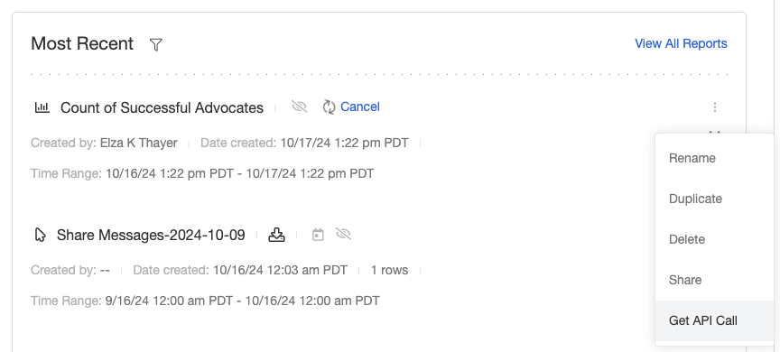
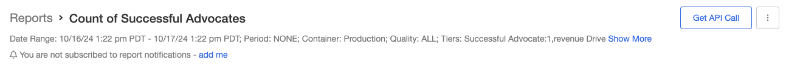
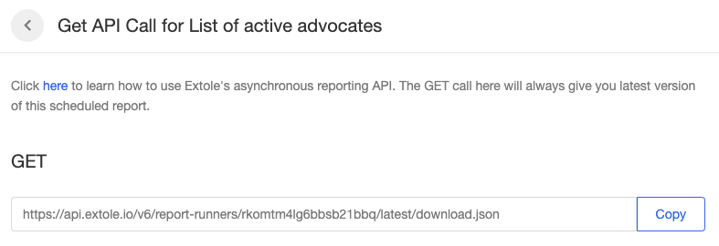
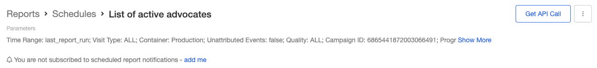

## Overview

We have asynchronous API endpoints to interact with your Extole reports. The three most essential endpoints can be used to run, check the status of, and download reports.

## Generate an Access Token

To get started, you'll first need to get an access token. This will authorize you to make calls to our APIs. To generate a long-lived access token, follow our documentation on [Generating Long-Lived Access Tokens](https://docs.extole.com/docs/generate-long-lived-access-tokens).

## Get a Report

Different reports require different parameters. To find out exactly how your API call should look, first go to [Reports](https://my.extole.com/reports) in My Extole and run the report. Once the report is running or complete, you have two options to get the correct API call.

1. Open the kebab menu to the right of the report listing and select the option to Get API Call.



2. Click into the report and and hit the button to Get API Call in the top right.



Both of the above methods will take you to the same page, where you can view and copy the GET call. This page also has the POST as well as the request body and response.



### Get Scheduled Reports

For scheduled reports, the Get API Call button on the schedules page will give you the latest version of the scheduled report.



### Successful GET Output

There are 2 endpoints that can be used for getting report information. /`{report_id}` and /`{report_id}`/download. The first of which will return a body similar to:

```json JSON
{
  "report_id": "<REPORT_ID>",
  "name": "AOV",
  "report_type": "AOV",
  "display_name": "Average Order Value-2026-11-13",
  "executor_type": "SPARK",
  "format": "CSV",
  "formats": [
    "CSV",
    "XLSX",
    "JSONL",
    "JSON"
  ],
  "status": "DONE",
  "user_id": "<USER_ID>",
  "parameters": {
    "container": {
      "value": "production"
    },
    "visit_type": {
      "value": "ALL"
    },
    "filters": {
      "value": "\"1\"==\"1\""
    },
    "time_range": {
      "value": "2026-11-12T00:00:00.000+02:00[Europe/Bucharest]/2026-11-13T00:00:00.000+02:00[Europe/Bucharest]",
      "details": {
        "name": "time_range",
        "display_name": "time_range",
        "category": "filter",
        "type": {
          "name": "TIME_RANGE",
          "value_type": "STATIC",
          "values": [
            "LAST_WEEK",
            "PREVIOUS_QUARTER",
            "LAST_QUARTER",
            "PREVIOUS_YEAR",
            "LAST_4_HOURS",
            "LAST_2_HOURS",
            "LAST_8_HOURS",
            "FROM_TIME",
            "PREVIOUS_MONTH",
            "YEAR_TO_DATE",
            "PREVIOUS_WEEK_START_MONDAY",
            "PREVIOUS_DAY",
            "LAST_MONTH",
            "LAST_DAY",
            "ALL_TIME",
            "MONTH_TO_DATE",
            "WEEK_TO_DATE",
            "CUSTOM_TIME",
            "LAST_HOUR",
            "LAST_YEAR",
            "LAST_SIX_MONTHS",
            "Forward slash-separated ISO8601 dates",
            "QUARTER_TO_DATE",
            "PREVIOUS_WEEK_START_SUNDAY"
          ]
        },
        "is_required": true,
        "order": 1
      }
    },
    "quality": {
      "value": "ALL"
    }
  },
  "tags": [
    "internal:category:Performance & Metrics:3",
    "internal:category:Performance & Metrics",
    "internal:schedule:<REPORT_RUNNER_ID>",
    "internal:scheduled-2026-11-05T22:00:00Z/2026-11-12T22:00:00Z",
    "User-Generated",
    "internal:report-runner:<REPORT_RUNNER_ID>"
  ],
  "created_date": "2026-11-13T00:03:38.292+02:00",
  "started_date": "2026-11-13T00:16:23.602+02:00",
  "completed_date": "2026-11-13T00:17:31.002+02:00",
  "error_code": null,
  "download_uri": "https://api.extole.io/v4/reports/<REPORT_ID>/download",
  "sftp_report_name": null,
  "visible": true,
  "scopes": [
    "CLIENT_ADMIN",
    "CLIENT_SUPERUSER"
  ],
  "sftp_server_id": null
}
```

Which contains all of the information about the report.

The /`{report_id}`/download will allow you to download the contents of the report. For scheduled reports, you can always download the latest version of the report with /`{report_id}`/latest/download. The API call will return the contents of the report in the format specified by the extension:

| File Type      | Extension              |
| :------------- | :--------------------- |
| .csv           | Comma Separated Values |
| .headless\_csv | CSV without header row |
| .psv           | Pipe Separated Values  |
| .headless\_psv | PSV without header row |
| .xlsx          | Excel File             |
| .json          | JSON                   |
| .jsonl         | JSON Lines             |

## Execute a Report

To run a report via API call, follow the instructions below.

1. Make a POST call to our reports endpoint.

```
POST <https://api.extole.io/v4/reports>
```

2. Include these HTTP Headers:

```
Authorization: <ACCESS_TOKEN>
Content-Type: application/json
```

3. Include this body with your values filled in:

```json
{
  "name": "<REPORT_NAME>",
  "report_type": "<REPORT_TYPE>",
  "format": "<FORMAT>",
  "parameters": {
    "time_range": "<TIME_RANGE.START>/<TIME_RANGE.END>"
  }
}
```

Options for the parameters above:

<table>
  <thead>
    <tr>
      <th>
        Parameter
      </th>
      <th>
        Value
      </th>
    </tr>
  </thead>
  <tbody>
    <tr>
      <td>
        &lt;REPORT_NAME&gt;
      </td>
      <td>
        The name of the report you want to download.
      </td>
    </tr>
    <tr>
      <td>
        &lt;REPORT_TYPE&gt;
      </td>
      <td>
        The report type to run, for example <code>AOV</code>. The Get API Call page shows the value for a report you have already run.
      </td>
    </tr>
    <tr>
      <td>
        &lt;FORMAT&gt;
      </td>
      <td>
        JSON, CSV
      </td>
    </tr>
    <tr>
      <td>
        &lt;TIME_RANGE.START&gt;
      </td>
      <td>
        The start of the report range, as an ISO 8601 date (<code>2026-11-12</code>) or date and time (<code>2026-11-12T09:30:00.000Z</code>). A date with no time means 00:00 at the start of that day, in your account's timezone.
      </td>
    </tr>
    <tr>
      <td>
        &lt;TIME_RANGE.END&gt;
      </td>
      <td>
        The end of the report range, which the report does not include, in the same form as the start. To include a whole last day, use the day after it.
      </td>
    </tr>
  </tbody>
</table>

Instead of `<start>/<end>`, `time_range` also takes a named range, such as `PREVIOUS_DAY` or `LAST_MONTH`. The `details` of `time_range` in a report's record list the names its report type accepts. A few older report types take `date_range` instead of `time_range`, and the **Get API Call** page shows which one a report uses. See [Time Ranges](#time-ranges).

## Check the Status of a Report

There are four options for the status of the report.

* Pending: The report is preparing to run.
* In progress: The report is initialized and in progress. Depending on the amount of data you pull back, reports typically remain in this status for one to ten minutes.
* Failed: There was an error in the API call.
* Done: The report is complete and ready to be downloaded.

A report in `IN_PROGRESS` with a null `error_code` has not failed, even when the report page in My Extole still shows it generating. Compare the record's `created_date` with the time you submitted it: a report submitted a few minutes ago is still queued. A failed run carries `EXECUTION_ERROR` or `CONFIGURATION_ERROR` in `error_code`.

To get a report's status, simply make the GET call listed on the report's Get API Call page and look for the `status` parameter in the response.

## Download a Report

Once the status of a report is `DONE` you will be able to download your report. You can do so by making the following GET call.

```
GET https://api.extole.io/v4/reports/<REPORT_ID>/download
```

The files a run generated are listed in the `formats` field of `GET /v4/reports/<REPORT_ID>`. They are chosen when the report is submitted and cannot be changed afterwards. A `format` query parameter on the download call does not convert the file: the run's own format comes back whatever you ask for, so read the `Content-Type` header and the `filename` in `Content-Disposition` and parse what arrived.

A paginated download, `download?limit=<N>`, is the preview that My Extole shows on the report page. It is available for the text formats only: CSV, PSV, JSON, JSONL, and the headless CSV and PSV variants. For an XLSX run the paginated call returns `400 report_preview_not_available` while the plain download succeeds, and My Extole shows `Report preview for requested format is not available`. Only the on-screen table is missing; the file is whole.

## Time Ranges

A time range covers everything from its start up to, but not including, its end. The same rule applies to a named range, such as `PREVIOUS_MONTH`, and to an explicit range written as `<start>/<end>`.

- A named range ends on a boundary, in your account's timezone. `PREVIOUS_DAY` ends at 00:00 today, and `PREVIOUS_MONTH` ends at 00:00 on the first day of the current month.
- In an explicit range, a date with no time means 00:00 at the start of that day, in your account's timezone. `2026-10-01/2026-10-31` covers October 1 through October 30.
- To include the whole of the last day, end the range on the day after it. `2026-10-01/2026-11-01` covers all of October.

Read a report's `period_start` and `period_end` from the record rather than assuming what a named range covers:

- `LAST_DAY` is the trailing 24 hours from the time the report ran. `PREVIOUS_DAY` is the previous calendar day.
- `ALL_TIME` starts at your account's own data start, not at the report type's. Check that the window covers the whole life of the record before you read a count as a lifetime total.
- Aggregate reports, such as the campaign and program summaries, lag the raw event reports by minutes to hours. When two windows over an aggregate disagree with a raw event count, the raw count is current.

## Filters That Drop Every Row

A report whose `filters` expression names a column that its `mappings` no longer define drops every row and still completes with `status: DONE` and a null `error_code`. The runner, the report status, and any SFTP delivery all report success, and an empty file is delivered. When a scheduled report stops returning rows, compare the failing run's `parameters` with the last run that had rows before you look anywhere else. A renamed mapping also changes the CSV header, because the header is the mapping's own identifier, so restoring the original name is usually the better fix.

Pattern parameters, and the `like` operator in mappings and filters, match the whole value rather than searching within it. See [Custom Data Queries](/guides/dashboards-and-reporting/configuring-reports/custom-data-queries-using-extole-reports#pattern-matching-with-like).

## Related Documentation

- [Paging and Filtering List Endpoints](/technical/platform-integrations/rest-apis/paging-and-filtering-list-endpoints)
