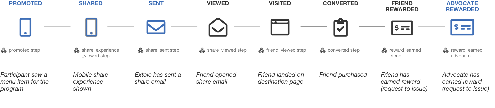
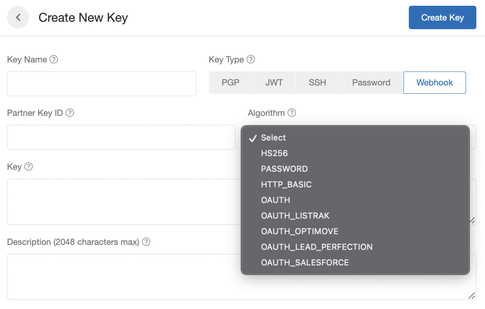
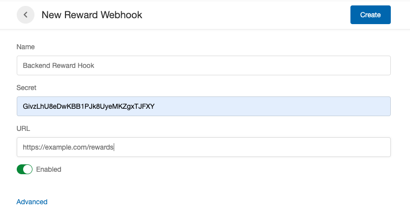
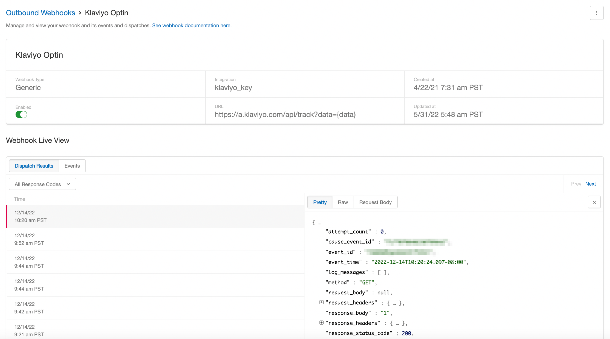

## Overview

[//]: # "How does Extole user webhooks?"

Extole webhooks submit real-time data about your participants and their journey through programs to your own HTTPS endpoints. Extole webhooks support a variety of authentication methods and can be customized to format the request body in as needed. Our Support Team is available and equipped to help you customize your webhooks.

[//]: ___



## Webhook Configuration

[//]: # "How do I configure webhooks in Extole?"

Webhooks require configuration within the Extole platform. You may configure your Extole account to use webhooks by logging in and going to [Tech Center](https://my.extole.com/tech-center) > [Outbound Webhooks](https://my.extole.com/tech-center/outbound-webhooks).

You need to provide the information required for the webhook to know where and how to send your data. At the most basic level, you can configure your webhooks by including:

* Name: How we will refer to the webhook in My Extole
* Client Key: The secret / key used to verify the authenticity of the Extole integration. Client Keys can be created by navigating to the [Security Center](https://my.extole.com/security-center), clicking + New Key.
* The payload URL: The destination URL the webhook will GET or POST to.
* Description: An optional description for your webhook.

Advanced configuration gives you control over the request Extole sends, how Extole reads the response, and how often it retries. You can set it up yourself, as described in [Advanced Configuration](#advanced-configuration) below. Your Extole Team can also set it up for you if you tell them what data you'd like to receive.

[//]: ___

## Client Keys & Security

[//]: # "How do I create client keys for webhooks?"

In the My Extole Security Center you can easily create Client Keys for your webhooks. We support HS256 signing, Password, Basic, OAuth, and a variety of vendor-specific variations of OAuth.

These authorization options are configurable within the [Security Center](https://my.extole.com/security-center) in your My Extole account under the Keys section.

[//]: ___



## Advanced Configuration

[//]: # "Who can set up a webhook's request, response handler, and retry intervals?"

Three optional fields control a webhook beyond its URL and client key:

- `request`: an expression that builds the HTTP request Extole sends, including its body and headers.
- `response_handler`: an expression that reads the response and returns `OK` or `RETRY`.
- `retry_intervals`: the wait, in seconds, after each failed attempt.

### Who Can Set It

Any My Extole user with full Admin access can set all three, with no help from Extole. A user limited to **User Support** can't. Over the API, use an access token with the `CLIENT_ADMIN` scope.

- **In My Extole:** go to **Tech Center** > **Outbound Webhooks** and click **+ New Webhook**. The **Create Webhook** drawer has **Request** and **Response Handler** fields, and **Retry Intervals (seconds)** under **Advanced**. You can change **Request** and **Response Handler** later by editing the webhook.
- **Over the API:** [Create a Webhook](/api-reference/webhooks/create-a-webhook) (`POST /v6/webhooks`) accepts all three fields. [Update a Webhook](/api-reference/webhooks/update-a-webhook) (`PUT /v6/webhooks/{webhook_id}`) changes `request` and `response_handler`.

Set `retry_intervals` when you create the webhook. The update request does not accept it, and the edit drawer shows it read-only, so a different schedule needs a new webhook.

The OAuth Generic client key has its own `request` and `response_handler` for the token call. The same users set them, in **Security Center** or with `POST /v2/settings/security/keys`.

### Get a Token With Custom Form Fields

An OAuth Generic client key (algorithm `OAUTH_GENERIC`) gets an access token with the client credentials grant and attaches it to each webhook request as `Authorization: Bearer`. Its default token request sends `grant_type`, `client_id`, and `client_secret` as a form, with no `scope`.

When the token endpoint needs more form fields, give the key a `request` expression that builds the token call. This example adds `resource` and `authorization_details`, two standard OAuth parameters ([RFC 8707](https://www.rfc-editor.org/rfc/rfc8707) and [RFC 9396](https://www.rfc-editor.org/rfc/rfc9396)) that some token endpoints require. `authorization_details` is a JSON string, so the expression builds it with `JSON.stringify`. The expression sends no `scope`. The examples on this page use a placeholder service at `api.example.com`. Replace its URLs and values with your destination's.

```javascript
javascript@runtime:(function () {
  var credentials = context.getClientCredentials();
  var form = {
    grant_type: 'client_credentials',
    client_id: credentials.getOAuthClientId(),
    client_secret: credentials.getOAuthClientSecret(),
    resource: 'https://api.example.com/',
    authorization_details: JSON.stringify([
      { type: 'event_write', locations: ['https://api.example.com/v1/events'], actions: ['write'] }
    ])
  };
  return context.createRequestBuilder()
    .withUrl(credentials.getAuthorizationUrl())
    .withBody(context.encodeToFormUrlEncoded(form))
    .addHeader('Content-Type', 'application/x-www-form-urlencoded')
    .build();
})();
```

Create the key with that expression as the `request` value, sent as one JSON string:

```json
{
  "type": "WEBHOOK",
  "algorithm": "OAUTH_GENERIC",
  "name": "Example Events API",
  "authorization_url": "https://auth.example.com/oauth2/token",
  "oauth_client_id": "CLIENT_ID",
  "key": "CLIENT_SECRET",
  "request": "javascript@runtime:(function () { ... })();"
}
```

- `key` holds the client secret. The expression reads it with `getOAuthClientSecret()`, and reads `oauth_client_id` and `authorization_url` the same way.
- A request with a body needs a `Content-Type` header.
- The key's default `response_handler` reads `access_token` and `expires_in` from the token response. Keep it when the endpoint returns those two fields.

Extole caches the token until shortly before `expires_in` runs out, so most webhook requests do not call the token endpoint.

### How the Token Call Is Retried

When the token endpoint answers with a 4xx or 5xx status, Extole sends the token request again, up to three more times, two seconds apart. A token endpoint that fails one request in a few and then succeeds is covered by these retries, with nothing to configure.

If all four tries fail, the webhook attempt fails before its request is sent. The log message reads `Error occurred while trying to get an access token for client key=`, and the event is retried on the webhook's own `retry_intervals`.

### Build the Request Body

A webhook's `request` expression builds the request from the data the webhook action sends. `context.createRequestBuilderWithDefaults()` starts from the webhook's URL and method, the action data as a JSON body, and the client key's authentication. For an OAuth Generic key, that is the `Authorization: Bearer` header with the token. Replace the body with `withBody`.

This example sends one event as a JSON array that holds that event, adds the Extole client id as `client_id`, and converts `event_time` from an ISO 8601 time to epoch microseconds:

```javascript
javascript@runtime:(function () {
  var event = JSON.parse(context.getGlobalServices().getJsonService().toJsonString(context.getData()));
  ['event_time'].forEach(function (field) {
    if (event[field] != null) {
      event[field] = Date.parse(event[field]) * 1000;
    }
  });
  event.client_id = context.getClientContext().getClientId();
  return context.createRequestBuilderWithDefaults()
    .withBody(JSON.stringify([event]))
    .build();
})();
```

- Name each timestamp field you send in the `['event_time']` list. `Date.parse` returns milliseconds, so multiplying by 1,000 gives microseconds.
- The fields in `context.getData()` are the ones the webhook action maps. Add or rename them in the action's `data`.
- A `POST` request gets `Content-Type: application/json` unless the expression sets another one.

For the example service, set the webhook URL to its events endpoint, `https://api.example.com/v1/events`, and choose the OAuth Generic key above as its client key.

### Decide Which Responses to Retry

A `response_handler` returns `OK` or `RETRY` for each attempt. `OK` counts the event as delivered, whatever the status, and it is not retried. `RETRY` sends it to the next attempt on `retry_intervals`.

This example retries 401, 429, 503, and any other failure, and stops on 400, 403, and 404:

```javascript
javascript@runtime:(function () {
  var status = context.getWebhookDispatchResultEvent().getResponseStatusCode();
  if (status == null) {
    return 'RETRY';
  }
  if (status >= 200 && status < 300) {
    return 'OK';
  }
  if (status === 400 || status === 403 || status === 404) {
    context.log('The destination rejected the event with status ' + status);
    return 'OK';
  }
  return 'RETRY';
})();
```

- The status is empty when no response arrived, such as when the request could not be sent or the token call failed. Return `RETRY` for it, so those events are tried again.
- An event the handler stops with `OK` is not delivered and not retried. The `context.log` line puts the status in the attempt's `log_messages`, so the rejection shows in the [Webhook Live View](/technical/platform-integrations/webhooks/webhook-alerts#reading-the-live-view).

### Set the Retry Schedule

`retry_intervals` is a list of seconds, one value per attempt. The webhook makes as many attempts as the list has values. Each value is the wait after that attempt fails, and the wait after the last attempt ends the retries rather than starting another one.

A webhook created without `retry_intervals` gets `[1, 30, 60]`: an attempt right away, then 1 second and 30 seconds after each failure. For a destination that can be unavailable for minutes at a time, set a longer schedule when you create the webhook:

```json
{
  "retry_intervals": [60, 300, 1800, 7200, 7200]
}
```

That schedule tries right away, then 1 minute, 5 minutes, 30 minutes, and 2 hours after each failure. [Webhook Alerts and the Live View](/technical/platform-integrations/webhooks/webhook-alerts#the-retry-schedule) covers what each failed attempt sends.

## Webhook Signature Validation

<Warning>
**HMAC Validation in Node.js**


**We do not recommend using webhook signature validation with Node.js**. Node.js has a habit of changing integer formatting when processing `application/json` responses. Special care should be taken if using Node.js to process the request.
</Warning>

The webhook signs the body of each webhook post with a client-specified secret key, specified with the webhook. The signature is passed as the header `X-Extole-Signature` when the event is posted.



The signature is a hash against the exact string sent in the HTTP request. It does not include the headers and it is not pretty-formatted. It looks like this:

```text
{"type":"reward_earned","event_id":"qb3jju459ugjr2aojk5e","event_time":"2020-05-29T14:14:18.548Z","reward_id":"bf67905b4e1b41daf39c30f0","reward_supplier_name":"Advocate Account Credit","reward_supplier_id":"701e681a9e46c8b6778f3452","partner_reward_supplier_id":"Advocate Account Credit","reward_supplier_type":"CUSTOM_REWARD","person_id": "6816411215104951917","partner_user_id":"1036950000","face_value":50,"face_value_type":"USD","message":null,"schema_version":1}
```

The signature can be calculated against the String of JSON using HMAC256:

```java
import javax.crypto.Mac;
import javax.crypto.spec.SecretKeySpec;
import javax.xml.bind.DatatypeConverter;

private static final String HMAC_SHA_256 = "HmacSHA256";

public String encode(String message, String secretKey) throws Exception {
  Mac algorithm = Mac.getInstance(HMAC_SHA_256);
  SecretKeySpec secretKeySpec = new SecretKeySpec(secretKey.getBytes(), HMAC_SHA_256);
  algorithm.init(secretKeySpec);
  return DatatypeConverter.printHexBinary(algorithm.doFinal(message.getBytes())).toLowerCase();
}
```
```ruby
signature = 'sha1='
  + OpenSSL::HMAC.hexdigest(OpenSSL::Digest.new('sha1'),
    secret, post_body)
```

## Webhook Live View

[//]: # "Where can I see the data and events sent by webhooks?"

Once you have a webhook configured, you'll be able to see a detailed view of it from the [Outbound Webhooks](https://my.extole.com/tech-center/outbound-webhooks) page. Here you will see the top-level details of your webhook as well as a live view of the events happening. [Webhook Alerts and the Live View](/technical/platform-integrations/webhooks/webhook-alerts) explains each column, the full dispatch result behind a row, and the alert each kind of failure sends.

[//]: ___



## Handling 5xx Responses

Webhooks occasionally encounter temporary service disruptions or issues on the receiving (client) side. A response code in the 5xx range (e.g., 500 Internal Server Error, 503 Service Unavailable) indicates a server-side error and must be handled by the client system.

### Receiving A 5xx Response

When you receive a 5xx response, the webhook delivery is retried on the webhook's `retry_intervals`. Retries stop after the last interval. See [Set the Retry Schedule](#set-the-retry-schedule).

You will receive alerts from the Extole system if persistent failures are detected. These alerts are intended to help your engineering team respond promptly to issues in your infrastructure or downstream services.

**It is your responsibility to monitor these alerts and take corrective actions (e.g., fix application errors, scale resources, restore service availability)**.

### Recommendations

1. Implement logging and alerting on your webhook server to capture and diagnose all 5xx responses.
2. Ensure your system can handle concurrent retries or fallback gracefully.
3. Avoid long response times, which may result in timeouts and trigger retries.

By handling 5xx errors effectively on your end, you ensure minimal data loss and uninterrupted integration with Extole's systems. You can set the retry schedule yourself when you create the webhook. For help setting up alert forwarding, contact your Extole implementation manager.
