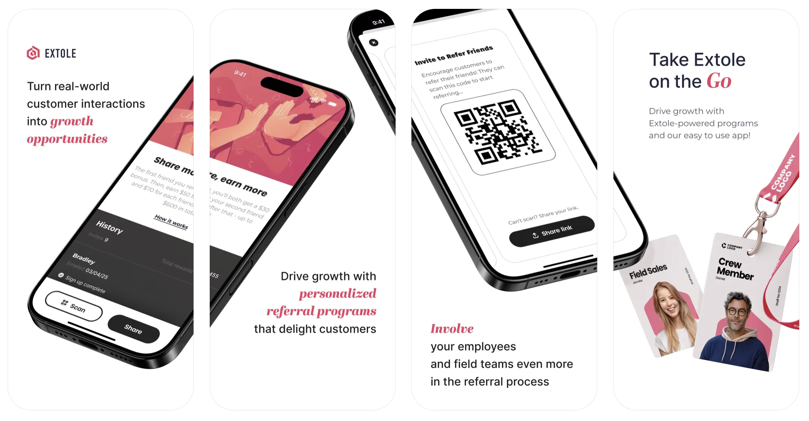
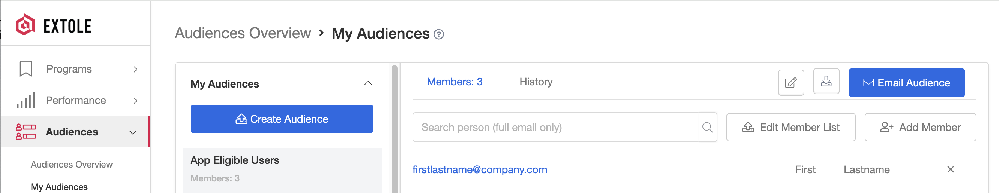
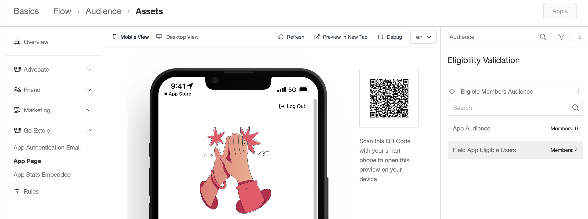
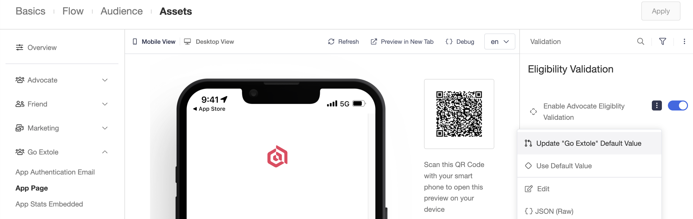
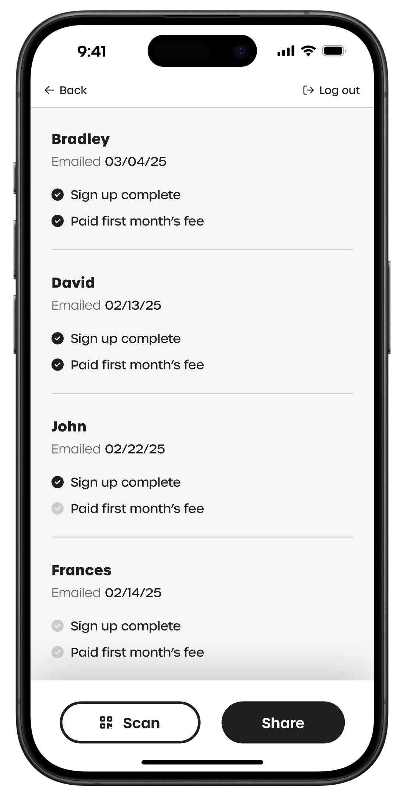

## Overview

The Go Extole mobile app allows an Extole campaign to be easily used for in-person referrals. The app supports personalized QR code and link sharing options for referrals.

### Availability

Go Extole is available for both iOS and Android devices

  &lt;style>
    \{`.app-badges .lightbox \{
      pointer-events: none !important;
      cursor: default !important;
    \}
    .app-badges a \{
      pointer-events: all !important;
      cursor: pointer !important;
    \}`\}
  &lt;/style>
  

    
    &nbsp;&nbsp;
    
  

## Setup

### Audience

To set up Go Extole access for your audience members, open the Extole platform, create an audience, and add or upload your audience members.

You can add or remove members individually, in bulk, or based on rules through the Extole UI, Extole's [People API](https://docs.extole.com/reference/people-endpoints), [file uploads](https://docs.extole.com/docs/general-file-uploads), or [automated SFTP workflows](https://docs.extole.com/docs/files). Access can also be granted to specific email domains, if you'd like all employees to log in with their company email address.

### Extole Program

Go Extole utilizes a new or existing Refer a Friend Extole program for its configuration. Create or select the program you would like to use with Go Extole, and we will make it available. Once it is available, go to your desired Extole campaign, select "Edit Creatives", under "Go Extole" select the "App Page", and in the right column under "Eligibility Validation":

* Select the audience that contains your Go Extole eligible members. Then, in the Eligible Members Audience three dots menu, indicate that that audience is the default audience for Go Extole and confirm you'd like to overwrite the existing default audience.

* Ensure that "Enable Advocate Eligibility Validation" is enabled, overwrite the default, and "Update Go Extole Default Value".

Finally, to access Go Extole, your employees will enter your company name and their email address on the mobile app login screen. Let us know what your company name should be on this screen, and we will finish the configuration so that your audience has access.

### Creatives

The required creatives for a Go Extole referral program are the authentication email, the app homepage, and the stats dashboard.

The authentication email is the email your employees receive after they enter their company name and email address in the app. It belongs to the **Go Extole** extension, not to your campaign. To edit it:

1. Open [Partners](https://my.extole.com/integrations) in My Extole and select the **Extensions** tab.
2. Open **Go Extole**.
3. In the **Go Default** journey, open the **Authentication Email**.

Its default subject is "Verify your email to login to Go Extole", and its **Verify Email** button opens the Go Extole app. The app requests this email through the `go_email_verification_requested` zone.

If **Go Extole** is not on the **Extensions** tab, your account uses an earlier Go Extole setup. Open your Go Extole campaign, select **Edit Creatives**, and find the authentication email under **Go Extole**.

Your Flow Builder campaign has its own **Authentication Email** in the advocate **Share** journey. That email verifies an advocate before it opens their referral stats page on the web, and the Go Extole app doesn't send it.

The app homepage and the stats dashboard belong to your campaign. To edit them, open the campaign in Flow Builder and select **Go Extole App Page**. The **Stats** section on that page is the stats dashboard.

### Branding

The authentication email, app homepage, and the stats dashboard can match your brand's experience. Some elements, including the login screen, verification email instructions, app name, and app icon, have a general "Go Extole" experience. If you'd like a fully-branded version of Go Extole, please reach out to your CSM.

You can send Go Extole emails from your company's domain. For more information on setting up this branded email domain, please see our [Javascript SDK](https://docs.extole.com/docs/javascript-sdk).

### Stats

Go Extole users can see their own referral metrics in-app. Users can see their reward earnings, who they referred, the date of referral, and which key steps each referral has progressed through. You can customize what referral information and which steps are shown here.

Extole platform users can see campaign-wide statistics through their Extole performance dashboard.

### Rewards

For reward redemption, Extole can automatically send rewards to your users as defined in your Extole campaign rules, or users can use [Reward Bank](https://docs.extole.com/docs/reward-bank) to select their own rewards. If you'd like to use Reward Bank with Go Extole, please reach out to your CSM.
